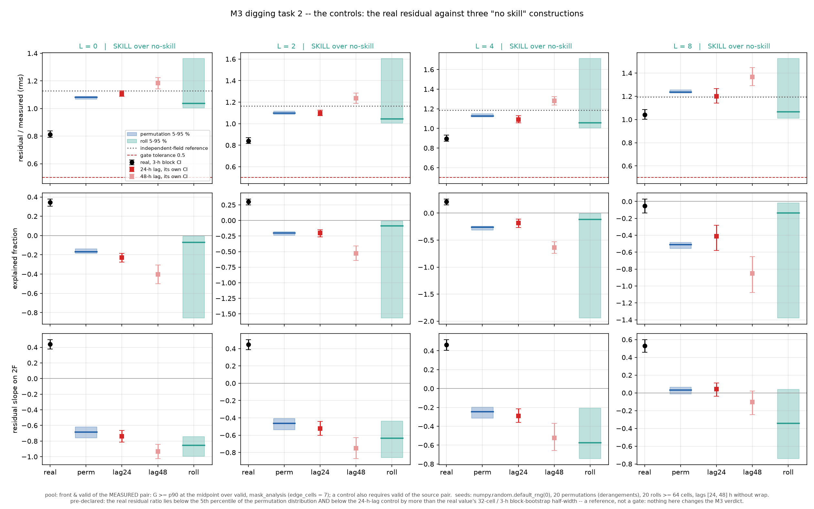
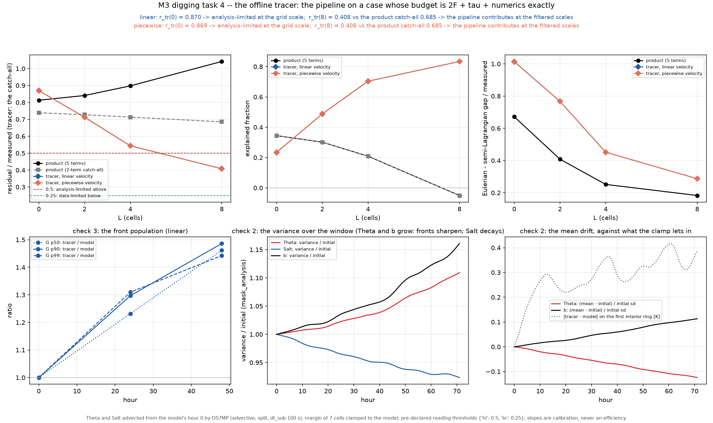
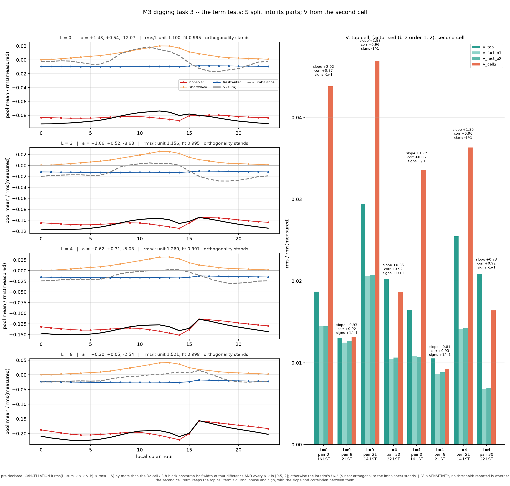
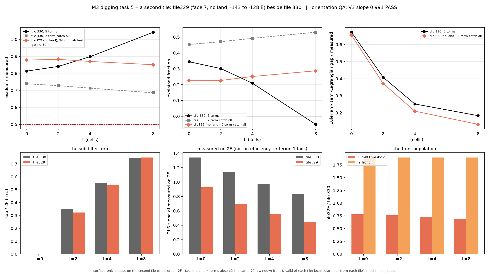
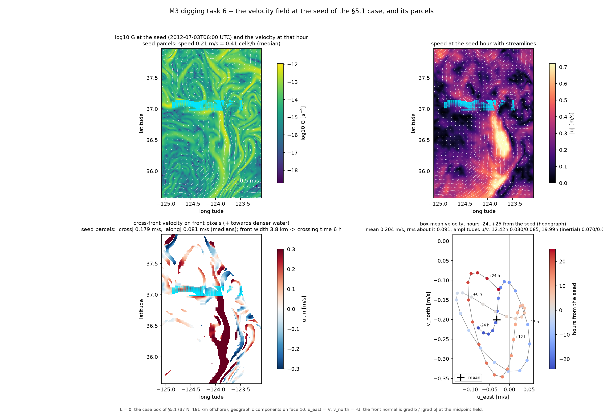
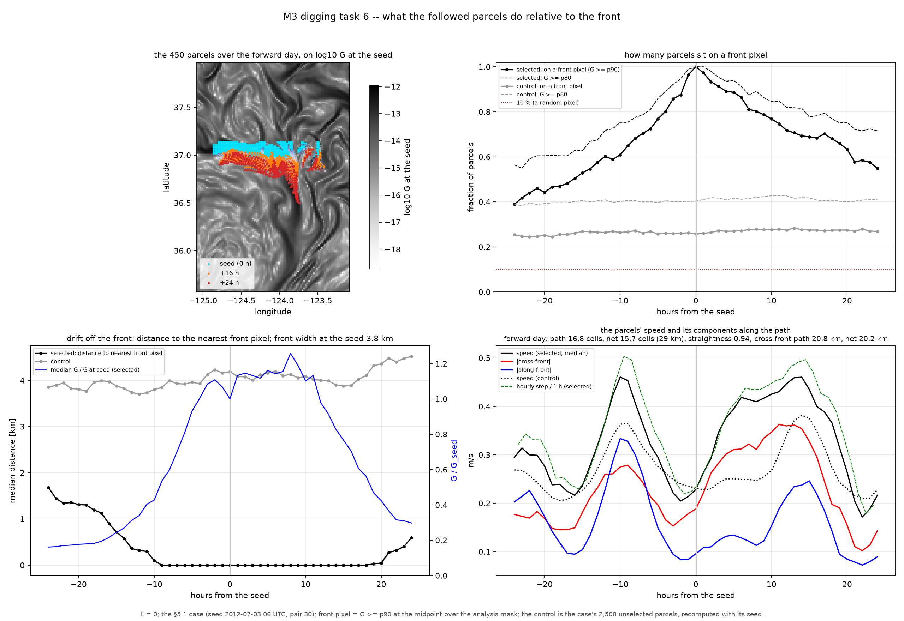

# Frontogenesis in the LLC4320 California Current — Digging into the M3 Null Result

**Authors:** J. X. Prochaska, with Claude (Fable 5.1)  
**Status:** Note on the M3 digging tests, 3 November 2026 — the M3 verdict unchanged  
**Circulation:** For the collaboration; not for citation. A companion to the interim report of 12 October 2026, which is not rewritten.

---

## 1. What was objected to

The interim report found that hourly, 2 km surface fields from LLC4320 do not close the budget of the surface buoyancy-gradient strength $G = |\nabla b|^2$ on one tile off Monterey Bay: the residual of the five-term budget is 0.813 / 0.841 / 0.898 / 1.042 of the measured tendency's amplitude at filter scales $L = 0 / 2 / 4 / 8$ cells, against a tolerance of 0.50 declared before any number was seen. An external review of that report (26 October 2026) accepted its logic and its pre-declared tolerance and raised one objection above the rest: **the null has no independent noise floor.** The semi-Lagrangian and Eulerian estimates of the same tendency differ by 0.672 of the amplitude at the grid scale, as large as the tolerance, and the discrete null that validated the operators checks only the kinematics of one hour. Until the pipeline is run on a case with a known answer, the review argued, "the data cannot do it" and "this analysis cannot do it" are indistinguishable, and the attribution of the grid-scale failure to hourly sampling is an inference.

The review ranked five changes: a noise-floor test on an offline tracer, with a time-shuffled control so that "no skill" has a number; downgrading the sampling claim to a hypothesis; recomputing the vertical term from a different cell; splitting the surface-flux term into its parts; and testing the selection and pooling — another selection variable, longer bootstrap blocks, a second tile. Its red team added that a residual positive at every local hour looks like a systematic bias rather than diffusion, and that the followed front's integral was a path-integrated fit rather than evidence. Every one of these was found to be runnable from the stores already on disk, with two exceptions stated in §7, and all were run between 31 October and 2 November with their readings declared before the numbers were looked at. This note reports what each gave. The principal investigator's addition — a look at the velocity field around the followed front — is reported with the second tile, since both concern what the fronts are. The measured-versus-predicted slopes of the product remain withheld, as in the interim; where a slope is quoted below it is the pipeline's calibration on a tracer, and it is labelled as such.

## 2. The noise floor

### 2.1 Three constructions of "no skill"

The real residual was set against three controls built from the stored terms themselves, on the gate's own pool of front pixels (the top decile of $G$ at the midpoint time, inside the analysis mask), with every real statistic carrying its 32-cell, 3-hour block-bootstrap interval. A **random pair permutation** keeps the measured tendency of each hour pair and takes the predicted terms from another pair at the same pixel, every pair displaced, twenty draws. A **24-hour lag** takes the predicted terms from the pair a day later, so the vertical and surface-flux terms keep their diurnal phase and only the flow is decorrelated. A **spatial roll** moves the same pair's predicted terms sideways by at least 64 cells, twenty draws. The declared rule: the real residual shows skill over no-skill at a filter scale if it lies below the 5th percentile of the permutation distribution and below the 24-hour lag by more than its own bootstrap half-width. This is a reference, not a gate.

| $L$ | real residual | permutation (median; 5th pct) | 24-h lag | roll (median; 5th pct) | independent-field reference |
|---|---|---|---|---|---|
| 0 | 0.813 | 1.081; 1.067 | 1.108 | 1.037; 1.003 | 1.127 |
| 2 | 0.841 | 1.098; 1.088 | 1.098 | 1.045; 1.004 | 1.164 |
| 4 | 0.898 | 1.127; 1.117 | 1.090 | 1.057; 1.006 | 1.187 |
| 8 | 1.042 | 1.238; 1.227 | 1.199 | 1.066; 1.010 | 1.194 |

The rule passes at every scale: the real residual sits 39 / 29 / 21 / 20 permutation standard deviations and 11.4 / 9.2 / 7.4 / 4.7 of its own half-widths below a shuffled flow. The permutation reproduces, to the second decimal, the back-of-envelope residual of two independent fields with the real amplitudes, $\sqrt{1 + (\mathrm{rms}\,2F/\mathrm{rms\ measured})^2}$, sitting a few hundredths below it because of the selection. The other statistics separate more sharply still: the explained fraction is +0.344 / +0.301 / +0.209 / −0.051 for the real budget against −0.167 / −0.203 / −0.263 / −0.511 for a permutation, and the residual's slope on $2F$ is +0.440 / +0.447 / +0.462 / +0.529 real against −0.686 / −0.465 / −0.247 / +0.031 shuffled — a no-skill residual at the grid scale contains $-2F$ itself and slopes on it at nearly −1.

Two things the rule does not say are recorded with it. The spatial roll is the weakest control, with a wide, skewed spread because rolls that land the predicted field on the coast inflate the residual, and **at $L = 8$ it does not separate**: the real 1.042 lies inside its 5–95 % band. At the coarsest scale the budget's residual is no better than the same pair's terms shifted sideways. And the lagged control is *higher* than the permutation at the grid scale: keeping the diurnal phase of the vertical and surface-flux terms does not help a control with the wrong flow, which is the interim's §6.2 seen from the other side. Finally, the red team's observation survives the shuffle: the real residual's mean is positive at all 24 local hours, and so is the lagged control's. A positive residual at every hour is not the signature of a missing term.

### 2.2 The offline tracer

The substantive test is the one the review asked for. Temperature and salinity were taken from the model at the first hour of the window and advected for 72 hours by the model's own hourly velocities, using the flux-form seventh-order monotonicity-preserving scheme that the finite-volume null of M1 validated, at a 100 s sub-step, with the 7-cell margin of the tile reset to the model's own fields so that the open boundaries do not contaminate the interior. For this tracer the true budget is exactly the strain term plus the sub-filter term plus the scheme's dissipation: no vertical term, no surface flux, no boundary-layer mixing, no sub-hourly flow. The full pipeline — the same filtered midpoint fields, the same semi-Lagrangian step, the same front selection — was run on it. Two columns were run, one with the velocity linear in time within each hour and one with the hour's midpoint velocity held constant, which is the flow the semi-Lagrangian step assumes. The first hour of the second column reproduces the validated finite-volume step bit for bit. The tracer's fronts sharpen under the strain with nothing to oppose them (the top decile of $G$ reaches 1.297 times the model's after a day and 1.486 after two), which inflates its floor at the grid scale; its residual, by construction, is the two-term catch-all.

The reading was declared in advance: a tracer residual above 0.50 at the grid scale means the hourly cadence limits the *analysis* even on a within-hour-smooth flow; below 0.25 means the limit is the model's own sub-hourly evolution; at $L = 8$, a tracer residual below 0.25 against the model's catch-all of 0.685 means the filtered-scale failure is not the pipeline.

| $L$ | model, five terms | model, two-term catch-all | tracer (linear velocity) | tracer (piecewise velocity) | Eulerian − semi-Lagrangian gap, model / tracer |
|---|---|---|---|---|---|
| 0 | 0.813 | 0.739 | 0.870 | 0.869 | 0.672 / 1.014 |
| 2 | 0.841 | 0.728 | 0.713 | 0.712 | 0.408 / 0.767 |
| 4 | 0.898 | 0.713 | 0.544 | 0.543 | 0.252 / 0.452 |
| 8 | 1.042 | 0.685 | 0.408 | 0.408 | 0.183 / 0.287 |

Both readings fire. At the grid scale the pipeline's own floor is **0.870**, as large as the model's imbalance: the hourly semi-Lagrangian estimate plus the scheme's dissipation produce the grid-scale failure with no physics in the tracer at all, and cause one of the interim is confirmed as the analysis's own floor — with the caveat that the tracer's sharper fronts raise it (its Eulerian gap is 1.014 against the model's 0.672). At the coarsest scale the tracer passes the gate at **0.408**, but that is above 0.25, so the pipeline still contributes there; the model's excess over the floor is 0.015 at $L = 2$, 0.169 at $L = 4$ and 0.277 at $L = 8$, growing with scale. The two velocity columns agree to 0.0006 at every scale: the within-hour velocity interpolation, which the second column was designed to isolate, has no effect. One further difference is the most telling. The tracer's measured tendency sits on $2F$ with a slope of 0.976 at the grid scale (the finite-volume null's calibration of 0.975, reproduced on the real flow) and its residual is uncorrelated with $2F$ (slope −0.024 / −0.072 / −0.048 / −0.026); the model's residual slopes on $2F$ at +0.440 to +0.529. That correlated excess is not the pipeline.

## 3. The two term tests

**The surface-flux term split into its parts.** The term is linear in the three fluxes, so it is exactly the sum of a non-solar heat part, a shortwave part with its Jerlov absorption fraction, and a freshwater part; the three were recomputed for every pair and scale and sum to the stored term to 5.5e-15 in relative terms. The declared rule: a cancellation is revealed if a three-multiplier fit of the imbalance $I = \mathrm{measured} - 2F - \tau - V$ on the three parts lowers the imbalance's rms below the unit-sum residual's by more than the bootstrap half-width *and* every multiplier lies in [0.5, 2]. The term *is* the non-solar part: 0.996 / 0.992 / 0.988 / 0.979 of its rms, correlated +1.00 with it; the shortwave part is 14 % of the term and opposes it, the freshwater part is 11 % and collinear with the non-solar. No part correlates with the imbalance above +0.03. The fitted multipliers are +1.43 / +1.06 / +0.62 / +0.30 on the non-solar part, +0.54 / +0.52 / +0.31 / +0.05 on the shortwave and −12.07 / −8.68 / −5.03 / −2.54 on the freshwater (a collinearity artefact), out of bounds at every scale; and however they are weighted the three parts leave 0.995 / 0.995 / 0.997 / 0.998 of the imbalance's rms. **The rule fails at every scale, in both depth forms: the orthogonality of §6.2 stands, part by part.** The composites settle one sentence of the interim: the imbalance's mean is within ±0.03 of zero at every local hour while the surface-flux term's mean is −0.07 to −0.22 at every hour, strongest at night. The product's residual is the imbalance minus that term, so its positive mean at every hour is the negative of the term's own frontolytic mean.

**The vertical term from the second cell.** On the four reference pairs (16, 01, 13 and 22 local solar time) at $L = 0$ and $4$, the tilting term of the second cell's budget — the next thickness, the next interface velocity — is 0.79 to 2.34 times the top cell's in rms, larger by day, correlated +0.856 to +0.965 with it and of the same sign in all eight cases (negative by day, positive at night); a three-level estimate of the vertical gradient changes the factorised form by 0.6 to 1.8 %. The review's reading was "if it moves, it is a grid artefact"; the interim's §2.4 is that it is a discretisation term and moving with the cell is the prediction. Amplitude moves; phase and sign do not. The numbers support §2.4, and the term is 1 to 5 % of the amplitude either way.

## 4. Pooling, selection, and the followed front

Selecting front pixels on the *previous* pair's gradient — so that the selection no longer sees the outcome — gives a residual of 0.810 / 0.839 / 0.898 / 1.043, indistinguishable from the gate's; selecting on persistence over three pairs gives 0.810 / 0.840 / 0.899 / 1.047; the 80th and 95th percentiles give 0.817 and 0.807 at the grid scale. Selecting on the **strain** rather than the gradient is the one choice that moves the numbers: 0.781 / 0.794 / 0.828 / 0.946, with a steeper residual slope on $2F$. Where the strain is large the measured tendency follows $2F$ more, and the residual grows with it faster. Bootstrap blocks of 3, 12 and 24 hours widen the residual's interval by 1.75 / 1.67 / 1.63 / 1.73, by about 2.7 to 3.1, and by 3.37 / 3.38 / 3.70 / 4.08 times the one-hour width: the hour-to-hour correlation extends to the day, and the skill margins of §2.1 survive it.

The followed front of the interim's §5.1 was re-seeded twice: twelve hours earlier on the same corridor, and on persistence rather than on the gradient at the seed. The selected parcels' strength falls by a factor 0.19 and 0.21 over the forward day against the original 0.19; the unselected control changes by 0.93 and 0.89 against 0.89; the strain term alone accounts for +0.01 and −0.08 of the observed change against −0.08; and the four-term integral accounts for **+0.63** and +0.93 against the original 0.99. The decay is selection at any seed, and the four-term integral's near-perfect agreement is not robust — the review's §7 reading, now with numbers.

What the parcels do explains why. At the seed the 450 parcels move at 0.21 m/s, mostly *across* the 3.8 km front (0.179 m/s across, 0.081 m/s along), into a southward jet of 0.4 to 0.7 m/s; the box-mean flow is a steady 0.20 m/s southward with a 0.09 m/s oscillation, near-inertial over semidiurnal. Sixteen hours later 0.68 of the parcels still sit on a front pixel but only 0.46 on a pixel that was front at the seed; the gradient pattern has moved 4 km while the water has moved 21 km, and the seed pixels themselves keep 0.70 of their front status and 0.67 of their strength. **The front is a standing feature of the flow, fed by cross-front convergence, not a material line**, and the water crossing it is lightened by one front contrast every 16 hours or so. This bears on the day-long constructions — the case study's fivefold "weakening" is the parcels' exit from a convergence zone — and not on the hourly gate, whose step is under half a front width and whose pool is re-selected every pair.

## 5. A second tile

Tile 329, the western neighbour on the same latitudes (143 to 128 W, the open North-East Pacific, no land in the tile), was pulled for the same 72 hours and given the surface-only, three-term budget. The grid's orientation is that of the Monterey tile, and the discrete null on its first hour gives a slope of 0.9908, inside the acceptance band and beside the Monterey tile's 0.981: the operators read the new face correctly. Its fronts are weaker (the top-decile threshold of $G$ is 0.78 / 0.76 / 0.73 / 0.69 of Monterey's) and its analysis area is 1.9 times larger.

| $L$ | Monterey, five terms | Monterey, catch-all | open ocean, catch-all | explained | residual slope on $2F$ | Eulerian gap |
|---|---|---|---|---|---|---|
| 0 | 0.813 | 0.739 | 0.878 | +0.227 | −0.073 | 0.654 |
| 2 | 0.841 | 0.728 | 0.882 | +0.226 | −0.093 | 0.372 |
| 4 | 0.898 | 0.713 | 0.870 | +0.251 | −0.078 | 0.210 |
| 8 | 1.042 | 0.685 | 0.851 | +0.287 | −0.045 | 0.132 |

The open-ocean tile fails the hourly budget at every scale, at the grid scale at the same size as Monterey and with the same Eulerian gap: **cause one is not Monterey's.** The two regimes part at the filtered scales. The open-ocean imbalance does not fall with $L$ — its excess over the tracer floor is 0.17 / 0.33 / 0.44 at $L = 2 / 4 / 8$, larger than Monterey's — and it is uncorrelated with $2F$, as the tracer's is; the measured tendency falls below $2F$ at the filtered scales. The strain-correlated excess of §2.2 is therefore a feature of the Monterey filament regime, the standing, fed fronts of §4, and the open ocean carries a scale-flat, strain-uncorrelated imbalance on weak fronts. An internal-wave and near-inertial field aliased into hourly differences of a weak gradient would look like that; the summer North-East Pacific is known to be dominated by such motions at these scales. That is a hypothesis for the next report, not a finding: separating the wave band needs what no hourly surface field has.

## 6. The review's items, answered

| Review item | Test | Outcome | What it changes in the diagnosis | What it does not change |
|---|---|---|---|---|
| §3, §6.1: no noise floor; a shuffled control | three controls; the offline tracer, two velocity columns | no-skill is 1.08–1.24 (shuffled) against the real 0.81–1.04, 20–39 sd apart; the tracer floor is 0.870 / 0.713 / 0.544 / 0.408 | §6.1: cause one is the analysis's own floor at the grid scale; at the filtered scales the model exceeds the floor by 0.17–0.28, and its residual carries a strain-correlated part the tracer does not | the verdict; nothing closes |
| §6.2: downgrade the sampling claim | the tracer at $L = 0$ vs $L = 8$ | the sampling claim is measured, not inferred, at the grid scale; at the filtered scales sampling is 0.41 of a 0.69 imbalance | §6.1 keeps its claim at $L = 0$ and loses it as the whole story at $L \ge 4$ | — |
| §6.3: the vertical term from another cell | the second cell's term on four pairs | 0.79–2.34× the amplitude, same sign in 8 of 8, correlated +0.86 to +0.97 | §2.4's reading stands | the term is 1–5 % of the amplitude |
| §6.4: split the surface-flux term | three parts, three multipliers, both depth forms | no part explains more than 1 % of the imbalance; no cancellation | §6.2 stands part by part; §6.4's positive residual is the term's own mean | — |
| §6.5: selection and pooling; a second tile | five selections; 3–24 h blocks; tile 329 | no selection changes the verdict; blocks widen intervals $\le$ 4.1× without closing the margins; tile 329 fails at 0.85–0.88 | cause one is general; the filtered-scale excess differs by regime | — |
| §7: the followed front | re-seeded twice; the velocity field | the decay is selection; the four-term integral 0.63–0.99; the front is a standing feature | §5.1's "weakening" is parcels leaving a convergence zone | the hourly gate |
| red team: residual positive at every hour | the lagged control; the composites | the control has it too; it is the surface-flux term's own mean | §6.4's unmet expectation is explained | — |

## 7. What remains untestable

Two of the review's requests cannot be met with what exists. The flow's own sub-hourly evolution — the part of cause one that the tracer cannot see, because its velocities are the model's hourly snapshots — would need sub-hourly fields, and only hourly output exists for this simulation. A five-term budget on a second region would need a full-depth hourly transfer of that region from the model's native output, which is a decision and a day of transfer for others, declined for now; the second tile's budget is therefore the three-term one, read against the product's two-term catch-all. Within those limits, every test the review asked for has been run, each with its reading declared first, and the verdict of the interim's §5.2 — the budget does not close at any scale, and no efficiency of the model is quoted — is unchanged.

**Figure 1.** The controls (§2.1). Per filter scale: the residual ratio, the explained fraction and the residual's slope on $2F$ for the real budget (point, 3-h block interval) against the permutation and roll distributions (bands, 5–95 %) and the two lagged controls (points, their own intervals), with the independent-field reference and the gate's tolerance.

**Figure 2.** The offline tracer (§2.2). Top: the residual ratio, the explained fraction and the Eulerian − semi-Lagrangian gap against filter scale for the product and the two tracer columns, with the declared thresholds. Bottom: the tracer's front population and conservation over the window.

**Figure 3.** The term tests (§3). Left: the local-hour composites of the three parts of the surface-flux term, their sum and the imbalance, per filter scale, with the fitted multipliers. Right: the top-cell, factorised and second-cell vertical terms on the four reference pairs.

**Figure 4.** The second tile (§5). The open-ocean tile's catch-all residual, explained fraction and Eulerian gap beside the Monterey tile's; the sub-filter fraction; the slope of measured on $2F$ (not an efficiency); the front population.

**Figure 5.** The velocity at the seed of the followed front (§4): the field over $\log_{10} G$ with the parcels, the speed with streamlines, the cross-front component on front pixels, and the hodograph of the box-mean velocity over the window.

**Figure 6.** The parcels relative to the front (§4): the trajectories over the forward day, the fraction on a front pixel, the distance to the nearest front pixel beside the parcels' strength, and the speed split into along- and cross-front parts.

## Appendix. Numbers and provenance

Every number in this note is from one of the digging summaries — `m3_controls_summary.json`, `m3_case_controls.json`, `m3_term_tests_summary.json`, `m3_tracer_summary.json`, `m3_closure_tile330tracer_summary.json`, `m3_closure_tile330tracerpc_summary.json`, `m3_closure_tile329_summary.json`, `m3_tile2_summary.json`, `m3_parcels_summary.json` — or from the product's `m3_closure_summary.json` for the comparison columns; `check_digging_numbers.py` asserts each. Keys are given under the file's top level; `[L]` stands for the filter scale.

| quantity | value(s) | source |
|---|---|---|
| product residual / measured; catch-all | 0.813 / 0.841 / 0.898 / 1.042; 0.739 / 0.728 / 0.713 / 0.685 | `m3_closure_summary.json` `per_L[L].closure.residual.over_measured`, `catchall.over_measured` |
| controls: real, permutation median / p5, 24-h lag, roll median / p5, reference | table in §2.1 | `m3_controls_summary.json` `per_L[L].real.resid_over_meas`, `controls.permutation.dist.resid_over_meas`, `controls.lag24.resid_over_meas`, `controls.roll.dist`, `real.independent_reference` |
| gaps real − control, in permutation sd and real half-widths | 39 / 29 / 21 / 20; 11.4 / 9.2 / 7.4 / 4.7 | `per_L[L].gaps.resid_over_meas.permutation` |
| explained fraction, real / permutation; residual slope on $2F$, real / permutation | §2.1 | `per_L[L].real.explained`, `controls.permutation.dist.explained`, `.resid_on_2F` |
| selections | 0.810 … (§4) | `per_L[L].selections.{G_prev,persist,sigma_mag,p80,p95}.resid_over_meas` |
| block widths, 3 h and 24 h over 1 h | §4 | `per_L[L].blocks.{3h,24h}.width_over_1h.resid_over_meas` |
| the case re-seeded | 0.19 / 0.93 / +0.01 / +0.63; 0.21 / 0.89 / −0.08 / +0.93 | `m3_case_controls.json` `runs.{seed_minus_12h,seed_persist}` |
| split identity; parts' rms over the term; multipliers; rms of the fit over the imbalance | §3 | `m3_term_tests_summary.json` `split.per_L[L].identity`, `depth.top.components`, `depth.top.fit3` |
| second-cell vertical term | §3 | `vertical.summary`, `vertical.rows` |
| tracer residual, explained, slope, Eulerian gap; the velocity columns' difference | §2.2 | `m3_tracer_summary.json` `columns.{linear,piecewise}.per_L[L]`, `interpolation_effect` |
| tracer front population; the first-hour identity | 1.297 / 1.486; bit for bit | `columns.linear.checks.checks_2_to_4.front_population`, `check_1` |
| tile 329 orientation QA, masks, closure | §5 | `m3_tile2_summary.json` `orientation_qa`, `masks`, `compare.per_L[L]` |
| the parcels | §4 | `m3_parcels_summary.json` `seed`, `selected.on_front`, `box_mean` |
