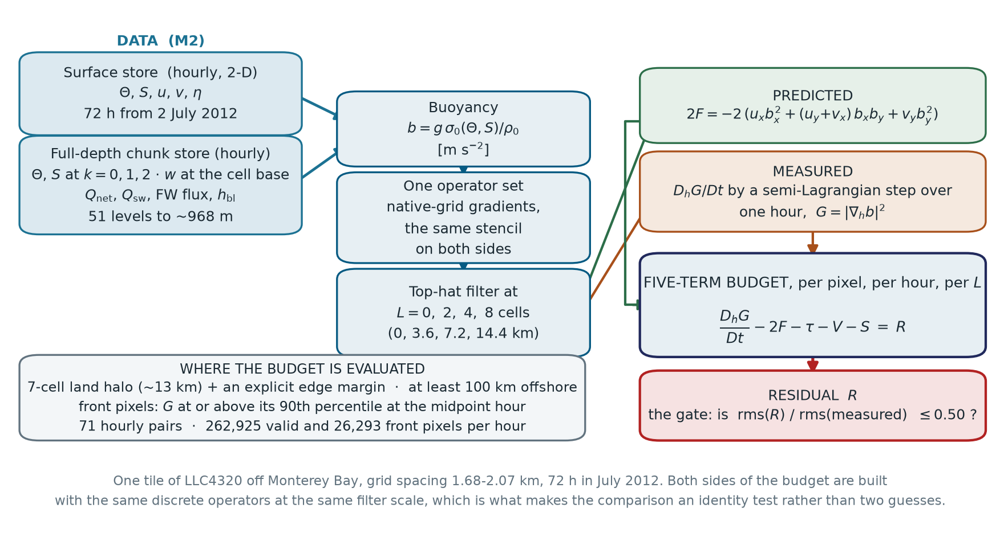
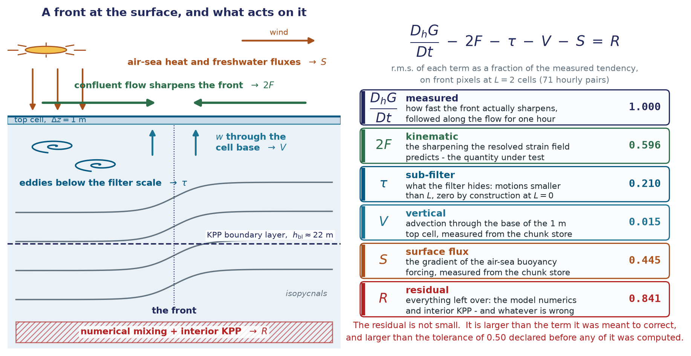
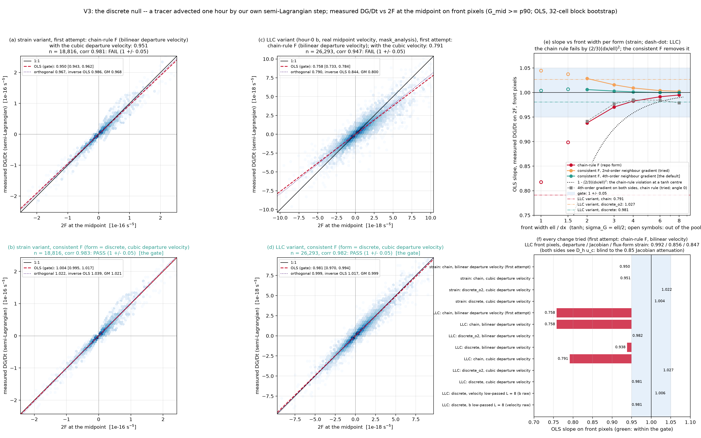
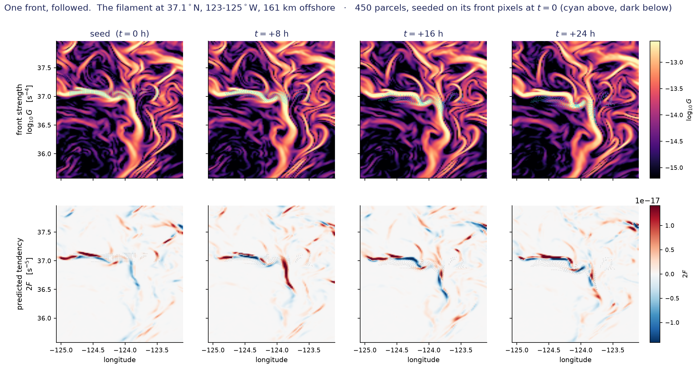
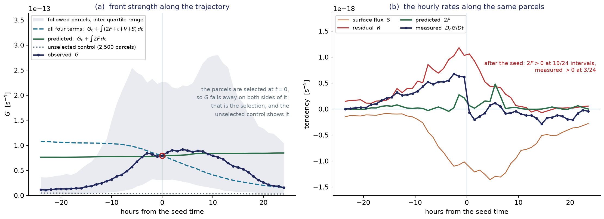
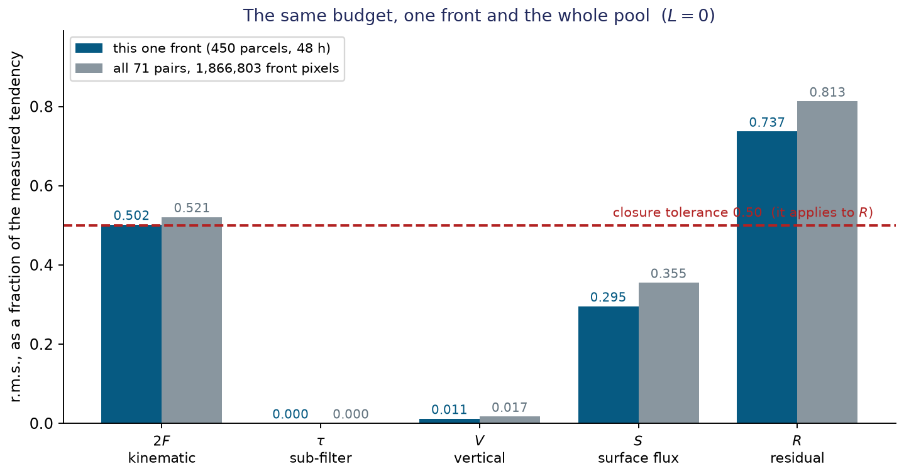
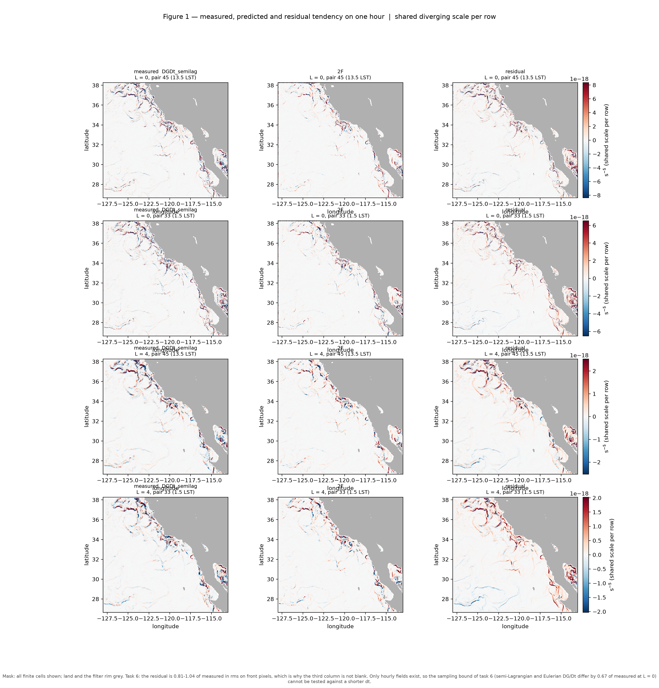
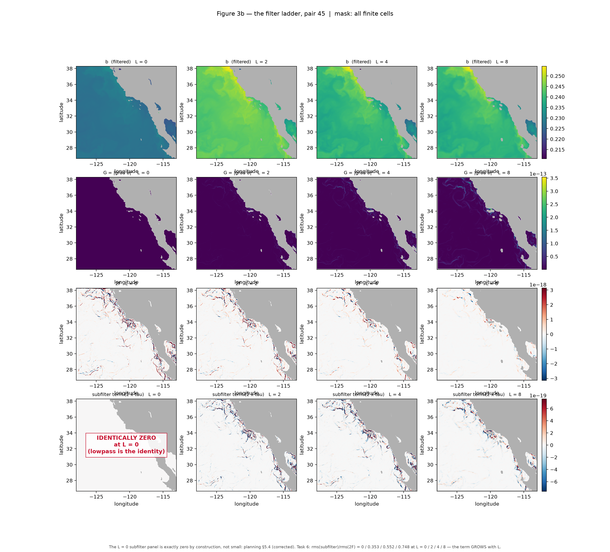

# Frontogenesis in the LLC4320 California Current — Interim Report on Milestone M3

**Authors:** J. X. Prochaska, with Claude (Fable 5.1)  
**Status:** Interim report, 12 October 2026 — M3 not closed; M4 not started  
**Circulation:** For the collaboration; not for citation.

---

## 1. Summary

The surface buoyancy-gradient budget of the LLC4320 California Current did not close at the tolerance fixed before any number was computed, and milestone M3 — the second of the project's two hard gates — is therefore not passed.

The project asks a narrow question of a 1/48° global ocean simulation: is the observed sharpening of surface buoyancy fronts accounted for by the kinematic frontogenesis rate computed from the model's own velocity and buoyancy fields? The two quantities are the two sides of an exact budget, so their difference is itself the physical content. On one tile off Monterey Bay (grid spacing 1.68–2.07 km), over 72 summer hours giving 71 hourly pairs, we measured the material rate of change of the front strength $G = |\nabla_h b|^2$ by a semi-Lagrangian step, predicted it as $2F$ from the frontogenesis function, and subtracted three further *measured* terms — sub-filter, vertical and surface flux — at four coarse-graining scales $L = 0, 2, 4, 8$ grid cells. The pre-declared criterion was a residual root-mean-square at most 0.50 of the measured tendency's on front pixels at every $L \ge 2$. The measured ratio is 0.813 / 0.841 / 0.898 / 1.042 at $L = 0 / 2 / 4 / 8$. Not one of the 71 hourly pairs reaches the tolerance at any scale, and a single strong front followed for 48 hours reproduces the pooled budget term by term.

The result carries three readings, in this order. First, the **finding**: this is the null outcome the design document declared in advance — hourly surface fields at 2 km resolution cannot constrain the surface frontogenesis budget in this regime, and the limiting factor is named. Second, the **diagnosis**: two separable causes, which the filter sweep separates. At the grid scale the limit is the time sampling — two defensible estimates of the *same* tendency from the *same* hourly pair differ by 0.672 of the measured amplitude at $L = 0$, as large as the imbalance itself, and interpolation order is demonstrably not the reason (0.108). At the filtered scales that gap has fallen to 0.183, but the surface-flux term, which carries 0.36–0.80 of the measured amplitude, correlates only $+0.02$ with the imbalance it should explain; subtracting it at unit weight adds its variance to the residual. Rescaling that term by the boundary-layer depth corrects its magnitude and leaves its correlation unchanged. Third, the **stop**: the execution plan blocks everything downstream of M3 on closure, and the next milestone does not begin without the principal investigator's decision. The first reading is a result. The third is a decision that has not been taken.

What the result is not: evidence that the method is broken. The operators passed every validation gate before M3 (discrete null 0.981 [0.970, 0.994]); the semi-Lagrangian and Eulerian estimates agree within tolerance at $L \ge 4$; the sub-filter term behaves as the one-hour pilot predicted. What failed is the ability of hourly snapshots at this resolution to pin the tendency of a quantity that evolves on the tidal and internal-wave band. No frontogenesis efficiency is quoted, no diabatic damping is claimed, and nothing was tuned.

---

## 2. Objective and the surface budget

### 2.1 Objective

Compare the **measured** strengthening of buoyancy fronts in LLC4320 against the **predicted** kinematic frontogenesis rate computed from the model's own fields, and interpret the difference. The two are not independent guesses at one number; they are the two sides of an exact budget, and stating that budget precisely is the whole design.

### 2.2 Definitions

Buoyancy is formed from the model's potential temperature $\Theta$ and salinity $S$ with the equation of state the model itself advected (JMD95),

$$
b = \frac{g\,\sigma_0(\Theta, S)}{\rho_0} \quad [\mathrm{m\,s^{-2}}],
$$

with $g = 9.81$ m s$^{-2}$, $\rho_0 = 1000$ kg m$^{-3}$ and $\sigma_0$ the potential-density anomaly. Note the sign: this is the repository's convention and it *increases with density* — the negative of textbook buoyancy. Everything below is quadratic in $\nabla b$, so nothing downstream depends on it, and the design instructs that it not be "fixed".

The **front strength** is the squared horizontal buoyancy gradient,

$$
G = |\nabla_h b|^2 = b_x^2 + b_y^2 \quad [\mathrm{s^{-4}}],
$$

and the **kinematic frontogenesis function** is the rate at which the resolved strain sharpens that gradient,

$$
F = -\left( u_x\, b_x^2 + (u_y + v_x)\, b_x b_y + v_y\, b_y^2 \right) \quad [\mathrm{s^{-5}}].
$$

For adiabatic horizontal flow, $F = \tfrac{1}{2}\, DG/Dt$ exactly. The comparison throughout is therefore **the predicted sharpening rate $2F$ against the measured sharpening rate $D_hG/Dt$**, never $F$ against $DG/Dt$; the factor of two is easy to lose, and every axis and regression in the project uses this pairing.

### 2.3 The budget at the free surface

Start from $Db/Dt = B$, where $B$ (m s$^{-3}$) collects every diabatic source: surface heat and freshwater fluxes, vertical mixing, and the model's numerical diffusion. Differentiating horizontally and contracting with $\nabla_h b$,

$$
\frac{D}{Dt}\!\left(\tfrac{1}{2}G\right) = \underbrace{F}_{\text{kinematic}} \;-\; \underbrace{b_z\,(w_x b_x + w_y b_y)}_{\text{tilting}} \;+\; \underbrace{\nabla_h b \cdot \nabla_h B}_{\text{diabatic}} .
$$

At the free surface $z = \eta$ the vertical velocity does not vanish — the kinematic condition is $w = D\eta/Dt$. What vanishes is the velocity *relative to* the surface, and that is what along-surface derivatives see: written for $b_s(x, y, t) = b(x, y, \eta, t)$, the terms in $b_z(\eta_t + \mathbf{u}\cdot\nabla\eta - w)$ cancel, the tilting term drops out, and the material derivative collapses to its horizontal form $D_h/Dt = \partial_t + u\,\partial_x + v\,\partial_y$:

$$
\frac{D_h}{Dt}\!\left(\tfrac{1}{2}G\right) = F + \nabla_h b \cdot \nabla_h B .
$$

This is why surface-only data are *sufficient* for the question rather than a compromise: there is no missing kinematic term.

### 2.4 Why the data are not the continuum

The stored fields are not the continuum. LLC4320 runs a *linear* implicit free surface: the top cell is a fixed box of thickness $\Delta z = 1.0$ m that the free surface moves through, the stored $b$ is a cell average, and the model's surface vertical velocity is $d\eta/dt$ — a coordinate-relative flux through the top of that box that the tracer equation sets to zero. The budget of a cell average contains the flux through the cell *base*, where $w$ carries both $d\eta/dt$ (tidal, reversing) and a convergence part that carries most of the horizontal *gradient*. The tilting term is therefore not absent; it is **reintroduced by the discretisation**, with a diurnal cycle set by the near-surface stratification. That is why the discrete budget has a measured vertical term at all, and why it had to be measured from full-depth data rather than assumed.

### 2.5 What the residual contains

The residual $D_hG/Dt - 2F$ is **not** purely diabatic; an early draft of the design said it was, and an adversarial review overturned the claim. It contains (i) the model's implicit numerical diffusion — LLC4320 has no explicit horizontal tracer diffusion, and its seventh-order flux-limited advection scheme has a strongly scale-selective effective diffusivity that switches on precisely at the grid-scale gradients that define fronts; (ii) the finite-top-cell vertical term of §2.4; (iii) genuine diabatic forcing — KPP mixing and the surface fluxes; and (iv) truncation error in the analysis operators. A slope of 0.5–0.8 between measured and predicted at the grid scale is fully explicable by numerics with zero air–sea flux. That is why the project refused from the outset to call "slope below one" a damping efficiency, and why the gate was defined as **closure of a five-term budget**, not as a slope:

$$
\underbrace{\frac{D_hG}{Dt}}_{\text{measured}} \;-\; \underbrace{2F}_{\text{kinematic}} \;-\; \underbrace{\tau}_{\text{sub-filter}} \;-\; \underbrace{V}_{\text{vertical}} \;-\; \underbrace{S}_{\text{surface flux}} \;=\; R \;\approx\; \text{numerical} + \text{interior KPP},
$$

with every term formed through one operator set at each filter scale and written for $G$ rather than $\tfrac{1}{2}G$ (Figure 2). The **vertical term** $V$ is $2\nabla_h b\cdot\nabla_h$ of the top-cell vertical advective tendency $-w_{\rm base}\,(b_0 - b_1)/\Delta z_{01}$ ($\Delta z_{01} = 1.07$ m), from the model's own cell-base velocity and its two uppermost levels. The **surface-flux term** $S$ is the same contraction of the top-cell buoyancy tendency from the net heat, shortwave and freshwater fluxes, each spread over $\Delta z = 1$ m (the shortwave fraction absorbed within the top metre is 0.521). The **sub-filter term** $\tau$ is defined in §3.3. With these three measured, $R$ reduces to numerical diffusion plus interior KPP mixing — the only form in which an efficiency could ever have been earned.

---

## 3. Method

Figure 1 shows the pipeline end to end; the subsections below take its stages in order.

**Figure 1.** The analysis pipeline. Two hourly data stores (surface fields; the top three levels plus fluxes from the full-depth archive) are combined into buoyancy and velocity, filtered identically with a top-hat of width $L = 0, 2, 4, 8$ cells, and passed through one shared native-grid operator set. The left arm predicts the sharpening rate $2F$ at the midpoint time of each hourly pair; the right arm measures $D_hG/Dt$ by a semi-Lagrangian step over the hour. Three further measured terms complete the five-term budget whose residual is the result. The side box lists the masking rules: a 7-cell land halo plus a tile-edge margin, at least 100 km offshore, and front pixels defined as $G$ at or above its 90th percentile at the midpoint time.

### 3.1 One operator set, both sides

A comparison in which the two sides use different stencils or filters manufactures a mismatch. Both sides are therefore computed from the same saved raw fields through the same gradient and Jacobian operators and the same filter. On this tile the grid rotation is an exact axis swap, so the rotation terms vanish identically; $G$ and $F$ are rotational invariants in any case. The front strength must be formed from the *same* $b_x, b_y$ that enter $F$: the repository's own front indicator uses a different stencil and is 0.91× the component form here, which would bias every slope before any physics (§4).

### 3.2 The measured side: a semi-Lagrangian step

The material derivative is measured by one Lagrangian difference, not by differencing $\partial_t G$ and $\mathbf{u}\cdot\nabla G$ separately:

$$
\frac{D_hG}{Dt} \approx \frac{G(\mathbf{x}, t + \Delta t) - G(\mathbf{x}_d, t)}{\Delta t}, \qquad \Delta t = 1\ \mathrm{h},
$$

where the departure point $\mathbf{x}_d$ is found by iterated midpoint integration of the time-centred velocity $\tfrac{1}{2}(\mathbf{u}(t) + \mathbf{u}(t+\Delta t))$. Three details are load-bearing. Displacements are typically 0.3–0.4 cells per hour but exceed 1.5 cells on the strong-front pixels the study is about (window maximum 2.27 cells), so errors are quoted at the tail. Buoyancy, not $G$, is interpolated — at cubic order, onto the gradient stencil centred at the departure point — because bilinear interpolation of $G$ at a half-cell offset is systematically negative at maxima by about 5 % and would *fabricate* frontogenesis at 25–80 % of the signal. And $F$ is evaluated, and front pixels are selected, at the trajectory **midpoint time**, so that neither axis shares an endpoint's error with the other (§3.4). The **Eulerian** estimate $\partial_t G + \mathbf{u}\cdot\nabla G$ is computed as well, as an independent cross-check whose agreement is reported rather than assumed.

### 3.3 Coarse-graining and the sub-filter term

Both $b$ and $(u, v)$ are low-pass filtered identically — a normalised top-hat of full width $L$ cells — before anything is computed, and the whole budget is swept over $L = 0, 2, 4, 8$. This is not noise control. Writing the filter as an overbar and $\sigma = \overline{\mathbf{u}\cdot\nabla b} - \bar{\mathbf{u}}\cdot\nabla\bar b$ for the sub-filter advection, the exact coarse-grained budget is

$$
\frac{\bar D}{Dt}\!\left(\tfrac{1}{2}\bar G\right) = F(\bar{\mathbf{u}}, \bar b) + \nabla\bar b\cdot\nabla\bar B - \nabla\bar b\cdot\nabla\sigma ,
$$

so the budget for $\bar G$ acquires a **sub-filter term** $\tau = -2\,\nabla\bar b\cdot\nabla\sigma$ (s$^{-5}$). It is a third derivative of the sub-filter flux and peaks at the filter cut-off, precisely where $|\nabla\bar b|^2$ has its variance; on the divergent surface flow the dilatation part of $\sigma$ must be kept or the term is overstated 2.2×. Because the full fields are available, $\tau$ is **computed explicitly** at each $L$ (Germano-identity coarse-graining, verified to round-off), so the sweep is a scale-transfer diagnostic in which the budget must close at each $L$. Two consequences shape the result: the explicit term is identically zero at $L = 0$, where the filter is the identity; and the model's own implicit dissipation is never in it — at every $L$ that stays in the residual. An earlier draft claimed the unfiltered limit isolates the diabatic part; it does not.

**Figure 2.** A cross-section through a surface front, with each process colour-matched to its term in the five-term budget printed beside it. Convergent flow sharpens the gradient ($2F$); eddies below the filter scale transfer gradient variance across the cut-off ($\tau$); the free surface and the 1 m top cell reintroduce a tilting term through the flux at the cell base ($V$); sun, wind and freshwater act through the top cell ($S$) and are mixed down through the ~22 m KPP boundary layer; the advection scheme dissipates at the grid scale and KPP mixes in the interior — the two things that remain in $R$.

### 3.4 Masks, pixels and statistics

Land is stored as NaN and the stencils propagate it; a 7-cell dilated land halo (about 13 km) is still applied before any differencing, because the widest filter needs its full support. The tile edges carry a finite, invalid rim of their own, so the analysis mask adds an explicit 7-cell edge margin. Primary statistics are restricted to **at least 100 km offshore**, which excludes the inner upwelling zone — filament tips are kept, roots are not — so the headline numbers describe the offshore regime. At $L = 8$ the departure-point support costs a further 19 cells per pair (median; at most 31). The pool is 262,925 valid pixels per hour; **front pixels** are those with $G$ at or above its 90th percentile at the midpoint time — 26,293 per hour, 1,866,803 pooled over 71 pairs (1,866,659 at $L = 8$). No front *finding* enters this milestone.

Because $F$ is quadratic in $\nabla b$ and both axes share it, several effects push a regression slope below one with no physics involved: attenuation from errors in the predictor, selection on the outcome, correlated errors between axes, and an over-stated sample size. Pixels inside a front are not independent: 72 hours on one tile is tens of independent patches, not $10^7$ samples. Every interval is therefore a **block bootstrap** over contiguous 32 × 32-cell blocks crossed with hour (17,165 blocks at $L = 0$), never over pixels; on a synthetic autocorrelated field the block interval is 15.2× wider than the pixel one, and on the real pool a 3-hour block widens it a further 1.5×. Every slope is quoted **relative to the discrete-null baseline** of §4, never against unity.

### 3.5 The pre-declared null, and the tolerances

The design stated in advance what would make the study a null result: the residual comparable to $2F$ at all filter scales so that the budget does not close; the measured slope indistinguishable from the discrete-null baseline; the residual's structure tracking $\nabla^4 b$ (numerical diffusion) rather than the boundary-layer depth or the diurnal cycle (forcing), so that no diabatic signal can be isolated; or the discrete null itself failing. In any of these cases the conclusion is **methodological**, not a claim about ocean fronts — a publishable outcome, and better than a slope of 0.6 presented as an efficiency.

The tolerances were fixed on 7 October 2026, three days before the sweep existed and before any closure number had been seen. **Criterion 1 (closure):** on front-and-valid pixels, per $L$, $\mathrm{rms}(R)/\mathrm{rms}(D_hG/Dt) \le 0.50$ — equivalently an explained fraction $1 - \mathrm{var}(R)/\mathrm{var}(D_hG/Dt) \ge 0.75$ — *and* the residual's ordinary-least-squares slope on $2F$ within $\pm 0.10$; judged at $L \ge 2$, with $L = 0$ reported but not gated, since its sub-filter term is zero by construction. A failure at $L = 0$ alone is not the null; a failure at every $L$ is. **Criterion 2:** the slope of the Eulerian estimate on the semi-Lagrangian one within 0.85–1.15 and their correlation at least 0.90 on front pixels at $L \ge 2$. **Criterion 3:** the filter sweep interpretable, with $\tau$ explicit. Criteria 4 (every slope against the baseline) and 5 (the figures) are machinery.

### 3.6 Scale and cost

One tile (tile 330), a 72-hour window from 2 July 2012 00:00 UTC, 71 usable hourly pairs. One store holds the hourly surface fields; a second holds the top three of 51 levels plus the three flux fields, so that $V$ and $S$ are measured rather than assumed. The sweep is 284 pair-budgets in 0.50 h of single-core compute (median 6.4 s each) and 7.50 GB on disk — 7.87 GB after the sensitivity of §6.3 was added.

---

## 4. What the earlier milestones established

**M0 — trust before scale.** First contact with the data settled five empirical questions and overturned several first-draft assumptions, each recorded as a marked correction in the design: land is NaN rather than zero, so there is no spurious coastal gradient ribbon; the model's surface vertical velocity is $d\eta/dt$ (correlation 0.994 with the centred hourly $\eta$ difference), not zero, which rewrote §2.3; the grid spacing is 1.68–2.07 km and the tile's face is rotated 90°; the rotation terms are identically zero. The load-bearing finding is a stencil one: the repository's front indicator is **0.91×** the component form on this tile, so mixing the two would bias the null slope by about 0.9 before any physics.

**M1 — the operators, and the discrete null.** Six validation tests were built before any science. The decisive one is the **discrete null**: a tracer is advected one hour by our own semi-Lagrangian step, so that the truth satisfies our discrete advection exactly, and the measured $D_hG/Dt$ is regressed on $2F$ at the midpoint. The first attempt failed at 0.758 on the real tile; the diagnosis was that the semi-Lagrangian difference measures the commutator of the gradient stencil with advection, which the chain-rule form of $F$ does not represent. With a discretely consistent $F$ and a cubic departure velocity the null passes at **0.981 [0.970, 0.994]** (Figure 3). The interval **excludes one**: the 2 % shortfall is the real velocity's grid-scale structure, and it is why every later slope is read against 0.981, not unity. A finite-volume variant with the model's own scheme as truth put the model-advection systematic at $-0.006 \pm 0.025$, so no upward correction is applied. Two further M1 results foreshadow M3: on hour 0 the sub-filter term is 0.31 / 0.50 / 0.70 of the mean kinematic term at $L = 2 / 4 / 8$ and anti-correlated with it at about $-0.6$; and the semi-Lagrangian and Eulerian estimates of one real hour already disagreed at $L = 0$ (correlation 0.74, slope 0.73).

**Figure 3.** The discrete null test. With the model's advection replaced by our own exact semi-Lagrangian step, the measured $D_hG/Dt$ regressed on the predicted $2F$ gives a slope of 0.981 [0.970, 0.994] on front pixels of the real tile (lower row; the synthetic-strain variant above), before and after the operator change the first attempt forced (left to right). Panel (e) shows the per-width slopes against the $1 - \tfrac{2}{3}(dx/\ell)^2$ prediction of the chain-rule violation. This is the baseline every later slope is read against: a slope merely below one is not evidence of anything.

**M2 — the data.** Both hourly stores were pulled for all 72 hours with no gaps, are bit-identical where they overlap, and show zero land-NaN mismatches against the model's own masks in every hour and level; $\Delta z = 1.0$ m was confirmed from the three-dimensional grid. Re-running the discrete null across the window gives **0.972 ± 0.020** over 71 pairs (0.987 ± 0.005 trimmed), with 7 of 71 pairs outside the ±0.05 gate; that spread is carried beside the baseline as a temporal systematic. Two caveats for later diurnal arguments were recorded: the air–sea forcing is six-hourly and linearly interpolated, so the shortwave flux is a triangle peaking at 13 local solar time; and the near-surface warm layer is 0.01 K, not the 0.1–0.3 K the design anticipated.

---

## 5. M3: the result

The gate of §3.5 is judged on 1.87 million pooled front pixels. A pool of that size cannot be seen, and a budget that fails on it fails as a statistic. The section therefore opens with one front — chosen, followed and budgeted on its own — before turning to the aggregate.

### 5.1 One front, followed

A strong, persistent filament was chosen by ranking the region's blocks on how often their pixels are front pixels over all 71 pairs, and taking the strongest of the leaders: a near-zonal front at 37.0–37.1 °N, 123.4–124.9 °W, 161 km offshore. At a seed time of 2012-07-03 06:00 UTC — pair 30, the centre of the window — a narrow corridor across it (11 cells, about 20 km) was taken, and every front pixel in that corridor, under the §3.4 definition unchanged, became a parcel: 450 parcels. They were carried by the model's own velocity 24 hours forward and 24 hours backward, from 2012-07-02 06:00 to 2012-07-04 06:00, and none was lost. No front finding of any kind enters — no labelling, no thinning, no skeletonising; those belong to the next milestone. What is followed is a set of water parcels.

The trajectory is the budget's own. Parcels live on the midpoint-time grid, where pair $t$'s fields sit at $t + 0.5$ h, and are stepped by the model's velocity at the integer hour between two midpoints, through the same midpoint iteration and the same cubic interpolation as the departure map of §3.2, forward instead of backward. Two checks. The integrator alone: a parcel started at the departure point the budget's backward map gives for a grid point, and stepped forward one hour, returns to that grid point to a median $5.3 \times 10^{-4}$ cells (99th percentile $2.9 \times 10^{-3}$); this tests the index conventions and no physics. The rate: differencing $G$ between consecutive midpoint fields along the trajectory, against the budget's own stored measured tendency, gives a correlation of 0.901, a median amplitude ratio of 1.13 and an r.m.s. difference of 0.443 of the measured amplitude. These are two estimates of the same Lagrangian rate on time bases half an hour apart, and the 0.443 is the sampling limit of §6.1 sighted independently — not a new error, but the study's central constraint seen a second way.

The parcels move a median 0.68 cells per hour (90th percentile 1.11, maximum 2.11) and a net 30.8 cells, about 58 km, over the 48 hours. The cloud's spread grows only from 10.2 to 11.5 cells: it stays a front rather than dispersing (Figure 4).

**Figure 4.** The followed front. Top row: $\log_{10} G$ in the region at the seed time, 2012-07-03 06:00 UTC, and at +8, +16 and +24 hours, with the 450 followed parcels in cyan. Bottom row: the predicted tendency $2F$ on the same frames, on a diverging red–blue scale, with the parcels as dark dots. The filament is the bright near-zonal band at 37 °N; the parcels ride it, fold into the meander near 124 °W and stay on it. The $2F$ panels show the strain dipole that straddles the front — positive on one flank, negative on the other — which is why its net effect along a parcel path is so much smaller than its pointwise amplitude.

Along the trajectory the median $G$ is $1.14 \times 10^{-14}$ s$^{-4}$ at −24 h, $7.95 \times 10^{-14}$ at the seed, peaks at $9.19 \times 10^{-14}$ four hours after it, and falls to $1.55 \times 10^{-14}$ at +24 h — a factor 0.19 over the forward day (Figure 5a). Much of that rise and fall is selection. Parcels chosen because their $G$ is large *now* must weaken afterwards whatever the physics does; regression to the mean is symmetric in time and acts on any selected set, and the figure shows exactly that symmetry about the seed. An unselected control of 2,500 parcels from the same box, carried by the same flow, changes by a factor 0.89 over the same 24 hours against the selected set's 0.19. The claims that follow are the ones that do not depend on the selection: the comparison of rates along one path, and the r.m.s. budget.

The prediction fails, and that is the point. Integrating the predicted tendency along the same parcels from the seed time gives $G_0 + \int 2F\,dt = 8.47 \times 10^{-14}$ at +24 h against an observed $1.55 \times 10^{-14}$: the prediction accounts for −0.08 of the observed change — essentially none of it, and of the wrong sign. Hour by hour (Figure 5b), the predicted tendency is positive at 19 of the 24 intervals after the seed while the measured tendency is positive at 3 of 24; they agree in sign at one interval in three, and yet correlate at +0.71. The shape is right; the amplitude and sign are not. Before the seed, when the front is sharpening fastest, the measured tendency and the residual rise together while the predicted tendency stays near zero: whatever sharpens this front is almost entirely not in $2F$. The four measured terms together do reproduce the net change — $G_0 + \int (2F + \tau + V + S)\,dt$ lands at $1.59 \times 10^{-14}$, 0.99 of the observed change — but that is a time integral in which errors cancel, and it is not closure. The hourly budget of this front fails exactly as the pool's does.

**Figure 5.** Strength and rates along the trajectory. (a) The median $G$ of the followed parcels against hours from the seed, with the inter-quartile range, the unselected control, and the two integrated predictions $G_0 + \int 2F\,dt$ and $G_0 + \int (2F + \tau + V + S)\,dt$. The symmetry about the seed is the selection; the control does not move; the predicted curve is nearly flat where the observed one falls by a factor of five. (b) The hourly rates along the same parcels — measured, predicted $2F$, residual $R$ and surface flux $S$. Before the seed the measured and residual rates rise together while $2F$ stays near zero.

The budget of this one front at the grid scale, $L = 0$, where $\tau$ is zero by construction — r.m.s. of each term as a fraction of the measured tendency's — with the 71-pair pooled values beside it:

| term | this front | all 71 pairs |
|---|---|---|
| kinematic $2F$ | 0.502 | 0.521 |
| sub-filter $\tau$ | 0.000 | 0.000 |
| vertical $V$ | 0.011 | 0.017 |
| surface flux $S$ | 0.295 | 0.355 |
| residual $R$ | **0.737** | **0.813** |

against the pre-declared tolerance of 0.50 on $R$. **One front reproduces the pooled budget term by term** (Figure 6). The aggregate result is therefore not an average washing out a well-behaved individual case, and the case is not a cherry-pick: the budget fails on one of the strongest and most persistent fronts in the region, in the same proportions as on 1.87 million pixels.

**Figure 6.** The budget of one front. The r.m.s. of each of the five terms as a fraction of the measured tendency's, for the 450 followed parcels beside the 71-pair pooled values at $L = 0$, with the 0.50 tolerance on $R$ drawn. The two sets of bars agree to within a few hundredths, term by term; the residual sits at 0.74 on this front and 0.81 on the pool.

§5.2 asks the same question of every front at once.

### 5.2 The gate

Criterion 1 fails at every gated scale, and not marginally.

| $L$ (cells) | residual / measured | explained | residual slope on $2F$ | verdict |
|---|---|---|---|---|
| 0 | 0.813 | +0.344 | +0.440 | not gated; fails |
| 2 | 0.841 | +0.301 | +0.447 | **fails** |
| 4 | 0.898 | +0.209 | +0.462 | **fails** |
| 8 | 1.042 | −0.051 | +0.529 | **fails** |

against 0.50 / 0.75 / ±0.10. Per pair, the median residual ratio is 0.831 / 0.861 / 0.910 / 1.048 with standard deviation 0.068 / 0.069 / 0.074 / 0.097 and a minimum of 0.715 / 0.714 / 0.731 / 0.824 — **0 of 71 pairs** reach 0.50 at any $L$. The seven third-day pairs covering a distinct northern front, declared in advance to be shown separately, are better than the median, not worse. Figure 7 shows one hour: the residual carries as much spatial structure as either side of the comparison.

**Figure 7.** Maps of the measured sharpening rate $D_hG/Dt$ (left), the predicted $2F$ (centre) and the residual $R$ (right) for one hourly pair, at $L = 0$ and $L = 4$, at 13:30 and 01:30 local solar time, on a shared diverging scale. The test is "if these do not look alike, nothing else matters": the two sides share the pattern of the fronts, but the residual column retains structure of the same amplitude — the closure failure in map form.

### 5.3 The five terms

As a fraction of the measured tendency's r.m.s. on front pixels:

| term | $L = 0$ | $L = 2$ | $L = 4$ | $L = 8$ |
|---|---|---|---|---|
| kinematic $2F$ | 0.521 | 0.596 | 0.639 | 0.653 |
| sub-filter $\tau$ | 0.000 | 0.210 | 0.353 | 0.488 |
| vertical $V$ | 0.017 | 0.015 | 0.015 | 0.016 |
| surface flux $S$ | 0.355 | 0.445 | 0.568 | 0.795 |
| residual $R$ | 0.813 | 0.841 | 0.898 | 1.042 |
| residual with no $V$ or $S$ | 0.739 | 0.728 | 0.713 | 0.685 |

The last row is the **catch-all** residual — what the budget would show with no full-depth data at all — and it is *smaller* than the full residual at every $L$. Adding two measured physical terms made the budget worse. That inversion is the diagnostic key of §6.

The sub-filter term reproduces the M1 pilot over all 71 pairs: as a fraction of $2F$ it is 0 / 0.353 / 0.552 / 0.748, correlated with $2F$ at $-0.547$ / $-0.590$ / $-0.563$. It **opposes** the resolved kinematic term and grows with the filter scale without converging; criterion 3 is met. The vertical term is 1.5–1.7 % of the measured tendency, inside the bracket M0 set from surface fields alone, with almost no day–night contrast. Figure 8 shows the fields across the ladder; Figure 9 is the verdict.

**Figure 8.** The filter ladder: buoyancy $b$, front strength $G$, predicted $2F$ and the sub-filter term $\tau$ (rows) at $L = 0, 2, 4, 8$ cells (columns) for one hour. Coarse-graining removes orders of magnitude from $G$ between $L = 0$ and $L = 2$ while leaving $b$ visually unchanged, and the sub-filter term — identically zero at $L = 0$, as stamped — becomes comparable to $2F$ by $L = 8$. The budget must close at each column separately.

**Figure 9.** The five-term budget per filter scale: the r.m.s. of each term as a fraction of the measured tendency's, with the pre-declared 0.50 tolerance drawn. The residual sits at 0.81–1.04 at every $L$ and rises with $L$; the surface-flux bar rises with it. The catch-all residual — the budget without the two full-depth terms — is lower at every scale.

### 5.4 The other criteria

**Criterion 2** (semi-Lagrangian against Eulerian, front pixels): slope 0.691 / 0.813 / 0.891 / 0.939, correlation 0.758 / 0.913 / 0.969 / 0.984. It **passes at $L = 4$ and $L = 8$**, fails at $L = 2$ on the slope alone, and at $L = 0$ reproduces M1's one-hour result. **Criteria 3 and 5** pass. **Criterion 4's** machinery — every estimator, interval and sensitivity against the 0.981 baseline — is complete and was exercised; the measured-versus-predicted slopes it produced were computed, are held in the closure summary with a flag marking them unquotable, and are not reported here, because the budget they would be read against did not close. The orthogonal estimator sits four to five baseline-widths above the ordinary one at every $L$, which means both axes carry large and comparable noise — itself an argument against quoting any slope.

Four alternative explanations were checked before the null was declared, and all were ruled out. It is not a front-selection or edge artefact: the front threshold at the 80th and 95th percentiles moves the residual ratio by less than 0.01, and a 13-cell edge margin by less than 0.02. It is not an interpolation-order artefact: orders 3 and 5 correlate above 0.995 and differ by 0.02–0.11 of the measured amplitude, an order below the residual. It is not a sign error in $V$ or $S$ — flipping either makes the residual worse (§6.2). And it is not the third-day pairs dragging the pool, since they are better than the median. One genuine bug — a bin-edge convention in a width composite — was found, fixed and re-run; the verdict was unchanged.

---

## 6. Diagnosis

Because the two causes depend on $L$ in opposite senses, the sweep separates them.

### 6.1 Cause one: time sampling at the grid scale

Three estimates of the *same* quantity — $D_hG/Dt$ on the same hourly pair, from the same data — are compared: the semi-Lagrangian estimate at cubic order, the same at quintic order, and the Eulerian estimate.

| $L$ | corr(order 3, order 5) | rms gap / measured | corr(semi-Lag., Euler) | rms gap / measured |
|---|---|---|---|---|
| 0 | 0.9946 | 0.108 | 0.758 | **0.672** |
| 2 | 0.9987 | 0.053 | 0.913 | 0.408 |
| 4 | 0.9997 | 0.027 | 0.969 | 0.252 |
| 8 | 0.9998 | 0.021 | 0.984 | 0.183 |

At $L = 0$ two defensible estimates of the tendency differ by 0.672 of the measured amplitude — comparable to the imbalance itself, 0.813. No term evaluated at the midpoint can explain a difference that large between two readings of the left-hand side. Interpolation order is demonstrably **not** the cause: raising it changes the estimate by 0.108. The hour is too long for the 2 km scale — the semidiurnal tide (0.6 m amplitude in surface elevation on this tile) and the internal-wave band alias into an hourly difference of a quantity quadratic in a gradient. By $L = 8$ the gap has fallen to 0.183 while the catch-all residual is still 0.685, so **at the filtered scales the failure is not sampling** (Figure 10). Only hourly output exists for this simulation, so the inference cannot be tested at a shorter interval.

**Figure 10.** Cause one. The r.m.s. difference between the Eulerian and semi-Lagrangian estimates of the same $D_hG/Dt$ (upper curve) and between the order-5 and order-3 semi-Lagrangian estimates (lower curve), each as a fraction of the measured amplitude, against the filter scale $L$. At $L = 0$ the two estimators disagree by 0.672 — as large as the budget's imbalance — while interpolation order accounts for 0.108; both fall steeply with $L$. The hourly cadence, not the interpolation, bounds what any budget term could explain at the grid scale.

### 6.2 Cause two: the surface-flux term is near-orthogonal to the imbalance

Adding a measured term to a budget should reduce the residual. For each term the test is the multiplier that would *minimise* the residual: $+1$ for a correct term, $-1$ for a sign error, near zero for a term that does not project onto what is missing. For $2F$ the answer is $+1.44$ (correlation with the rest $+0.69$); for $V$, $+0.82$ — real but negligible; for $\tau$ at $L = 8$, $+0.59$ (correlation $+0.27$) — real, overstated at unit weight, and genuinely helpful. For $S$ the optimal multiplier is **$+0.048$** at $L = 0$ and $+0.009$ at $L = 8$, with correlation $+0.022$ and $+0.010$. The term is **not sign-flipped** — adding it instead of subtracting it is worse still — it simply does not project onto the imbalance while carrying 0.36–0.80 of the measured amplitude. Subtracting a large uncorrelated quantity at unit weight adds its variance, and that is the whole of the residual's growth with $L$ and of the catch-all inversion.

### 6.3 The depth scale of the surface-flux term — a declared sensitivity

The multiplier on $S$ has a physical reading. $S$ spreads the fluxes over the top-cell thickness $\Delta z = 1$ m. The multiplier that minimises the residual, $+0.0476$ at $L = 0$ and $+0.0463$ at $L = 2$, matches $\Delta z / \mathrm{median}(h_{\rm bl})$ = 0.0451 and 0.0450 to 3–5 %, where $h_{\rm bl}$ is the KPP boundary-layer depth (median 22.2 m on front pixels). Evidently KPP mixes the surface flux through the boundary layer *within the hour*, so the hourly-mean tendency of the top cell is set by $h_{\rm bl}$ and not by the cell thickness; the instantaneous top-cell form over-weights the flux by a factor of about 22. On the principal investigator's decision the term was recomputed with $h_{\rm bl}$ as the divisor and carried as a **declared sensitivity**, the 1 m form remaining primary and the primary columns bit-identical to the original sweep. The rescaled term's optimal multiplier moves to $+1.93 / +2.03 / +1.47 / +0.64$ — roughly the right size — so **the mixed-layer depth is the right scale for its magnitude**. But its correlation with the imbalance rises only to $+0.04$ to $+0.09$, and the residual with the rescaled term is 0.738 / 0.725 / 0.711 / 0.684 against 0.50: essentially the catch-all. **The budget still does not close.** Settling the depth scale changes the term's amplitude, not its projection, and so cannot change the verdict.

### 6.4 The discriminator: no diabatic signal can be isolated

If the residual were dominated by numerical diffusion it should track the biharmonic of buoyancy, $\nabla^4 b$; if by air–sea forcing, the boundary-layer depth $h_{\rm bl}$. The partial correlation of $R$ with each, controlling for the other, on front pixels:

| $L$ | $\mathrm{partial}(R, \nabla^4 b \mid h_{\rm bl})$ | $\mathrm{partial}(R, h_{\rm bl} \mid \nabla^4 b)$ |
|---|---|---|
| 0 | **+0.144** | +0.056 |
| 2 | **+0.134** | +0.090 |
| 4 | +0.100 | **+0.146** |
| 8 | +0.076 | **+0.219** |

The two **cross over** between $L = 2$ and $L = 4$ — consistent with numerics dominating at the grid scale and forcing at the filtered scales — but **neither ever exceeds 0.22**. No diabatic signal can be isolated from this residual at any scale, which is the third of the design's null conditions in its stronger form, and no damping is claimed (Figure 11). The residual's diurnal composite does *not* change sign over the day, contrary to the expectation written into the figure specification: it is positive at every local hour, with a 34 % modulation and a minimum near 17 local solar time. That expectation is recorded as unmet, not smoothed over. The boundary-layer depth itself shows the expected phase — minimum 15.6 m at 12 and maximum 26.5 m at 02 local solar time — so the forcing signal is in the data; it is simply not detectable in the residual. The residual ratio is also flat with distance offshore (0.77–0.89 at $L = 0$).

**Figure 11.** The discriminator. Partial correlations of the residual with $\nabla^4 b$ (a numerical-diffusion signature, controlling for $h_{\rm bl}$) and with the boundary-layer depth $h_{\rm bl}$ (an air–sea-forcing signature, controlling for $\nabla^4 b$), against filter scale. The two cross between $L = 2$ and $L = 4$, the expected ordering, but neither rises above 0.22 at any scale. This is why no slope in this study is called diabatic damping.

---

## 7. What the failure means

**The finding.** The study reached the null outcome its design declared in advance, on two of the four stated conditions — the residual comparable to $2F$ at every filter scale (1.4–1.6× in r.m.s.) and no isolable diabatic structure — and the first is decisive on its own. The conclusion is methodological: **hourly surface fields at 2 km resolution cannot constrain the surface buoyancy-gradient budget in the summer California Current**, and the limiting factor is named — at the grid scale the hourly cadence, at the filtered scales the projection of the surface-flux term. This is a result about what a widely used class of model output can and cannot support, and it is publishable as such. It is not a statement about ocean fronts, and it is not a statement that the method is wrong: the operators passed their gates, the sampling-consistency criterion passes at $L \ge 4$, the sub-filter term behaves as predicted, and the depth-scale sensitivity isolated exactly the kind of error a broken method would hide. What the data cannot do is pin a tendency on the tidal and internal-wave band from snapshots an hour apart.

**The diagnosis.** Two separable causes (§6), separated by the filter sweep. They are not one cause seen twice: the sampling gap falls monotonically with $L$ while the surface-flux variance grows with it.

**The stop.** The execution plan places M3 on the critical path with everything after it blocked on closure. Milestone M4 would have found and tracked front *objects* and reconciled each front's strength history against the integral of $2F$ along its advected pixel set; M5 would have consolidated the figures and written the report; M6 would have extended the budget to depth. None of these begins on this result without the principal investigator's decision. The stop is procedural and provisional; the finding is not.

---

## 8. Options on record

The report recommends none of these; the decision belongs to the principal investigator. Each is listed with the cost already on record.

- **Accept the $L \ge 4$ result as a bound.** Criterion 2 passes there (slope 0.891 / 0.939, correlation 0.969 / 0.984) and the sampling gap has fallen to 0.25 / 0.18, so the measured side is trustworthy at those scales — but criterion 1 still fails (0.898 / 1.042) because of the surface-flux term, so the bound would be on the budget's closure, not an efficiency.
- **Coarser filtering.** $L = 16$ requires a new analysis mask with a land halo and edge margin of at least 11 cells; $L$ must be even for the present filter.
- **A longer window.** The 504-hour series costs 3.58 h and 53 GB of budget compute, against a 42 h pull of the full-depth store. It sharpens the statistics; it does not change the cadence, which is cause one.
- **A different region or season.** The California Current in summer was fixed by two decisions of record at the planning stage; a winter window or a stronger-front region would re-open both.
- **Resolving the surface-flux term's depth scale.** The boundary-layer divisor fixes the term's magnitude (§6.3). On this evidence it cannot fix its correlation, and so cannot close the budget alone; it would settle what the term *means*.
- **Stopping**, with the finding written up as it stands.

Only hourly output exists, so the one experiment that would turn cause one from an inference into a measurement — the same budget at a shorter interval — is not available.

---

## Appendix A. Glossary

Units are given for every variable. The grid cell on this tile is 1.68–2.07 km.

**Physics**

| term | meaning | units |
|---|---|---|
| $b$ | buoyancy, $g\,\sigma_0(\Theta, S)/\rho_0$; repository sign convention (increases with density) | m s$^{-2}$ |
| $G$ | front strength, $|\nabla_h b|^2$; formed from the same $b_x, b_y$ as $F$ | s$^{-4}$ |
| $F$ | kinematic frontogenesis function (§2.2); $F = \tfrac{1}{2}DG/Dt$ adiabatically | s$^{-5}$ |
| $2F$ | predicted sharpening rate — always compared with $D_hG/Dt$, never $F$ | s$^{-5}$ |
| $D_hG/Dt$ | measured sharpening rate: the horizontal material derivative of $G$ along the surface | s$^{-5}$ |
| $B$ | diabatic buoyancy source in $Db/Dt = B$ | m s$^{-3}$ |
| $\tau$ | sub-filter term, $-2\nabla\bar b\cdot\nabla\sigma$; identically zero at $L = 0$ | s$^{-5}$ |
| $\sigma$ | sub-filter advection, $\overline{\mathbf{u}\cdot\nabla b} - \bar{\mathbf{u}}\cdot\nabla\bar b$ | m s$^{-3}$ |
| $V$ | vertical term: the finite-top-cell tilting term reintroduced by the discretisation (§2.4) | s$^{-5}$ |
| $S$ | surface-flux term: heat, shortwave and freshwater fluxes spread over $\Delta z$ (primary) or $h_{\rm bl}$ (sensitivity) | s$^{-5}$ |
| $R$ | residual, $D_hG/Dt - 2F - \tau - V - S$; approximately numerical diffusion plus interior KPP mixing | s$^{-5}$ |
| catch-all residual | $R + V + S$: the residual the budget would have with no full-depth data | s$^{-5}$ |
| $w$, $\eta$ | vertical velocity; free-surface height. At the top face $w = d\eta/dt$ | m s$^{-1}$; m |
| $\Delta z$ | top-cell thickness, 1.0 m (the cell-base spacing used in $V$ is 1.07 m) | m |
| $h_{\rm bl}$ | KPP boundary-layer depth; median 22.2 m on front pixels; diurnal range 15.6–26.5 m | m |
| $\nabla^4 b$ | biharmonic of buoyancy, the signature of the model's scale-selective numerical diffusion | m$^{-3}$ s$^{-2}$ |
| KPP | the model's vertical mixing parameterisation; its interior part stays in $R$ | — |
| numerical diffusion | implicit dissipation of the model's seventh-order flux-limited advection scheme; no explicit tracer diffusion is set | — |

**Method**

| term | meaning |
|---|---|
| $L$ | full width of the top-hat low-pass filter, in grid cells (1.68–2.07 km each); swept over 0, 2, 4, 8; must be even |
| semi-Lagrangian estimate | $[G(\mathbf{x}, t+\Delta t) - G(\mathbf{x}_d, t)]/\Delta t$, $b$ interpolated at cubic order onto the stencil at the departure point (§3.2); the primary measured side |
| Eulerian estimate | $\partial_t G + \mathbf{u}\cdot\nabla G$ from the same pair; the cross-check of criterion 2 |
| departure point $\mathbf{x}_d$ | where the parcel arriving at $\mathbf{x}$ was one hour earlier; iterated midpoint on the time-centred velocity |
| midpoint time | $t + \Delta t/2$; where $F$ is evaluated and front pixels are selected, so that neither endpoint's error is shared |
| front pixels | $G$ at or above its 90th percentile at the midpoint time, inside the analysis mask; 26,293 per hour |
| valid pixels | the analysis mask with finite values on both sides; 262,925 per hour |
| analysis mask | ocean, outside the 7-cell land halo, inside the 7-cell edge margin, at least 100 km offshore |
| land halo; edge margin | 7-cell dilation of land (~13 km); 7-cell strip at each tile edge where the grid library's zero padding makes derivatives invalid |
| discrete null | the M1 test with our own advection as truth; slope 0.981 [0.970, 0.994] |
| baseline | 0.981: every slope is quoted relative to it, never to unity |
| block bootstrap | resampling over 32 × 32-cell blocks crossed with hour, never over pixels |
| explained fraction | $1 - \mathrm{var}(R)/\mathrm{var}(D_hG/Dt)$ |
| optimal multiplier | the coefficient on a term that minimises the residual: $+1$ correct, $-1$ sign error, ~0 irrelevant |
| partial correlation | correlation of $R$ with one candidate signature controlling for the other |
| LST | local solar time (UTC − 8.0 h at the tile's longitude) |
| seed time | the midpoint time of pair 30, 2012-07-03 06:00 UTC, the centre of the window, from which the case-study parcels are carried in both directions |
| seed corridor | an 11-cell (about 20 km) strip across the chosen front at the seed time; every front pixel in it, under the §3.4 definition, becomes a parcel |
| followed parcels | the 450 front pixels of the seed corridor, carried by the model's velocity 24 h forward and 24 h backward by the §3.2 integrator run forward on the midpoint-time grid; no front finding is involved |
| unselected control | 2,500 parcels from the same box, chosen without regard to $G$ and carried by the same flow; the reference against which regression to the mean is measured |
| integrated prediction | $G_0 + \int 2F\,dt$ along the followed parcels from the seed time; with the four measured terms, $G_0 + \int (2F + \tau + V + S)\,dt$ |

**Data and code**

| identifier | meaning |
|---|---|
| tile 330 | the 720 × 720-cell tile on face 10 of the LLC4320 grid covering Monterey Bay to the Gulf of California |
| surface store | `tile330_raw_20120702T00_72h.zarr`: hourly surface $\Theta$, $S$, $U$, $V$, $W$, $\eta$, `KPPhbl`, wind stress |
| chunk store | `tile330_chunk_20120702T00_72h.zarr`: hourly levels $k = 0..2$ of $\Theta$, $S$, $W$ and the three flux fields, from the full-depth archive |
| derived stores | `tile330_derived_L{0,2,4,8}.zarr`: the per-pair budget fields at each $L$ |
| closure summary | `data/m3_closure_summary.json`: every number of §5–§6 |
| figure summary | `data/m3_figs_summary.json`: the numbers each diagnostic figure drew |
| case summary | `data/m3_case_summary.json`: every number of §5.1 |
| `measured`, `two_F`, `subfilter`, `vertical`, `surface_flux`, `residual` | the five budget columns and the residual: $D_hG/Dt$, $2F$, $\tau$, $V$, $S$, $R$ |
| `DGDt_semilag`, `DGDt_euler` | the semi-Lagrangian (order 3; `_o5` for order 5) and Eulerian estimates |
| `surface_flux_kpp` | the depth-scale sensitivity of §6.3 |
| `G_mid`, `front & valid`, `mask_analysis` | $G$ at the midpoint time; the gate's pool; the analysis mask |
| `KPPhbl`, `lap2_b` | $h_{\rm bl}$; $\nabla^4 b$ |
| `L_cells`, `edge_cells`, `drF` | $L$; the edge margin; the level thicknesses (`drF[0]` = $\Delta z$) |

---

## Appendix B. Numbers and provenance

Every number in this report is taken from a task log entry in `claude_prompts/frontogenesis_prompts.md` or from the three JSON summaries; nothing was recomputed and no data store was opened. "JSON" names a key in `data/m3_closure_summary.json` under `per_L[L]`, with the group `closure.` left off where it is the first element (so `residual.over_measured` is `per_L[L].closure.residual.over_measured`); "figs" names a key in `data/m3_figs_summary.json`; "JSON `m3_case_summary.json`" names the case-study summary of §5.1, `data/m3_case_summary.json`; "log only" marks numbers that exist only in the named log entry and cannot be asserted by a script.

| quantity | value(s) | source |
|---|---|---|
| grid spacing; face rotation | 1.68–2.07 km; 90° | log only — M0 task 3 (2026-09-28) |
| surface $w$ vs centred $d\eta/dt$ | corr 0.994 | log only — M0 task 3 |
| repository front indicator vs component form | 0.91× | log only — M0 task 5 (2026-09-28) |
| discrete null, first attempt (real tile) | 0.758 | log only — M1 task 6 (2026-09-29) |
| discrete null baseline | 0.981 [0.970, 0.994] | log only — M1 task 6; `declared.baseline`, `declared.baseline_ci` |
| model-advection systematic (finite-volume null) | −0.006 ± 0.025; band 0.954–1.003 | log only — M1 task 6b / task 7; `declared.v3b_band` |
| sub-filter term at hour 0, fraction of $\bar F$; correlation | 0.31 / 0.50 / 0.70; $\approx$ −0.6 | log only — M1 task 4 (2026-09-29), as quoted in M3 task 6 |
| semi-Lagrangian vs Eulerian, one real hour, $L = 0$ | corr 0.74, slope 0.73 | log only — M1 task 3, as quoted in M3 task 6 |
| hours in both stores; overlap; land-NaN mismatches | 72/72; bit-identical at $k = 0$; 0 | log only — M2 task 6 (2026-10-04) |
| top-cell thickness $\Delta z$ | 1.0 m | log only — M2 task 6 |
| discrete null over 71 pairs | 0.972 ± 0.020 (0.987 ± 0.005 trimmed); 7/71 outside ±0.05 | log only — M2 task 3 (2026-10-03); `declared.temporal` |
| displacement envelope on the analysis mask | median 0.25–0.44, max 2.27 cells | log only — M2 task 3 |
| tide amplitude (surface elevation) | 0.6 m | log only — M2 task 3 |
| forcing cadence | 6-hourly, linearly interpolated; shortwave triangle peaking 13 LST | log only — M2 task 6 / M3 task 7 |
| near-surface warm layer | 0.01 K | log only — M3 task 2 (2026-10-07) |
| shortwave fraction absorbed in 1 m | 0.521 | log only — M3 task 2 |
| sweep: pair-budgets, wall, volume, per-budget | 284; 0.50 h; 7.50 GB (7.87 GB after §6.3); 6.4 s median | log only — M3 task 4 (2026-10-10), task 7 |
| cells lost at $L = 8$ | median 19, max 31 | log only — M3 task 4 |
| valid and front pixels per hour | 262,925; 26,293 | log only — M3 task 1 / task 3 |
| pooled front pixels | 1,866,803 (1,866,659 at $L = 8$) | JSON `n` |
| one-hour blocks at $L = 0$ | 17,165 | log only — M3 task 5 (2026-10-10) |
| block vs pixel bootstrap (synthetic); 3-h vs 1-h blocks (real) | 15.2×; 1.52× | log only — M3 task 5 |
| tolerances | 0.50 / 0.75 / ±0.10; 0.85–1.15 and $\ge$ 0.90; fixed 2026-10-07 | JSON `declared.criterion1`, `declared.criterion2` |
| residual ratio per $L$ | 0.813 / 0.841 / 0.898 / 1.042 | JSON `residual.over_measured` |
| explained fraction | +0.344 / +0.301 / +0.209 / −0.051 | JSON `residual.explained` |
| residual slope on $2F$ | +0.440 / +0.447 / +0.462 / +0.529 | JSON `residual.slope_on_2F` |
| residual over $2F$ | 1.56 / 1.41 / 1.41 / 1.60 | JSON `residual.over_two_F` |
| per-pair residual ratio: median; s.d.; min; pairs $\le$ 0.50 | 0.831 / 0.861 / 0.910 / 1.048; 0.068 / 0.069 / 0.074 / 0.097; 0.715 / 0.714 / 0.731 / 0.824; 0 of 71 | JSON `per_pair.resid_over_meas` |
| term r.m.s. over measured: $2F$; $\tau$; $V$; $S$ | 0.521 / 0.596 / 0.639 / 0.653; 0 / 0.210 / 0.353 / 0.488; 0.017 / 0.015 / 0.015 / 0.016; 0.355 / 0.445 / 0.568 / 0.795 | JSON `term_contribution.*.rms_over_measured`; figs `fig10.rms` |
| catch-all residual | 0.739 / 0.728 / 0.713 / 0.685 | JSON `catchall.over_measured` |
| $\tau$ over $2F$; correlation with $2F$ | 0 / 0.353 / 0.552 / 0.748; −0.547 / −0.590 / −0.563 | JSON `subfilter.over_two_F`, `subfilter.corr_with_2F` |
| criterion 2: slope; correlation | 0.691 / 0.813 / 0.891 / 0.939; 0.758 / 0.913 / 0.969 / 0.984 | JSON `euler.front.ols`, `euler.front.corr` |
| order-3 vs order-5: correlation; r.m.s. gap | 0.9946 / 0.9987 / 0.9997 / 0.9998; 0.108 / 0.053 / 0.027 / 0.021 | JSON `measured_coherence` |
| Eulerian − semi-Lagrangian r.m.s. gap | 0.672 / 0.408 / 0.252 / 0.183 | JSON `measured_coherence.rms_euler_minus_semilag` |
| optimal multipliers at $L = 0$: $2F$, $V$, $S$; $\tau$ and $S$ at $L = 8$ | +1.44, +0.82, +0.048; +0.59, +0.009 | JSON `term_contribution.*.optimal_multiplier` |
| correlation of $S$ with the rest | +0.022 ($L = 0$), +0.010 ($L = 8$) | JSON `term_contribution.surface_flux.corr_with_rest` |
| depth-scale check: multiplier; $\Delta z/\mathrm{median}(h_{\rm bl})$; median $h_{\rm bl}$ | +0.0476 / +0.0463; 0.0451 / 0.0450; 22.2 m | JSON `depth_scale_check` ($L = 0, 2$) |
| $h_{\rm bl}$ sensitivity: multiplier; correlation; residual | +1.93 / +2.03 / +1.47 / +0.64; +0.077 / +0.086 / +0.071 / +0.041; 0.738 / 0.725 / 0.711 / 0.684 | JSON `surface_flux_kpp` |
| partial correlations: $\nabla^4 b \mid h_{\rm bl}$; $h_{\rm bl} \mid \nabla^4 b$ | +0.144 / +0.134 / +0.100 / +0.076; +0.056 / +0.090 / +0.146 / +0.219 | JSON `fig2b.partial_res_lap_given_kpp`, `fig2b.partial_res_kpp_given_lap`; figs `fig02b` |
| diurnal composite of $R$ at $L = 0$: sign; modulation; minimum | positive at every hour; 34 %; near 17 LST | figs `fig06.L0_residual`; log — M3 task 7 |
| $h_{\rm bl}$ diurnal extremes | 15.6 m at 12 LST; 26.5 m at 02 LST | figs `fig06.L0_KPPhbl` |
| residual ratio by distance offshore, $L = 0$ | 0.77–0.89 | figs `fig07.L0`; log — M3 task 6 |
| alternatives ruled out: front percentile p80/p95; 13-cell margin; order 3 vs order 5 | residual ratio within 0.01; within 0.02; corr > 0.995 and a gap of 0.02–0.11 of measured | log only — M3 task 6 |
| $L = 16$ mask requirement | halo and margin $\ge$ 11 cells | log only — M3-Q3 (prompt 4 Q&A) |
| 504-hour series cost | 3.58 h, 53 GB compute; 42 h chunk pull | log only — M3 task 4 / task 8 |
| case front: position; distance offshore | 37.0–37.1 °N, 123.4–124.9 °W; 161 km | JSON `m3_case_summary.json` |
| case seed: time; pair; corridor; parcels; lost | 2012-07-03 06:00 UTC; pair 30; 11 cells (about 20 km); 450; 0 | JSON `m3_case_summary.json` |
| case window | 2012-07-02 06:00 to 2012-07-04 06:00 UTC (±24 h) | JSON `m3_case_summary.json` |
| case integrator round-trip error | median $5.3 \times 10^{-4}$ cells; 99th percentile $2.9 \times 10^{-3}$ | JSON `m3_case_summary.json` |
| case along-trajectory rate vs stored measured: correlation; median amplitude ratio; r.m.s. gap | 0.901; 1.13; 0.443 | JSON `m3_case_summary.json` |
| case displacement: per hour median / 90th pct / max; net; cloud spread | 0.68 / 1.11 / 2.11 cells; 30.8 cells (about 58 km); 10.2 to 11.5 cells | JSON `m3_case_summary.json` |
| case median $G$ at −24 h; seed; peak (about +5 h); +24 h | 1.14 / 7.95 / 9.19 / 1.55 $\times 10^{-14}$ s$^{-4}$ | JSON `m3_case_summary.json` |
| case strength change over the forward day: followed parcels; unselected control (2,500 parcels) | 0.19; 0.89 | JSON `m3_case_summary.json` `strength.change_factor` |
| case integrated prediction at +24 h: $2F$ alone; four terms; fraction of observed change | $8.47 \times 10^{-14}$; $1.59 \times 10^{-14}$; −0.08; 0.99 | JSON `m3_case_summary.json` |
| case hourly tendencies after the seed: $2F$ positive; measured positive; sign agreement; correlation | 19 of 24; 3 of 24; 1 in 3; +0.71 | JSON `m3_case_summary.json` |
| case budget r.m.s. over measured: $2F$; $\tau$; $V$; $S$; $R$ (pooled $L = 0$ beside) | 0.502 (0.521); 0.000 (0.000); 0.011 (0.017); 0.295 (0.355); 0.737 (0.813) | JSON `m3_case_summary.json`; JSON `term_contribution.*.rms_over_measured` |
