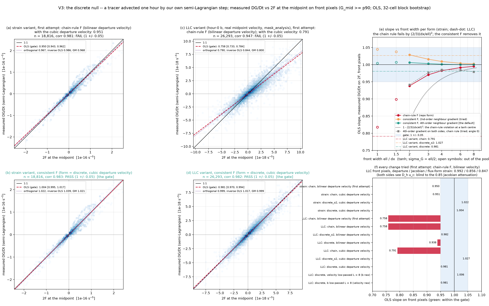

# Frontogenesis intuition

**Authors:** J. X. Prochaska, with Claude (Fable 5.2)  
**Status:** Working note, begun 23 November 2026. Section 1 (`2F`) is written, including the equation for the alignment angle (§1.7, added in prompt 2) and the continuum and discrete forms (§1.9, expanded in prompt 3); later sections will follow from `claude_prompts/frontogenesis_intuition.md`.  
**Circulation:** For the collaboration; not for citation.

---

## Purpose

This note builds intuition for frontogenesis, from the primary equations to their use on tracked fronts. It is a companion to the report (`frontogenesis_report.md`) and to the slides, and it introduces no new result. Where it quotes numbers, they are for one front at one hour: label 83 (the tracked front "label 81") at pair 36, 2012-07-03 12:30 UTC, the case shown on the `2F` and `DG/Dt` slides.

## Notation

| Symbol | Meaning |
|---|---|
| $b$ | Surface buoyancy [m s⁻²] |
| $\nabla b = (b_x, b_y)$ | Horizontal buoyancy gradient; it points across the front, toward lighter water |
| $G = \lvert\nabla b\rvert^2$ | Front strength [s⁻⁴] |
| $\mathbf{u} = (u, v)$ | Horizontal velocity; $D/Dt = \partial_t + \mathbf{u}\cdot\nabla$ follows the water horizontally |
| $\nabla\mathbf{u}$ | Velocity-gradient tensor, $\begin{pmatrix} u_x & u_y \\ v_x & v_y \end{pmatrix}$ |
| $\delta = u_x + v_y$ | Divergence ($\delta < 0$ is convergence) |
| $\sigma_n = u_x - v_y$, $\sigma_s = v_x + u_y$ | Normal and shear strain; $\lvert\sigma\rvert = \sqrt{\sigma_n^2 + \sigma_s^2}$ |
| $\zeta = v_x - u_y$ | Vorticity |
| $\alpha$ | Direction of $\nabla b$, anticlockwise from east |
| $\psi$ | Direction of the **extensional** axis of the strain; the **compressional** axis is at $\psi + 90°$ |
| $\theta$ | Angle between $\nabla b$ and the compressional axis, between 0° and 90° |
| $\phi$ | The same angle with its sign: positive when $\nabla b$ is turned anticlockwise from the compressional axis, between −90° and 90°; $\theta = \lvert\phi\rvert$ |
| $r$ | Rotation ratio, $(\zeta - 2\,D\psi/Dt)/\lvert\sigma\rvert$ (§1.7) |
| $F$ | Frontogenesis function [s⁻⁵]; the comparison is always $2F$ against $DG/Dt$ |

---

## 1. `2F`: the kinematic rate of change of a front

### 1.1 The result

For water that keeps its buoyancy and moves horizontally, the strength of a front changes at the rate

$$\frac{DG}{Dt} = 2F, \qquad F = -(\nabla b)^{\mathsf T}(\nabla\mathbf{u})(\nabla b) = -\left(u_x\,b_x^2 + (u_y + v_x)\,b_x b_y + v_y\,b_y^2\right). \tag{1}$$

It splits exactly into a divergence term and a strain term:

$$\boxed{\,2F = -\delta\,G \;+\; \lvert\sigma\rvert\,G\cos 2\theta\,} \qquad\text{or, as a growth rate,}\qquad \frac{1}{G}\frac{DG}{Dt} = -\delta + \lvert\sigma\rvert\cos 2\theta. \tag{2}$$

In words:

- **Convergence sharpens a front whatever its orientation.** The rate is $-\delta$.
- **Strain sharpens a front that it compresses across, and weakens one that it stretches across.** The rate is $\lvert\sigma\rvert\cos 2\theta$: it runs from $+\lvert\sigma\rvert$ ($\theta = 0°$) through zero ($\theta = 45°$) to $-\lvert\sigma\rvert$ ($\theta = 90°$).
- **Rotation does not appear.** Vorticity turns $\nabla b$ without changing its length. It acts through $\theta$, which has its own equation (§1.7).

Both terms of the second form are rates in s⁻¹, so they can be compared directly with each other and with $f$, and the inverse of their sum is an e-folding time for $G$.

The rest of this section derives (1) and (2) and shows what each term looks like.

### 1.2 What `G` measures

Take two neighbouring isopycnals that differ by $\Delta b$ and lie a distance $L$ apart. Then $\lvert\nabla b\rvert \approx \Delta b / L$ and $G \approx \Delta b^2 / L^2$. Each parcel keeps its buoyancy, so $\Delta b$ is fixed and **the only way to change `G` following the water is to change the spacing `L`**:

$$\frac{1}{G}\frac{DG}{Dt} = -\frac{2}{L}\frac{DL}{Dt}. \tag{3}$$

Frontogenesis is the flow bringing isopycnals closer together. The equations below say which part of the flow does it.

### 1.3 The exact equation

Start from conservation of buoyancy, $Db/Dt = 0$, and take its gradient. Differentiating $b_t + u\,b_x + v\,b_y = 0$ with respect to $x$ and to $y$ gives

$$\frac{D b_x}{Dt} = -(u_x b_x + v_x b_y), \qquad \frac{D b_y}{Dt} = -(u_y b_x + v_y b_y), \qquad\text{that is}\qquad \frac{D\,\nabla b}{Dt} = -(\nabla\mathbf{u})^{\mathsf T}\,\nabla b. \tag{4}$$

Only the *differences* of velocity across a parcel appear. A uniform current carries a front along without changing it, which is why the slides draw the velocity relative to the parcel. Then

$$\frac{DG}{Dt} = 2\,\nabla b\cdot\frac{D\,\nabla b}{Dt} = -2\,(\nabla b)^{\mathsf T}(\nabla\mathbf{u})(\nabla b) = 2F,$$

which is equation (1).

A more compact reading of the same expression: write $\nabla b = \sqrt{G}\,\mathbf{n}$, with $\mathbf{n}$ the unit vector across the front. Then

$$\frac{1}{G}\frac{DG}{Dt} = -2\,\mathbf{n}^{\mathsf T}(\nabla\mathbf{u})\,\mathbf{n} = -2\,\frac{\partial u_n}{\partial n}, \tag{5}$$

where $u_n$ is the cross-front velocity and $n$ the cross-front coordinate. **The front sharpens at twice the rate at which the cross-front flow converges on it.** Comparing with (3), $\partial u_n/\partial n$ is the rate $(1/L)\,DL/Dt$ at which the isopycnal spacing changes. Equation (2) is this one number, $\partial u_n/\partial n$, written in terms of quantities that do not depend on the front's orientation ($\delta$, $\lvert\sigma\rvert$) and one angle that does ($\theta$).

What (1) leaves out: vertical advection, surface fluxes and mixing, which all change $b$ following the horizontal flow. In the report these are the further terms of the budget $DG/Dt = 2F + V + S + R$.

### 1.4 Splitting the flow around a parcel into three motions

Any velocity-gradient tensor is the sum of three parts:

$$\nabla\mathbf{u} = \underbrace{\frac{\delta}{2}\begin{pmatrix} 1 & 0 \\ 0 & 1\end{pmatrix}}_{\text{convergence / divergence}} + \underbrace{\frac{1}{2}\begin{pmatrix} \sigma_n & \sigma_s \\ \sigma_s & -\sigma_n\end{pmatrix}}_{\text{strain}} + \underbrace{\frac{\zeta}{2}\begin{pmatrix} 0 & -1 \\ 1 & 0\end{pmatrix}}_{\text{rotation}}. \tag{6}$$

Multiplying out returns $u_x, u_y, v_x, v_y$, so this is an identity. Each part is a simple motion of the water around the parcel (Figure 1):

- the first changes the area of a ring of water and keeps its shape;
- the second keeps the area and turns the ring into an ellipse;
- the third turns the ring and changes neither.

Put (6) into $F = -(\nabla b)^{\mathsf T}(\nabla\mathbf{u})(\nabla b)$, one part at a time:

- **Convergence:** $-\tfrac12\,\delta\,(b_x^2 + b_y^2) = -\tfrac12\,\delta\,G$, whatever the direction of $\nabla b$.
- **Strain:** $-\tfrac12\left[\sigma_n\,(b_x^2 - b_y^2) + 2\,\sigma_s\,b_x b_y\right]$, which depends on the direction of $\nabla b$.
- **Rotation:** $-\tfrac12\,\zeta\,(-b_x b_y + b_y b_x) = 0$.

So

$$2F = -\delta\,G - \left[\sigma_n\,(b_x^2 - b_y^2) + 2\,\sigma_s\,b_x b_y\right]. \tag{7}$$

**Figure 1.** One flow around a parcel (a) written as the sum of a convergence (b), a strain (c) and a rotation (d), as in equation (6). In each panel the flow has acted for a time $0.5/\lvert\sigma\rvert$ on a ring of water (grey dashed to brown) and on a set of evenly spaced isopycnals (grey dashed to blue). The red arrow is $\nabla b$ afterwards, drawn with its length proportional to $\lvert\nabla b\rvert$; before, it pointed east with the length shown in (d). The rate under each panel is the instantaneous $(1/G)\,DG/Dt$ of that flow. Example values: $\delta = -0.6\,\lvert\sigma\rvert$, $\zeta = 0.8\,\lvert\sigma\rvert$, $\theta = 25°$. A drawing, not data (`py/intuition.py`).

### 1.5 The angles

The strain term in (7) becomes a single cosine once two angles are introduced (Figure 2a).

1. **The direction of the gradient, $\alpha$.** Write $\nabla b = \sqrt{G}\,(\cos\alpha, \sin\alpha)$. Then $b_x^2 - b_y^2 = G\cos 2\alpha$ and $2\,b_x b_y = G\sin 2\alpha$.
2. **The direction of the strain, $\psi$.** Write $\sigma_n = \lvert\sigma\rvert\cos 2\psi$ and $\sigma_s = \lvert\sigma\rvert\sin 2\psi$. In axes turned by $\psi$ the strain matrix of (6) is $\tfrac12\lvert\sigma\rvert\begin{pmatrix} 1 & 0 \\ 0 & -1\end{pmatrix}$: the water is stretched along $\psi$, the **extensional axis**, at the rate $\lvert\sigma\rvert/2$, and squeezed along $\psi + 90°$, the **compressional axis**, at the same rate.

The bracket in (7) is then $\lvert\sigma\rvert\,G\,(\cos 2\psi\cos 2\alpha + \sin 2\psi\sin 2\alpha) = \lvert\sigma\rvert\,G\cos 2(\alpha - \psi)$.

3. **The angle that matters, $\theta$.** Let $\theta$ be the angle between $\nabla b$ and the compressional axis. Then $\alpha - \psi = 90° \pm \theta$, so $\cos 2(\alpha - \psi) = -\cos 2\theta$, and (7) becomes equation (2):

$$2F = -\delta\,G + \lvert\sigma\rvert\,G\cos 2\theta.$$

Three remarks on the angles.

- **Why twice the angle.** A strain axis is a line, not an arrow: turning it by 180° gives the same strain. The same holds for the front, since reversing the sign of $\nabla b$ does not change $G$. Everything therefore depends on $2\alpha$ and $2\psi$, and $\theta$ can be folded into 0°–90° with nothing lost.
- **The sign convention.** $\theta$ is measured from the *compressional* axis, so the strain term carries a plus sign and $\theta = 0°$ is the most frontogenetic. Measured from the extensional axis it would carry a minus sign (planning §2.4 records this correction). Check: for $u = -ax$, $v = ay$ and a front $b(x)$, the compressional axis is $x$, $\theta = 0°$, $\lvert\sigma\rvert = 2a$, $\delta = 0$, and $2F = 2a\,b_x^2 > 0$.
- **The same thing in the strain's own axes.** With $b_c$ and $b_e$ the components of $\nabla b$ along the compressional and extensional axes, the strain term is $\lvert\sigma\rvert\,(b_c^2 - b_e^2)$. From (4), strain makes $b_c$ grow at the rate $\lvert\sigma\rvert/2$ and $b_e$ decay at the same rate. This is the form that Figure 2 (b)–(d) draws.

**Figure 2.** (a) The angles of the derivation. The isopycnals (blue) are perpendicular to $\nabla b$ (red), which lies at $\alpha$ from east. The strain stretches the water along the extensional axis at $\psi$ (outward arrows) and squeezes it along the compressional axis at $\psi + 90°$ (inward arrows); the faint arrows are the strain flow. $\theta$ is the angle between $\nabla b$ and the compressional axis. Here $\psi = 20°$, $\alpha = 80°$, $\theta = 30°$. (b)–(d) One strain field (compression left–right, extension up–down) acting for a time $0.5/\lvert\sigma\rvert$ on fronts at $\theta = 0°$, 45° and 90°, drawn as in Figure 1. (e) The factor $\cos 2\theta$, with the two angles measured at pair 36: the close-up parcel of the `2F` slide and the median over the band of label 83. A drawing, apart from those two angles (`py/intuition.py`).

### 1.6 What each term does to a front

**Convergence** (Figure 1b). In the flow $u = \tfrac12\delta\,x$, $v = \tfrac12\delta\,y$ every length changes at the rate $\delta/2$, in every direction. The isopycnal spacing does too, and by (3) $G$ grows at the rate $-\delta$. A front in convergent flow sharpens whichever way it lies. At the surface $\delta = -\partial w/\partial z$, so convergence comes with downwelling.

**Strain** (Figure 1c, Figure 2b–d). The area of the ring is kept: what is squeezed along one axis is stretched along the other. What happens to a front depends on which of the two it lies across.

| $\theta$ | The front lies… | Isopycnal spacing | $(1/G)\,DG/Dt$ |
|---|---|---|---|
| 0° | along the extensional axis | squeezed | $+\lvert\sigma\rvert$ |
| 45° | half-way | unchanged at first | 0 |
| 90° | along the compressional axis | pulled apart | $-\lvert\sigma\rvert$ |

The same strain field can therefore sharpen or weaken a front. **The orientation of the front sets the sign; the strength of the strain sets only the size.**

The case $\theta = 45°$ is not a steady state. The strain also turns the isopycnals toward the extensional axis (Figure 2c: the blue lines are steeper than the grey ones), so $\theta$ falls and the front starts to sharpen. In pure strain every front ends up along the extensional axis and sharpening. In Figure 2c, $G$ has already grown by 13% after a time $0.5/\lvert\sigma\rvert$, although its initial rate is zero.

**Rotation** (Figure 1d). Solid rotation turns the isopycnals and leaves their spacing alone, so it does not appear in $2F$. It still matters, because it changes $\theta$. Strain turns $\nabla b$ toward the compressional axis ($\theta \to 0$) and rotation turns it away. Vorticity therefore acts on $2F$ through $\cos 2\theta$; §1.7 makes this quantitative.

### 1.7 What sets the angle

Equation (2) gives the rate once $\theta$ is known. This section asks what sets $\theta$. The answer is a second equation, for the angle itself, which pairs with (2).

**The equation.** Equation (4) gives the rate of change of the whole vector $\nabla b$. Its component along $\nabla b$ changed the length and gave $2F$. Its component *across* $\nabla b$ turns it. With $\mathbf{n}$ the unit vector along $\nabla b$ and $\mathbf{t}$ the unit vector 90° anticlockwise from it,

$$\frac{D\alpha}{Dt} = -\,\mathbf{n}^{\mathsf T}(\nabla\mathbf{u})\,\mathbf{t}.$$

Put the three parts of (6) in, one at a time:

- **Convergence:** zero. An even squeeze does not turn anything.
- **Rotation:** $+\zeta/2$. The gradient turns with the water, at half the vorticity.
- **Strain:** $+\tfrac12\lvert\sigma\rvert\sin 2(\alpha - \psi)$.

The angle that matters is measured from the compressional axis. Give it a sign: $\phi = \alpha - (\psi + 90°)$, positive when $\nabla b$ is turned anticlockwise from the compressional axis, so that $\theta = \lvert\phi\rvert$. Then $\sin 2(\alpha - \psi) = -\sin 2\phi$. The axes themselves may turn following the water, at the rate $D\psi/Dt$, and that must be subtracted. The result is

$$\boxed{\,\frac{D\phi}{Dt} = \frac{\lvert\sigma\rvert}{2}\,\left(r - \sin 2\phi\right)\,}, \qquad r = \frac{\zeta - 2\,D\psi/Dt}{\lvert\sigma\rvert}. \tag{8}$$

Equations (2) and (8) are a closed pair for one parcel: given $\delta$, $\lvert\sigma\rvert$ and $r$ along its path, (8) moves the angle and (2) turns the angle into a growth rate.

**Reading it.** There are two tendencies in (8) (Figure 3a).

- $-\sin 2\phi$: the strain pulls $\nabla b$ toward the compressional axis ($\phi = 0$), from either side. This is the turning seen in Figure 2c.
- $r$: the rotation of the water *relative to the strain axes* pushes $\nabla b$ steadily one way. Only the relative rotation counts. If the strain axes turn with the water ($2\,D\psi/Dt = \zeta$), there is no push at all.

Three cases follow (Figure 3b, c).

1. **No relative rotation, $r = 0$.** The gradient swings onto the compressional axis: $\tan\phi(t) = \tan\phi(0)\,e^{-\lvert\sigma\rvert t}$. The time scale is $1/\lvert\sigma\rvert$. Afterwards $G$ grows at the full rate $\lvert\sigma\rvert$.
2. **Strain wins, $\lvert r\rvert < 1$.** The two tendencies balance at a steady angle,
$$\sin 2\phi^* = r, \qquad\text{so}\qquad \cos 2\theta^* = \sqrt{1 - r^2}.$$
The gradient locks at $\phi^* = \tfrac12\arcsin r$, turned away from the compressional axis in the sense of the rotation (anticlockwise for $r > 0$). Strain still sharpens the front, but at the reduced rate
$$\lvert\sigma\rvert\cos 2\theta^* = \sqrt{\lvert\sigma\rvert^2 - (\zeta - 2\,D\psi/Dt)^2}.$$
If the strain axes do not turn, this is $\sqrt{\lvert\sigma\rvert^2 - \zeta^2}$, the square root of the Okubo–Weiss parameter.
3. **Rotation wins, $\lvert r\rvert > 1$.** There is no steady angle. The gradient turns continually, passing through sharpening and weakening orientations in turn, and $\cos 2\theta$ averages to zero over a turn. $G$ oscillates and strain produces no net growth. This is the inside of an eddy.

So the picture of §1.6 can be completed: **strain makes fronts, and rotation decides how efficiently.** The efficiency $\cos 2\theta$ of equation (2) is not a free parameter of a front. It is set by the ratio of relative rotation to strain, and it falls from 1 to 0 as that ratio goes from 0 to 1.

Two limits on this picture. It treats $\lvert\sigma\rvert$ and $r$ as steady for longer than $1/\lvert\sigma\rvert$, and they need not be. And the steady angle is approached, not jumped to: a front younger than $1/\lvert\sigma\rvert$ still remembers the angle it started with.

**Figure 3.** The angle equation (8). (a) The rate of turning against the signed angle $\phi$, for four values of the rotation ratio $r$. Where a curve crosses zero going down, the angle is steady and stable (filled circle); going up, steady and unstable (open circle). For $r = 1.3$ the curve never reaches zero. Shading: the angles at which strain sharpens. (b) The angle in time from three starting angles, by integrating (8). For $\lvert r\rvert < 1$ every start ends at the same steady angle; for $r = 1.3$ (dashed) the gradient keeps turning. (c) The long-time mean of $\cos 2\theta$, the factor on the strain term of equation (2): $\sqrt{1 - r^2}$ for $\lvert r\rvert < 1$ and zero beyond. A drawing, not data (`py/intuition.py`).

### 1.8 The terms and the angle on a tracked front

The slide figures show the same quantities on data, at pair 36 on the band of label 83 (1,143 cells: the 307 front pixels widened by one cell).

**Figure 4.** `slides/2F_method.png`, reused. (b) is Figure 2a on data: one parcel with its $b$ contours, the direction of $\nabla b$, the compressional axis and the velocity relative to the parcel. (e) is $\cos 2\theta$ on every cell of the band. (c) and (f) are the stored `2F`.

**Figure 5.** `slides/2F_split.png`, reused: the convergence term $-\delta G$, the strain term $\lvert\sigma\rvert G\cos 2\theta$ and their sum, the continuum `2F`, on every cell of the band (top) and in the close-up window (bottom).

As growth rates (equation 2), with $f = 6.82 \times 10^{-5}$ s⁻¹ at 27.9°N:

| | $-\delta$ | $\lvert\sigma\rvert\cos 2\theta$ | total | e-folding time of $G$ |
|---|---|---|---|---|
| close-up parcel (j 126, i 653) [10⁻⁵ s⁻¹] | +2.18 | +0.87 | +3.05 (0.45 $f$) | 9.1 h |
| band, weighted by $G$ [10⁻⁵ s⁻¹] | +0.22 | +0.51 | +0.73 (0.11 $f$) | 38 h |
| band, contribution to the mean `2F` [10⁻¹⁹ s⁻⁵] | +1.29 | +2.92 | +4.21 | |

The parcel has $\delta = -2.18 \times 10^{-5}$ s⁻¹, $\lvert\sigma\rvert = 1.48 \times 10^{-5}$ s⁻¹ and $\theta = 27°$ ($\cos 2\theta = 0.59$). The band rates are weighted by $G$ because that is the weighting under which they add up to the band mean of `2F`: $\langle 2F\rangle = \langle G\rangle \times$ (the $G$-weighted rate), with $\langle G\rangle = 5.74 \times 10^{-14}$ s⁻⁴.

Three things to take from the table.

- **Strain carries 69% of the band's `2F`, although the parcel shown is led by convergence.** The share is the same on the front pixels (+1.93 and +4.25) and on the cells beside them (+1.05 and +2.43).
- **The divergence is not small; it cancels.** The $G$-weighted $\lvert\delta\rvert$ is $1.06 \times 10^{-5}$ s⁻¹, 60% of the $G$-weighted $\lvert\sigma\rvert$ ($1.77 \times 10^{-5}$ s⁻¹). But only 59% of the cells converge, so the net rate is about a fifth of the typical $\lvert\delta\rvert$.
- **The strain has a steady sign and is used at about 30% of its strength.** $\theta$ is below 45° on 72% of the cells, with a median of 29°. The $G$-weighted mean of $\cos 2\theta$ is 0.30 (the plain mean is 0.33). A front lying exactly along the extensional axis would have 1.

A caution on the first two points: they describe one front at one hour.

**The angle against the vorticity.** §1.7 predicts that the sign and size of $\phi$ follow the rotation ratio. On the same band the vorticity gives part of that ratio, $\zeta/\lvert\sigma\rvert$. The other part, the turning of the strain axes following the water, was not measured, so this is a test with $r \approx \zeta/\lvert\sigma\rvert$.

**Figure 6.** The alignment angle against the vorticity on the band of label 83 at pair 36 (1,143 cells). (a) $\sin 2\phi$ against $\zeta/\lvert\sigma\rvert$ for every cell (grey), the median in bins of width 0.5 (squares) and the steady-angle prediction $\sin 2\phi = r$ of §1.7 (red; dotted where $\lvert r\rvert > 1$ and there is no steady angle). (b) The signed angle, for cyclonic and anticyclonic cells separately; dashed lines are the medians, and the grey band marks the angles at which strain sharpens.

- **Most of the band is strain-led.** $\lvert\zeta\rvert < \lvert\sigma\rvert$ on 73% of the cells, and the median of $\lvert\zeta\rvert/\lvert\sigma\rvert$ is 0.61. The vorticity is of both signs (42% of cells cyclonic) and weak against $f$ (median $-0.03\,f$).
- **The gradient is turned the way the vorticity turns it.** $\phi$ has the sign of $\zeta$ on 70% of the cells. The median angle is $+26°$ on the cyclonic cells and $-15°$ on the anticyclonic ones (Figure 6b).
- **The medians lie close to the steady-angle line.** In the four bins with $\lvert r\rvert < 1$ the median $\sin 2\phi$ is $-0.62$, $-0.23$, $+0.43$ and $+0.83$, against $-0.75$, $-0.25$, $+0.25$ and $+0.75$ on the line at the bin centres (Figure 6a).
- **Cell by cell the scatter is large.** Where $\lvert r\rvert < 1$, $\sin 2\phi$ and $r$ correlate at 0.50. The steady angle would give a median $\theta$ of 13° and a mean $\cos 2\theta$ of 0.82 on those cells; the measured values are 27° and 0.35. Scatter of the angle about its steady value lowers $\cos 2\theta$ whichever way it goes, which is why the measured efficiency is well below the steady one although the medians agree.

What this does and does not show. The relation of §1.7 holds on this front in the median: the rotation of the water accounts for the *direction* in which the front is turned off the compressional axis, and roughly for how far. It does not hold cell by cell. Three causes of the scatter are not separated here: the unmeasured turning of the strain axes; the time needed to reach the steady angle, $1/\lvert\sigma\rvert = 19$ h at the median strain, over which the flow itself changes; and noise in a grid-scale angle. One front, one hour.

### 1.9 The continuum and the discrete forms of `2F`

The project carries two versions of `2F`. They answer slightly different questions.

| | Continuum ("chain") form | Discrete form |
|---|---|---|
| In the code | `operators.frontogenesis(form='chain')`, stored as `two_F_chain` | `form='discrete'` (the default), stored as `two_F` |
| What it is | Equation (1), with the grid's gradients of $b$ and $\mathbf{u}$ put in | The exact rate of change of the grid's own $G$ under advection |
| Used for | The split into convergence and strain (§1.1–§1.8) | Every comparison with the measured $DG/Dt$ |
| Band of label 83, pair 36 | +4.21 | +3.46 |

The short version: **the chain form is the growth rate of the true gradient; the discrete form is the growth rate of the gradient the grid can see.** On a front many cells wide they are the same. On a front one or two cells wide the grid sees less, and the discrete form is smaller.

#### The grid does not measure the true gradient

The gradient stencil $\mathsf{L}$ of `operators.grad_b` is a centred difference over two cells. Along $x$, with grid spacing $h$,

$$(\mathsf{L}_x b)(x) = \frac{b(x + h) - b(x - h)}{2h} = \frac{1}{2h}\int_{x-h}^{x+h}\frac{\partial b}{\partial x}\,dx'. \tag{9}$$

It is the slope of the straight line between the two neighbours (Figure 7a), which is the *mean* of the true gradient over the two cells. At the centre of a narrow front that mean is below the peak (Figure 7b). The front strength used everywhere in the project is $G = \lvert\mathsf{L}b\rvert^2$, and the measured rate is the rate of change of this $G$. So the prediction to compare it with should be the rate of change of $\lvert\mathsf{L}b\rvert^2$, not of the true $\lvert\nabla b\rvert^2$.

#### What the semi-Lagrangian difference measures

The measured rate at a cell $\mathbf{x}$ is (`tracked/matched_parcels_track_81.md` §1.1)

$$\left.\frac{DG}{Dt}\right|_{\rm meas} = \frac{\lvert\mathsf{L}\,b_{t+1}\rvert^2(\mathbf{x}) - \lvert\mathsf{L}\,b_t\rvert^2(\mathbf{x}_d)}{\Delta t}, \qquad \mathbf{x}_d = \mathbf{x} - \mathbf{d}(\mathbf{x}),$$

where $\mathbf{d}(\mathbf{x})$ is the displacement over the hour of the water that arrives at $\mathbf{x}$, and the stencil at the earlier time is the arrival cell's stencil moved rigidly by $\mathbf{d}(\mathbf{x})$.

Suppose the water only carries its buoyancy: $b_{t+1}(\mathbf{y}) = b_t(\mathbf{y} - \mathbf{d}(\mathbf{y}))$ for every point $\mathbf{y}$. Write out the two stencils along direction $k$, with $\mathbf{e}_k$ one cell in that direction:

$$\mathsf{L}_k b_{t+1}(\mathbf{x}) = \frac{b_t\big(\mathbf{x} + \mathbf{e}_k - \mathbf{d}(\mathbf{x} + \mathbf{e}_k)\big) - b_t\big(\mathbf{x} - \mathbf{e}_k - \mathbf{d}(\mathbf{x} - \mathbf{e}_k)\big)}{2h_k},$$

$$\mathsf{L}_k b_t(\mathbf{x}_d) = \frac{b_t\big(\mathbf{x} + \mathbf{e}_k - \mathbf{d}(\mathbf{x})\big) - b_t\big(\mathbf{x} - \mathbf{e}_k - \mathbf{d}(\mathbf{x})\big)}{2h_k}.$$

The two differ only because the neighbours have a different displacement from the centre: $\mathbf{d}(\mathbf{x} \pm \mathbf{e}_k)$ against $\mathbf{d}(\mathbf{x})$. If the flow were uniform they would be identical, and the measured rate would be zero. With $\mathbf{d} = \mathbf{u}\,\Delta t$ and $\Delta t$ small, subtracting gives

$$\frac{D(\mathsf{L}_k b)}{Dt} = -\,\frac{\big[\mathbf{u}(\mathbf{x} + \mathbf{e}_k) - \mathbf{u}(\mathbf{x})\big]\cdot\nabla b(\mathbf{x} + \mathbf{e}_k) + \big[\mathbf{u}(\mathbf{x}) - \mathbf{u}(\mathbf{x} - \mathbf{e}_k)\big]\cdot\nabla b(\mathbf{x} - \mathbf{e}_k)}{2h_k}. \tag{10}$$

This is the grid's version of equation (4). In words: **the stencil gradient changes because each end of the stencil moves relative to the centre, and each end then reads a different buoyancy by an amount set by the slope of $b$ at that end.** Multiplying by $2\,\mathsf{L}_k b$ and summing over the two directions gives the discrete form,

$$2F_{\rm disc} = 2\sum_{k}(\mathsf{L}_k b)\,\frac{D(\mathsf{L}_k b)}{Dt}. \tag{11}$$

The code and the earlier documents call the right-hand side of (10) a *commutator*, $-[\mathsf{L}_k,\ \mathbf{u}\cdot\nabla]\,b$. The name says the same thing: it is the difference between advecting and then taking the stencil gradient, and taking the stencil gradient and then advecting.

#### Where the continuum form differs

The chain form puts the grid's quantities into equation (1):

$$2F_{\rm chain} = -2\sum_{k,m}(\mathsf{L}_k b)\,\frac{\partial u_m}{\partial x_k}\,(\mathsf{L}_m b).$$

To see the difference, take one dimension and a velocity gradient $u'$ that is uniform across the stencil. Then (10) and the chain form give

$$\frac{D(\mathsf{L}b)}{Dt}\bigg|_{\rm disc} = -u'\cdot\underbrace{\tfrac12\left[\frac{\partial b}{\partial x}(x + h) + \frac{\partial b}{\partial x}(x - h)\right]}_{\text{slope at the two ends}}, \qquad \frac{D(\mathsf{L}b)}{Dt}\bigg|_{\rm chain} = -u'\cdot\underbrace{\mathsf{L}b}_{\text{mean slope over the stencil}}. \tag{12}$$

**The two forms differ in one factor: which gradient the velocity difference multiplies.** The chain form uses the mean slope between the neighbours. The discrete form uses the slope *at* the neighbours. For a straight-line $b$ these are equal, and the two forms agree exactly. Across a front they are not (Figure 7b): the gradient peaks at the centre and falls away, so the slope at the ends is below the mean, and the discrete form is the smaller.

Why the ends, and not the middle? The stencil reads $b$ at $x + h$ and $x - h$ and nowhere else. Its value changes only when those two readings change. Convergence brings water from further out to each end, and how much the reading changes there depends on the slope of $b$ there. What $b$ does between the two points does not enter.

Expanding both factors of (12) about the cell gives the size of the difference:

$$\frac{2F_{\rm disc}}{2F_{\rm chain}} \approx 1 + \frac{h^2}{3}\,\frac{\partial^3 b/\partial x^3}{\partial b/\partial x}, \qquad\text{which for } b \propto \tanh(x/\ell) \text{ at the centre is}\qquad 1 - \frac{2}{3}\left(\frac{h}{\ell}\right)^2. \tag{13}$$

The limit of a very thin front makes the point. A step in $b$ between two cells has the stencil gradient $\Delta b/2h$, and no amount of convergence can raise it: the grid cannot see the front get thinner. The slope at the ends is zero, so the discrete form gives zero. The chain form gives $-2u'(\Delta b/2h)^2 > 0$, a sharpening that the grid's $G$ will never show.

**Figure 7.** The two forms on a one-dimensional front $b = \tanh(x/\ell)$ in a uniform convergence, at the cell on the front's centre. (a) The front with $\ell = 1.2\,h$, the grid points, and three slopes: the stencil gradient (blue), the true slope at the cell (red dashed) and the true slope at the two ends of the stencil (brown). (b) The true gradient across the front and the same three values: 1 at the cell, 0.82 averaged over the stencil, 0.53 at its ends. (c) The rate of change of the grid's $G$ relative to the chain form, against the front width: equation (10) with the exact slope at the ends (brown), the code's discrete form (green squares), one semi-Lagrangian step of exact advection (open circles) and the expansion (13) (dotted). A calculation, not data (`py/intuition.py --what discrete`).

| $\ell / h$ | grid $G$ / true $G$ | semi-Lagrangian step / chain | equation (10) / chain | code's discrete form / chain |
|---|---|---|---|---|
| 1 | 0.58 | 0.55 | 0.55 | 0.65 |
| 1.5 | 0.76 | 0.76 | 0.76 | 0.77 |
| 2 | 0.85 | 0.85 | 0.85 | 0.85 |
| 3 | 0.93 | 0.93 | 0.93 | 0.93 |
| 4 | 0.96 | 0.96 | 0.96 | 0.96 |
| 8 | 0.99 | 0.99 | 0.99 | 0.99 |

Two things to read from Figure 7c and the table.

- **The semi-Lagrangian step follows equation (10), not the chain form.** The open circles lie on the brown curve at every width (to five figures). A measurement made this way on a front two cells wide returns 0.85 of the chain form even when advection is perfect and nothing else acts.
- **The deficit is about the same as the grid's deficit in $G$ itself** (second column). In this example the chain form divided by the grid's $G$ is the growth rate of the *true* gradient. The grid's gradient grows more slowly, because as the front narrows the stencil captures a smaller share of it.

#### Three details of the discrete form in the code

`operators._frontogenesis_discrete` is equations (10) and (11), with three choices that each tie it to the measurement.

1. **The same stencil.** $\mathsf{L}_k b$ in (11) is the `grad_b` stencil that defines $G$ on both sides of the comparison.
2. **The same velocity.** The differences $\mathbf{u}(\mathbf{x} \pm \mathbf{e}_k) - \mathbf{u}(\mathbf{x})$ are taken from the cell-centred velocity that the departure points are computed from (`centred_model_velocity`), over one cell on each side. The chain form takes its velocity gradient from the interpolated Jacobian instead.
3. **The slope at the ends, at fourth order.** Equation (10) needs the true slope of $b$ at the neighbouring cells, and the grid can only estimate it. The code uses the fourth-order estimate, which is the slope at a grid point of the cubic that the semi-Lagrangian step interpolates $b$ with. Using the two-cell stencil there instead over-corrects by about half the deficit (the code keeps it as `form='discrete_o2'`). In Figure 7c the fourth-order estimate matches the exact slope for $\ell \ge 1.5\,h$ and is too high for the thinnest front (0.65 against 0.55 at $\ell = h$); that example interpolates nothing, so it does not test the match to the cubic.

#### Why this makes it the better match, and the test that showed it

If buoyancy is only advected, the measured rate tends to $2F_{\rm disc}$ as the time step goes to zero. That is an identity of the construction, not an approximation that improves with resolution. It means a difference between the measured $DG/Dt$ and the discrete `2F` cannot come from the gradient stencil. It has to come from something that changes buoyancy along the path (vertical exchange, surface fluxes, mixing) or from the one-hour step. With the chain form, a deficit of 5–25% on narrow fronts would sit in that difference and look like physics.

The project found this by test, not by foresight (gate V3, M1 task 6). A synthetic tracer was advected for one hour by the project's own semi-Lagrangian step, so the truth was pure advection, and the measured rate was regressed on `2F` at the front pixels:

| | chain form | discrete form |
|---|---|---|
| synthetic strain flow | 0.951 | 1.004 |
| LLC velocity of one hour | 0.791 | 0.981 |

The chain form failed the pre-declared gate of $1 \pm 0.05$ on the model's velocity; the discrete form passes on both. Figure 8 (e) shows the same against front width, with equation (13) as the dotted curve.

**Figure 8.** `figs/V3_discrete_null.png`, reused: the test that led to the discrete form. Measured semi-Lagrangian $DG/Dt$ against `2F` for a tracer advected one hour by the same semi-Lagrangian step, with the chain form (a, c) and the discrete form (b, d), on a synthetic strain flow (left) and with LLC velocities (middle). (e) The slope against the front width for each form. (f) Every variant tried.

What "better match" does not claim:

- **It holds for pure advection in the limit of a short step.** Over a real hour, with two velocity snapshots, the measured rate carries its own error (report §7.1).
- **It is not a more physical quantity.** The discrete form has no exact split into convergence and strain, and it depends on the stencil. For understanding why a front sharpens, the chain form and equation (2) are the ones to use.
- **Both forms use the grid's $G$.** Neither recovers the true gradient of a front the grid does not resolve.

#### On the tracked front

On the band of label 83 at pair 36 the discrete form averages +3.46 and the chain form +4.21: a ratio of 0.82 (0.81 on the front pixels, 0.83 on the cells beside them), with a cell-by-cell correlation of 0.95. The stored width proxy (`front_width`) on the 307 front pixels has a median of 2.2 cells (quartiles 1.8 and 2.6). For a front of that width the one-dimensional example of Figure 7 gives 0.87. The measured ratio is of the size expected for a front about two cells wide, and a little lower; the example is a straight front in a uniform convergence, so closer agreement is not expected.

One caution. At this pair the band mean of the measured $DG/Dt$ is +4.20, which happens to sit beside the chain value and not the discrete one. A single band mean does not test the forms: the measured rate also contains everything that is not advection, and cell by cell it correlates with the discrete `2F` at only 0.59. The test of the forms is Figure 8, where the truth is known.

#### Two further details

- **The split closes only with the strain set taken from the same velocity gradient.** `operators.strain_from_jacobian` gives $\delta$, $\sigma_n$, $\sigma_s$ from the Jacobian that the chain form uses, and with it the two terms of equation (2) sum to the chain `2F` to $1 \times 10^{-15}$ of its r.m.s. The flux-form $\delta$ and $\sigma$ of the derived store are differenced on a different stencil; with them the terms sum to 4.29 instead of 4.21.
- `operators.strain_alignment` computes $\theta$ exactly as in §1.5: $\cos 2\theta = -\left[\sigma_n\,(b_x^2 - b_y^2) + 2\,\sigma_s\,b_x b_y\right] / (\lvert\sigma\rvert\,G)$.

---

## Sources

- The angle equation (§1.7) follows Lapeyre, Klein & Hua (1999, *Phys. Fluids* 11, 3729) for tracer gradients; the reference is quoted from memory and should be checked before it is cited.
- Equations and conventions: `frontogenesis_planning.md` §2.4; `py/operators.py` (`frontogenesis`, `strain_from_jacobian`, `strain_alignment`); `tracked/matched_parcels_track_81.md` §1.1; `claude_prompts/frontogenesis_slides.md`, Q&A/2F, Round 3.
- Figures 1 and 2: `py/intuition.py --what schematics`. Every rate written on them is computed with `strain_from_jacobian` and `strain_alignment` and asserted against $-2\,\mathbf{n}^{\mathsf T}(\nabla\mathbf{u})\,\mathbf{n}$.
- Figure 3: `py/intuition.py --what schematics`. Equation (8) is asserted against the turning of a gradient carried by the flow of Figure 1, against the closed form in pure strain, and against the steady angle reached by integration.
- Figures 4 and 5: `py/slides_2F.py`.
- Figure 6: `py/intuition.py --what data`, drawn from `data/intuition_2F.json` (`numbers.angle`). The signed angle is asserted to equal `strain_alignment`'s $\theta$ in magnitude.
- Figure 7 and the table of §1.9: `py/intuition.py --what discrete` (`data/intuition_2F.json`, `discrete`). The one-dimensional semi-Lagrangian step is asserted to equal equation (10) to $10^{-4}$. The `front_width` numbers are read from the derived store.
- Figure 8 and the slopes 0.951 / 0.791 / 1.004 / 0.981: gate V3, `figs/V3_discrete_null.png` panel (f) and `frontogenesis_coding.md`. The derivation of equation (10) follows the docstring of `operators._frontogenesis_discrete`. The correlation 0.59 is from the slides log (2F prompt 1).
- Numbers of §1.8 and §1.9: `data/intuition_2F.json` (`py/intuition.py --what numbers`), asserted against `data/slides_2F_36.json`. The 4.29 is from the slides log (2F prompt 1: 1.30 + 2.99).
