# Frontogenesis in the LLC4320 California Current — Report

**Authors:** J. X. Prochaska, with Claude (Fable 5.2)  
**Status:** Report on milestones M0 to M5, 18 November 2026 — M3 not closed (the pre-declared null result); M4 complete; supersedes the interim report of 12 October 2026  
**Circulation:** For the collaboration; not for citation.

---

## 1. What we measured

The surface buoyancy-gradient budget of the LLC4320 California Current does not close at the tolerance fixed before any number was computed. That is the null outcome the design declared in advance, and it is the result of this study.

The project asked a narrow question of a 1/48° global ocean simulation: is the observed sharpening of surface buoyancy fronts accounted for by the kinematic frontogenesis rate computed from the model's own velocity and buoyancy? The two quantities are the two sides of an exact budget, so their difference is itself the physical content. On one tile off Monterey Bay (grid spacing 1.68–2.07 km), over 72 summer hours giving 71 hourly pairs, we measured the material rate of change of the front strength $G = |\nabla_h b|^2$ by a semi-Lagrangian step, predicted it as $2F$ from the frontogenesis function, and subtracted three further *measured* terms — sub-filter, vertical and surface flux — at four coarse-graining scales $L = 0, 2, 4, 8$ grid cells. The numbers the rest of the report rests on:

| quantity | value | read against |
|---|---|---|
| closure residual, r.m.s. over the measured tendency's, $L = 0 / 2 / 4 / 8$ | **0.813 / 0.841 / 0.898 / 1.042** | tolerance **0.50**, fixed 7 October 2026, judged at $L \ge 2$ |
| hourly pairs reaching the tolerance | **0 of 71**, at any $L$ | — |
| discrete-null baseline (our operators on our own advection) | **0.981 [0.970, 0.994]** | the acceptance band $1 \pm 0.05$; passes |
| the analysis's own floor (an offline tracer through the full pipeline) | 0.870 / 0.713 / 0.544 / 0.408 | the two-term residual 0.739 / 0.728 / 0.713 / 0.685 |
| a budget with no skill (terms shuffled in time) | 1.08–1.24 | the real 0.81–1.04 |
| partial correlation of the residual with a numerical or a forcing signature | never above 0.22 | — |
| ten fronts tracked as objects | 70 h each, no gaps | — |
| object-level reconciliation of two estimates of the same rate | correlation 0.953, r.m.s. ratio 0.415 on a one-cell band; −0.093 and 1.123 as pre-registered | 0.8 and 0.5 |

The result has three parts. **The finding:** hourly surface fields at 2 km resolution cannot constrain the surface frontogenesis budget in this regime; the residual is 1.4–1.6 times the kinematic term in r.m.s. at every scale. **The diagnosis:** two separable causes, which the filter sweep separates. At the grid scale the limit is the analysis's own floor on hourly data — an offline passive tracer with no physics at all leaves a residual of 0.870, and two defensible estimates of the same tendency from the same hourly pair differ by 0.672 of its amplitude. At the filtered scales the floor falls to 0.408 but the surface-flux term, which carries 0.36–0.80 of the measured amplitude, correlates only $+0.02$ with the imbalance it should explain, and subtracting it at unit weight adds its variance. **The object-level result:** ten fronts found and tracked by the flow show the same thing front by front — hourly rates on a tracked front agree with the kinematic prediction in sign and shape while the 70-hour integrals scatter from −0.8 to 1.1 of it.

What the result is not. It is not evidence that the method is broken: the operators passed every validation gate, the residual is 20 to 39 standard deviations better than a shuffled budget, the sub-filter term behaves as the one-hour pilot predicted, and a second, open-ocean tile fails in the same way at the grid scale. It is not a statement about ocean fronts. No frontogenesis efficiency is quoted anywhere in the body of this report, no diabatic damping is claimed, and nothing was tuned. The measured-versus-predicted slopes, which exist, are confined to Appendix C under their caveats, by decision of the principal investigator. The result describes one region, one season and 72 hours, at least 100 km offshore, and does not generalise beyond them.

---

## 2. The surface budget

### 2.1 Definitions

Buoyancy is formed from the model's potential temperature $\Theta$ and salinity $S$ with the equation of state the model itself advected,

$$
b = \frac{g\,\sigma_0(\Theta, S)}{\rho_0} \quad [\mathrm{m\,s^{-2}}],
$$

with $g = 9.81$ m s$^{-2}$, $\rho_0 = 1000$ kg m$^{-3}$ and $\sigma_0$ the potential-density anomaly. This is the repository's convention and it *increases with density* — the negative of textbook buoyancy. Everything below is quadratic in $\nabla b$, so nothing depends on the sign. The **front strength** is the squared horizontal buoyancy gradient and the **kinematic frontogenesis function** is the rate at which the resolved strain sharpens it:

$$
G = |\nabla_h b|^2 = b_x^2 + b_y^2 \quad [\mathrm{s^{-4}}], \qquad F = -\left( u_x\, b_x^2 + (u_y + v_x)\, b_x b_y + v_y\, b_y^2 \right) \quad [\mathrm{s^{-5}}].
$$

For adiabatic horizontal flow $F = \tfrac{1}{2}\, DG/Dt$ exactly. The comparison throughout is therefore **the predicted sharpening rate $2F$ against the measured sharpening rate $D_hG/Dt$**.

### 2.2 The budget at the free surface, and why the data are not the continuum

Start from $Db/Dt = B$, where $B$ (m s$^{-3}$) collects every diabatic source. Differentiating horizontally and contracting with $\nabla_h b$ gives a kinematic term, a tilting term $-b_z(w_x b_x + w_y b_y)$ and a diabatic term. At the free surface the velocity *relative to* the surface vanishes, the tilting term drops out, and the material derivative collapses to its horizontal form $D_h/Dt = \partial_t + u\,\partial_x + v\,\partial_y$:

$$
\frac{D_h}{Dt}\!\left(\tfrac{1}{2}G\right) = F + \nabla_h b \cdot \nabla_h B .
$$

Surface-only data are therefore *sufficient* in the continuum: there is no missing kinematic term. The stored fields are not the continuum. The model runs a linear free surface with a fixed top cell of thickness $\Delta z = 1.0$ m; the stored $b$ is a cell average, and the budget of a cell average contains the flux through the cell *base*. The tilting term is **reintroduced by the discretisation**, which is why the discrete budget has a measured vertical term at all.

### 2.3 The five-term budget and what its residual contains

The difference $D_hG/Dt - 2F$ is not purely diabatic; an early draft of the design said it was, and review overturned the claim. It contains the model's implicit numerical diffusion (there is no explicit horizontal tracer diffusion; the seventh-order flux-limited advection scheme dissipates selectively at the grid scale, exactly where fronts live), the finite-top-cell vertical term, genuine diabatic forcing, and truncation error in the analysis. A slope of 0.5–0.8 between measured and predicted at the grid scale would be fully explicable by numerics with zero air–sea flux. The gate was therefore defined as **closure of a five-term budget**, not as a slope:

$$
\underbrace{\frac{D_hG}{Dt}}_{\text{measured}} \;-\; \underbrace{2F}_{\text{kinematic}} \;-\; \underbrace{\tau}_{\text{sub-filter}} \;-\; \underbrace{V}_{\text{vertical}} \;-\; \underbrace{S}_{\text{surface flux}} \;=\; R ,
$$

with every term formed through one operator set at each filter scale (Figure 2). The **vertical term** $V$ is $2\nabla_h b\cdot\nabla_h$ of the top-cell vertical advective tendency, from the model's own cell-base velocity and its two uppermost levels. The **sub-filter term** $\tau$ is defined in §3.3. All three extra terms are measured, from an hourly store of the top three model levels and the surface fluxes, so the residual $R$ is, in intent, **numerical diffusion plus interior boundary-layer mixing**. In practice it also carries the hourly sampling error of the measured side, which §7 shows is as large as the imbalance at $L = 0$ and $2$; at those scales even "numerics plus mixing" overstates what $R$ isolates.

### 2.4 The surface-flux term

The term $S$ is the one budget term that is a parameterised forcing rather than a kinematic quantity. The model forces its top cell with the net heat flux $Q_{\rm net}$ (which includes the shortwave), the shortwave flux $Q_{\rm sw}$ and the freshwater flux $F_w$, all positive into the ocean. Within a layer of thickness $h$ they change temperature and salinity $\mathcal{S}$ at the rates

$$
\left.\frac{\partial\Theta}{\partial t}\right|_{\rm sfc} = \frac{\left(Q_{\rm net} - Q_{\rm sw}\right) + f_{\rm sw}(h)\,Q_{\rm sw}}{\rho_c\, c_p\, h}, \qquad \left.\frac{\partial\mathcal{S}}{\partial t}\right|_{\rm sfc} = -\frac{\mathcal{S}\,F_w}{\rho_c\, h},
$$

where $\rho_c$ and $c_p$ are the model's reference density and heat capacity and $f_{\rm sw}(h)$ is the shortwave fraction absorbed within the layer (0.521 for the 1 m top cell). With the expansion coefficients $\alpha$, $\beta$ of the equation of state, the buoyancy tendency and the budget term are

$$
B_{\rm sfc} = \frac{g}{\rho_0}\left(-\rho\,\alpha\left.\frac{\partial\Theta}{\partial t}\right|_{\rm sfc} + \rho\,\beta\left.\frac{\partial\mathcal{S}}{\partial t}\right|_{\rm sfc}\right), \qquad S = 2\,\nabla_h b \cdot \nabla_h \overline{B_{\rm sfc}}^{\,L}.
$$

Three properties matter later. The sign: heating that favours the dense side of a front lowers $b$ most where it is highest, so $S < 0$ — **frontolytic**. The depth scale: with $h = \Delta z = 1$ m, $S$ is the term the stored top cell obeys instant by instant; with $h = h_{\rm bl}$, the boundary-layer depth, it is the hourly-mean tendency after the mixing scheme has spread the flux down — a factor of about 22 in amplitude and none in pattern (§7.3). Linearity: $S$ is exactly the sum of a non-solar heat part, a shortwave part and a freshwater part, and on the pooled front pixels the non-solar part is 0.996 of its amplitude at the grid scale. The fluxes are six-hourly forcing interpolated by the model, so the shortwave's diurnal cycle is a triangle peaking at 13 local solar time, not resolved insolation.

### 2.5 What sharpens a front: convergence and strain

**$G$ measures the spacing of isopycnals.** If two neighbouring isopycnals differ by $\Delta b$ and lie a distance $\ell$ apart, then $|\nabla_h b| \approx \Delta b/\ell$ and $G \approx \Delta b^2/\ell^2$. A parcel conserves $b$ in adiabatic flow, so $\Delta b$ is fixed, and everything that changes $G$ following the water changes the spacing:

$$
\frac{1}{G}\frac{DG}{Dt} = -\frac{2}{\ell}\frac{D\ell}{Dt}.
$$

To sharpen a front is to bring its isopycnals closer together. What $F$ adds is *which part of the flow* does that.

**The rate form.** With the horizontal divergence $\delta = u_x + v_y$, the strain magnitude $|\sigma| = [(u_x - v_y)^2 + (v_x + u_y)^2]^{1/2}$ and the angle $\theta$ between $\nabla_h b$ and the compressional axis of the strain, the kinematic term of §2.1 is, exactly,

$$
2F = -\delta\, G + |\sigma|\, G \cos 2\theta, \qquad\text{that is}\qquad \boxed{\;\frac{1}{G}\frac{DG}{Dt} = -\delta + |\sigma| \cos 2\theta\;}
$$

for adiabatic horizontal flow. Each term is a growth rate of $G$ in s$^{-1}$, and its inverse is an e-folding time. The vorticity does not appear. Appendix D gives the derivation: the velocity gradient splits exactly into an isotropic squeeze, an area-preserving strain and a solid rotation, and the rotation turns $\nabla_h b$ without changing its length.

**The two pure flows.** Each term is clearest in its own flow, taken alone.

- *Divergence*, $u = \tfrac{1}{2}\delta x$, $v = \tfrac{1}{2}\delta y$. Every length changes at the rate $\delta/2$ in every direction, so $D\ell/Dt = \tfrac{1}{2}\delta\,\ell$ and $(1/G)\,DG/Dt = -\delta$. **Convergence ($\delta < 0$) packs the isopycnals together whatever the front's orientation**: a ring of parcels shrinks uniformly.
- *Strain*, $u' = +\tfrac{1}{2}|\sigma| x'$ along the extensional axis and $v' = -\tfrac{1}{2}|\sigma| y'$ along the compressional axis. Area is conserved, so a ring of parcels becomes an ellipse. The gradient component along the compressional axis grows at $|\sigma|/2$ and the component along the extensional axis decays at the same rate, so $(1/G)\,DG/Dt = |\sigma|(\cos^2\theta - \sin^2\theta) = |\sigma| \cos 2\theta$.
  - At $\theta = 0°$ the isopycnals lie along the stretching direction and are squeezed together, at the largest rate, $+|\sigma|$. This is the classical deformation-field front.
  - At $\theta = 45°$ compression and stretching cancel.
  - At $\theta = 90°$ the isopycnals are pulled apart, at $-|\sigma|$.

  **The same strain sharpens or weakens a front according to the front's orientation, not the strain's strength.**

**One front.** The terms are evaluated on the front of §9.4 at 2012-07-03 12:30 UTC: label 83 of track 0, on its one-cell band of 1,143 parcels, where $f = 6.80 \times 10^{-5}$ s$^{-1}$. The rates are weighted by $G$, the weighting under which the band means of $2F$ add up ($\langle 2F\rangle = \langle G\rangle \times$ rate).

| | rate, $G$-weighted [10$^{-5}$ s$^{-1}$] | magnitude, $G$-weighted [10$^{-5}$ s$^{-1}$] | contribution to $\langle 2F\rangle$ [10$^{-19}$ s$^{-5}$] |
|---|---|---|---|
| convergence, $-\delta$ | +0.22 | $|\delta|$ 1.06 | +1.29 |
| strain, $|\sigma| \cos 2\theta$ | +0.51 | $|\sigma|$ 1.77 | +2.92 |
| total | +0.73 (0.11 $f$; e-folding 38 h) | | +4.21 |
| stored discrete $2F$, the same split (point 3) | | | +1.08 + 2.39 = +3.46 |

- **Divergence is large but mostly cancels.** The typical $|\delta|$ is 60 % of $|\sigma|$, but only 59 % of the parcels converge; the rest diverge. The net convergence rate is 0.21 of the typical $|\delta|$.
- **Strain keeps one sign.** On 72 % of the parcels $\nabla_h b$ lies within 45° of the compressional axis (median $\theta$ 29°, mean $\cos 2\theta$ 0.33). The strain therefore delivers 0.29 of the rate it would at $\theta = 0$, consistently.
- **Strain carries 69 % of $2F$ on this front.** The same holds on the ridge (+1.93 from convergence, +4.25 from strain) and on the flanks (+1.05, +2.43).
- **Single parcels can differ.** At the parcel in the middle of the window of the slides, $\delta = -2.18$ and $|\sigma| = 1.48 \times 10^{-5}$ s$^{-1}$ with $\theta = 27°$. The rates there are $+2.18$ from convergence and $+0.87$ from strain, a total of $3.05 \times 10^{-5}$ s$^{-1}$ (0.45 $f$; e-folding 9.1 h). That parcel is convergence-led, while the front as a whole is strain-led.

**Three points of reading.**

1. **Why strain sets the sign and convergence varies.** The mesoscale strain varies slowly and is coherent along the front. Much of the convergence is the front's own ageostrophic secondary circulation: the cross-front overturning that holds the front near thermal-wind balance (Hoskins & Bretherton 1972; Hoskins 1982). It converges on one side of the front and diverges on the other, consistent with the 59/41 split above. In the semi-geostrophic picture, strain starts the sharpening and the convergence it induces speeds it up. At the surface, $\delta = -\partial w/\partial z$, so convergence comes with downwelling.
2. **Vorticity acts through $\theta$.** The vorticity $\zeta$ does not change $G$, but it rotates $\nabla_h b$, while strain turns $\nabla_h b$ toward the compressional axis. The balance between the two sets the typical angle (Lapeyre, Klein & Hua 1999). A front at $\theta \approx 29°$, not at 0°, is the mark of that competition.
3. **The split holds for the discrete $2F$ as well.** The identity is exact for the chain-rule form: here the two terms reproduce it to $10^{-15}$ of its r.m.s., with $\delta$ and $\sigma$ formed from the same Jacobian. The $2F$ this report compares with $D_hG/Dt$ is the discretely consistent form (§4), a commutator of the gradient stencil; on this front it is +3.46, 0.82 of the continuum +4.21. That form is linear in the one-sided velocity differences to each neighbour, so splitting those exactly as above splits it too (Appendix D, Step 4): **+1.08 from convergence and +2.39 from strain**, with a rotation remainder of −0.003 (r.m.s. 2.4 against 16.2 for the total) that vanishes for a linear $b$. Strain again carries 69 %. The grid shrinks both terms, convergence to 0.84 and strain to 0.82 of their continuum values; cell by cell each correlates with its continuum counterpart at 0.97 and 0.96. On the ridge the discrete terms are +1.68 and +3.23, on the flanks +0.86 and +2.08.

---

## 3. Method

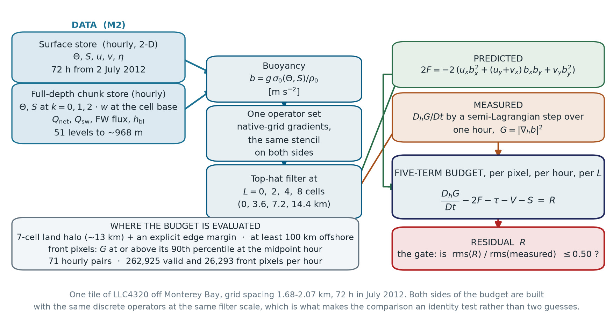

**Figure 1.** The analysis pipeline. Two hourly stores (surface fields; the top three levels plus fluxes) are combined into buoyancy and velocity, filtered identically with a top-hat of width $L = 0, 2, 4, 8$ cells, and passed through one shared native-grid operator set. The left arm predicts $2F$ at the midpoint time of each hourly pair; the right arm measures $D_hG/Dt$ by a semi-Lagrangian step. Three further measured terms complete the five-term budget. Mask: a 7-cell land halo plus a 7-cell tile-edge margin, at least 100 km offshore; front pixels are $G$ at or above its 90th percentile at the midpoint time.

### 3.1 One operator set, both sides

A comparison in which the two sides use different stencils or filters manufactures a mismatch. Both sides are computed from the same raw fields through the same gradient operators and the same filter, and $G$ is formed from the *same* $b_x, b_y$ that enter $F$: the repository's own front indicator uses a different stencil and is 0.91× the component form on this tile, which would bias every comparison before any physics.

### 3.2 The measured side: a semi-Lagrangian step

The material derivative is measured by one Lagrangian difference,

$$
\frac{D_hG}{Dt} \approx \frac{G(\mathbf{x}, t + \Delta t) - G(\mathbf{x}_d, t)}{\Delta t}, \qquad \Delta t = 1\ \mathrm{h},
$$

where the departure point $\mathbf{x}_d$ is found by iterated midpoint integration of the time-centred velocity. Displacements are typically 0.3–0.4 cells per hour and reach 2.27 cells. Buoyancy, not $G$, is interpolated — at cubic order, onto the gradient stencil centred at the departure point — because interpolating $G$ itself is biased low at maxima. $F$ is evaluated, and front pixels are selected, at the trajectory **midpoint time**, so that neither axis shares an endpoint's error with the other. An **Eulerian** estimate $\partial_t G + \mathbf{u}\cdot\nabla G$ is computed as an independent cross-check.

### 3.3 Coarse-graining and the sub-filter term

Both $b$ and $(u, v)$ are low-pass filtered identically — a normalised top-hat of full width $L$ cells — before anything is computed. Writing the filter as an overbar and $\sigma = \overline{\mathbf{u}\cdot\nabla b} - \bar{\mathbf{u}}\cdot\nabla\bar b$ for the sub-filter advection, the budget for $\bar G$ acquires a **sub-filter term** $\tau = -2\,\nabla\bar b\cdot\nabla\sigma$ (s$^{-5}$). Because the full fields are available it is computed explicitly at each $L$, so the sweep is a scale-transfer diagnostic in which the budget must close at each $L$ separately. The term is identically zero at $L = 0$, and the model's own implicit dissipation is never in it — at every $L$ that stays in the residual.

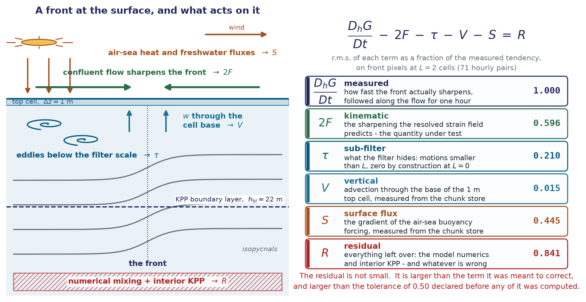

**Figure 2.** A cross-section through a surface front, each process colour-matched to its term in the five-term budget. Convergent flow sharpens the gradient ($2F$); eddies below the filter scale transfer gradient variance across the cut-off ($\tau$); the free surface and the 1 m top cell reintroduce a tilting term ($V$); sun, wind and freshwater act through the top cell ($S$) and are mixed through the ~22 m boundary layer; the advection scheme dissipates at the grid scale and the mixing scheme acts in the interior — what remains in $R$. The amplitudes printed are the measured ones of §5.2.

### 3.4 Masks, pixels and statistics

Land is stored as NaN; a 7-cell dilated land halo (about 13 km) and a 7-cell tile-edge margin are applied before any differencing. Primary statistics are restricted to **at least 100 km offshore**, which excludes the inner upwelling zone. The pool is 262,925 valid pixels per hour; **front pixels** are those with $G$ at or above its 90th percentile at the midpoint time — 26,293 per hour, 1,866,803 pooled over 71 pairs. Pixels inside a front are not independent, so every interval is a **block bootstrap** over contiguous 32 × 32-cell blocks crossed with hour, never over pixels; on a synthetic autocorrelated field the block interval is 15.2× wider than the pixel one.

### 3.5 The pre-declared null, and the tolerances

The design stated in advance what would make the study a null result: (1) the residual comparable to $2F$ at all filter scales, so that the budget does not close; (2) the measured-versus-predicted relation indistinguishable from the discrete-null baseline; (3) the residual tracking neither $\nabla^4 b$ (numerical diffusion) nor the boundary-layer depth (forcing), so that no diabatic signal can be isolated; or (4) the discrete null itself failing at $1 \pm 0.05$. In any of these cases the conclusion is **methodological**, not a claim about ocean fronts.

The tolerances were fixed on 7 October 2026, three days before the sweep existed, and are held as constants in the code that judges them. **Criterion 1 (closure):** on front pixels, per $L$, $\mathrm{rms}(R)/\mathrm{rms}(D_hG/Dt) \le 0.50$ — equivalently an explained fraction of at least 0.75 — and the residual's regression coefficient on $2F$ within $\pm 0.10$; judged at $L \ge 2$, with $L = 0$ reported but not gated, since its sub-filter term is zero by construction. **Criterion 2:** the Eulerian estimate regressed on the semi-Lagrangian one within 0.85–1.15 with correlation at least 0.90, at $L \ge 2$. **Criterion 3:** the filter sweep interpretable, with $\tau$ explicit.

### 3.6 Finding and tracking fronts as objects

For the object-level analysis (§9), fronts were found on $G$ at $L = 0$ at each of the 71 midpoint times, inside the same analysis mask, with the repository's front finder in its production configuration (a local 85th-percentile threshold in a 64-cell window, sharpened and de-spurred to one-pixel-wide skeletons, labelled by 8-connectivity). Each front was then followed from the middle of the window in both directions. The repository's tracker predicts where a front will be by extrapolating its centroid at constant velocity; the **flow-informed** tracker built here predicts it by carrying the front's pixel mask with the model's own surface velocity — the same trajectory integrator as §3.2 — and adds the overlap between that prediction and each candidate to the matching score. Labels are never interpolated; only the binary mask is advected.

### 3.7 Scale and cost

One tile (720 × 720 cells), a 72-hour window from 2 July 2012 00:00 UTC, 71 usable hourly pairs. The budget sweep is 284 pair-budgets in 0.50 h of single-core compute; the object analysis is 71 minutes. Every figure in this report is redrawn by one command from the stored products.

---

## 4. What the earlier milestones established

**M0 — trust before scale.** First contact with the data overturned several first-draft assumptions: land is NaN rather than zero; the model's surface vertical velocity is $d\eta/dt$ (correlation 0.994 with the centred hourly difference of surface height $\eta$), not zero, which rewrote §2.2; the grid spacing is 1.68–2.07 km on a face rotated by 90°; the rotation terms are identically zero. The load-bearing finding is the 0.91× stencil mismatch of §3.1.

**M1 — the operators, and the discrete null.** Six validation tests were built before any science. The decisive one is the **discrete null**: a tracer is advected one hour by our own semi-Lagrangian step, so that the truth satisfies our discrete advection exactly, and the measured $D_hG/Dt$ is regressed on $2F$. The first attempt failed at 0.758 on the real tile; the diagnosis was that the semi-Lagrangian difference measures the commutator of the gradient stencil with advection, which the chain-rule form of $F$ does not represent. With a discretely consistent $F$ and a cubic departure velocity the null passes at **0.981 [0.970, 0.994]** (Figure 3). The interval excludes one: the 2 % shortfall is the real velocity's grid-scale structure, and it is why any regression coefficient in this project is read against 0.981 and not against unity. A finite-volume variant with the model's own advection scheme as truth put the model-advection systematic at $-0.006 \pm 0.025$ (band 0.954–1.003). The planning-stage risk that interpolation bias might be 25–80 % of the signal was measured instead at 0.28–1.0 % of $G$ per hour at cubic order — small, but signed.

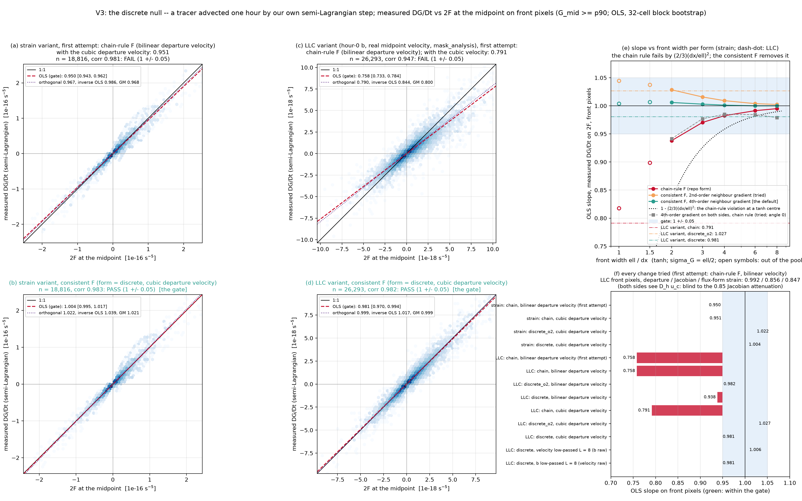

**Figure 3.** The discrete null test. With the model's advection replaced by our own exact semi-Lagrangian step, the measured $D_hG/Dt$ regressed on the predicted $2F$ gives 0.981 [0.970, 0.994] on front pixels of the real tile, after the operator change the first attempt forced. A synthetic test: no filter scale applies, and the mask is the test's own.

**M2 — the data.** Both hourly stores were pulled for all 72 hours with no gaps and are bit-identical where they overlap. Re-running the discrete null across the window gives **0.972 ± 0.020** over 71 pairs, carried beside the baseline as a temporal systematic. Two caveats for diurnal arguments: the air–sea forcing is six-hourly and linearly interpolated, and the near-surface warm layer is 0.01 K, not the 0.1–0.3 K the design anticipated.

---

## 5. The budget, term by term

### 5.1 The gate

Criterion 1 fails at every gated scale, and not marginally.

| $L$ (cells) | residual / measured | explained | residual on $2F$ | verdict |
|---|---|---|---|---|
| 0 | 0.813 | +0.344 | +0.440 | not gated; fails |
| 2 | 0.841 | +0.301 | +0.447 | **fails** |
| 4 | 0.898 | +0.209 | +0.462 | **fails** |
| 8 | 1.042 | −0.051 | +0.529 | **fails** |

against 0.50 / 0.75 / ±0.10. Per pair, the median residual ratio is 0.831 / 0.861 / 0.910 / 1.048 with a minimum of 0.715 / 0.714 / 0.731 / 0.824 — **0 of 71 pairs** reach 0.50 at any $L$. Figure 4 shows one hour: the residual carries as much spatial structure as either side of the comparison.

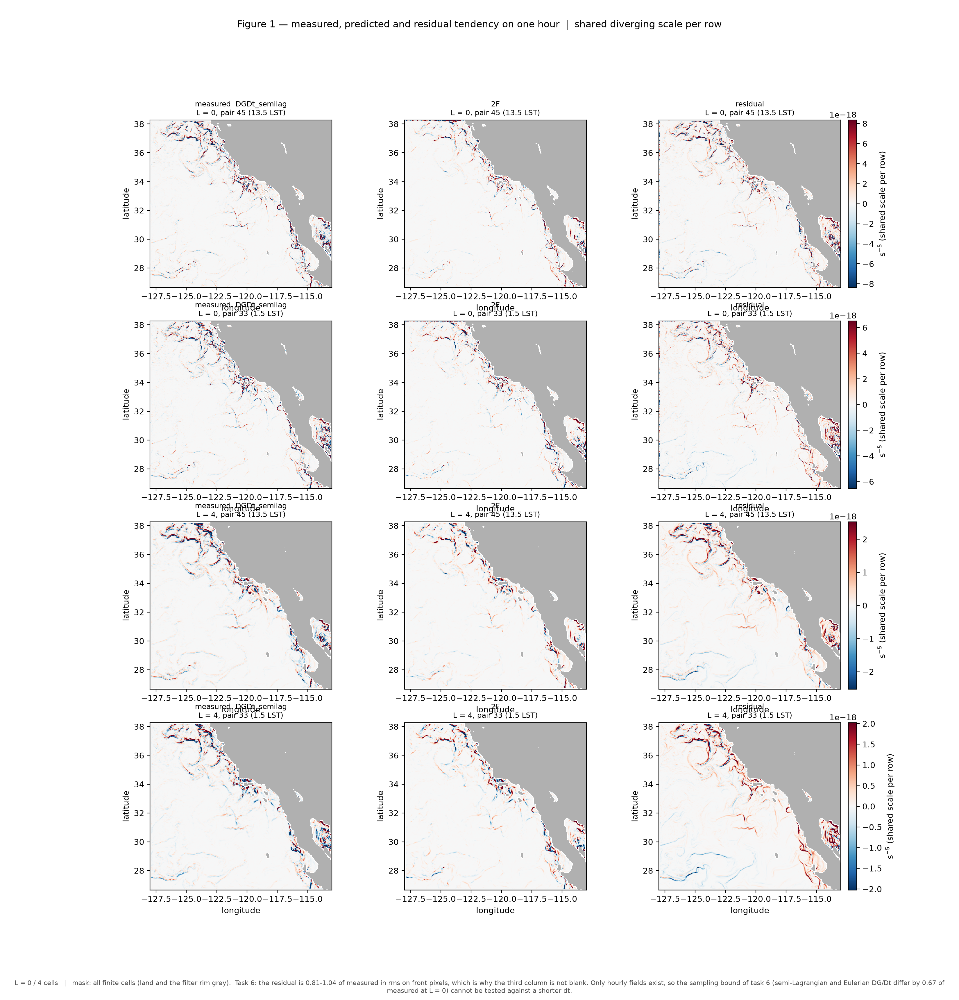

**Figure 4.** Maps of the measured sharpening rate $D_hG/Dt$ (left), the predicted $2F$ (centre) and the residual $R$ (right) for one hourly pair, at $L = 0$ and $L = 4$, at 13:30 and 01:30 local solar time, on a shared diverging scale. All finite cells are drawn; land and the filter rim are grey. The two sides share the pattern of the fronts, but the residual column retains structure of the same amplitude.

### 5.2 The five terms and their relative sizes

As a fraction of the measured tendency's r.m.s. on front pixels:

| term | $L = 0$ | $L = 2$ | $L = 4$ | $L = 8$ |
|---|---|---|---|---|
| kinematic $2F$ | 0.521 | 0.596 | 0.639 | 0.653 |
| sub-filter $\tau$ | 0.000 | 0.210 | 0.353 | 0.488 |
| vertical $V$ | 0.017 | 0.015 | 0.015 | 0.016 |
| surface flux $S$ | 0.355 | 0.445 | 0.568 | 0.795 |
| residual $R$ | 0.813 | 0.841 | 0.898 | 1.042 |
| residual with no $V$ or $S$ | 0.739 | 0.728 | 0.713 | 0.685 |
| residual with $S$ spread over $h_{\rm bl}$ | 0.738 | 0.725 | 0.711 | 0.684 |

All five terms are measured. The sixth row is the **two-term residual** — what the budget would show with no full-depth data at all — and it is *smaller* than the full residual at every $L$: adding two measured physical terms made the budget worse. The seventh row is the declared sensitivity of §7.3: with the surface flux spread over the boundary-layer depth instead of the top cell, the term's magnitude is corrected and the residual returns to the two-term value. Neither form closes the budget.

The sub-filter term reproduces the M1 one-hour pilot over all 71 pairs: as a fraction of $2F$ it is 0 / 0.353 / 0.552 / 0.748, anti-correlated with $2F$ at about $-0.55$ to $-0.59$. It opposes the resolved kinematic term and grows with the filter scale; criterion 3 is met. The vertical term is 1.5–1.7 % of the measured tendency.

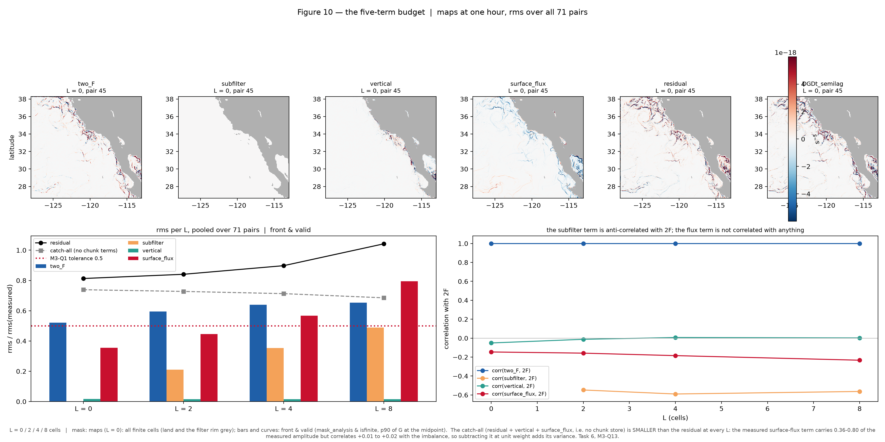

**Figure 5.** The five-term budget. Top: each term and the measured tendency at one hour, $L = 0$, all finite cells. Bottom left: the r.m.s. of each term over the measured tendency's per filter scale, pooled over 71 pairs on front pixels, with the 0.50 tolerance, the residual (black) and the two-term residual (grey, lower at every scale). Bottom right: each term's correlation with $2F$.

### 5.3 One front, followed as water

A pool of 1.87 million pixels cannot be seen. One strong, persistent filament — a near-zonal front at 37.0–37.1 °N, 161 km offshore — was therefore followed on its own. At 2012-07-03 06:00 UTC every front pixel in an 11-cell corridor across it became a parcel, 450 in all, and the parcels were carried 24 hours forward and backward by the model's velocity through the budget's own integrator. No front finding enters. A parcel started at the departure point the budget's backward map gives for a grid point returns to that point to a median $5.3 \times 10^{-4}$ cells; and the rate differenced along the trajectory agrees with the budget's stored measured tendency at correlation 0.901 with an r.m.s. difference of 0.443 of its amplitude — two estimates of the same rate half an hour apart, the sampling limit of §7.1 sighted independently.

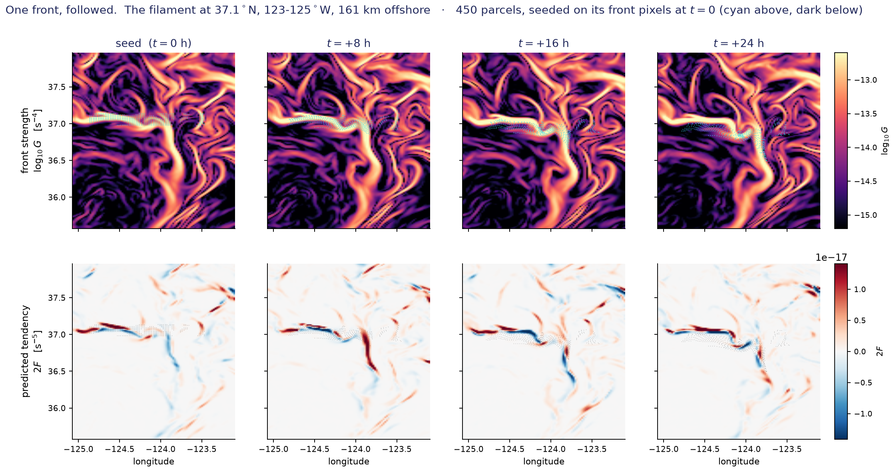

**Figure 6.** The followed front, $L = 0$. Top row: $\log_{10} G$ at the seed time and at +8, +16 and +24 hours, with the 450 followed parcels in cyan. Bottom row: the predicted tendency $2F$ on the same frames with the parcels as dark dots. The $2F$ panels show the strain dipole that straddles the front.

Along the trajectory the median $G$ is $1.14 \times 10^{-14}$ s$^{-4}$ a day before the seed, $7.95 \times 10^{-14}$ at the seed and $1.55 \times 10^{-14}$ a day after — a factor 0.19 over the forward day. Much of that is selection: parcels chosen because their $G$ is large now must weaken afterwards whatever the physics does, and an unselected control of 2,500 parcels changes by a factor 0.89 over the same day. The claims that do not depend on the selection are these. Integrating the predicted tendency along the parcels from the seed gives $8.47 \times 10^{-14}$ at +24 h against the observed $1.55 \times 10^{-14}$: the kinematic prediction accounts for −0.08 of the observed change. Hour by hour, $2F$ is positive at 19 of 24 intervals after the seed while the measured tendency is positive at 3 of 24, and yet the two correlate at +0.71. And the r.m.s. budget of this one front at $L = 0$ reproduces the pooled budget term by term:

| term | this front | all 71 pairs |
|---|---|---|
| kinematic $2F$ | 0.502 | 0.521 |
| vertical $V$ | 0.011 | 0.017 |
| surface flux $S$ | 0.295 | 0.355 |
| residual $R$ | **0.737** | **0.813** |

The aggregate result is not an average washing out a well-behaved individual case.

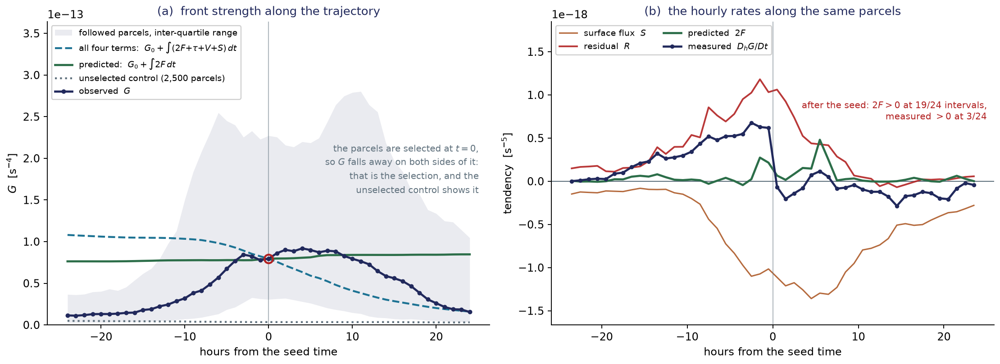

**Figure 7.** Strength and rates along the trajectory, $L = 0$, the 450 followed parcels. (a) The median $G$ against hours from the seed, with the inter-quartile range, the unselected control, and the two integrated predictions. (b) The hourly rates along the same parcels — measured, predicted $2F$, residual and surface flux.

**The surface-flux term on this front.** The four measured terms integrated together land at $1.59 \times 10^{-14}$, 0.99 of the observed change — but that agreement is the surface-flux term's mean and nothing else. The parcel-median $S$ is negative at 24 of 24 forward intervals: the heating favours the dense side of this filament. Integrated from the seed, $S$ alone accounts for +1.08 of the observed change and the three other terms together for −0.08; re-seeding the case twelve hours earlier moves the four-term figure to +0.63, so it is not robust. Pointwise, on the parcels hour by hour, $S$ correlates with the imbalance it should explain at only +0.141. A term that is the right sign and size on average and uncorrelated with the imbalance hour by hour is the pooled finding of §7.2 stated on one front.

**What the parcels do.** The front is not a material line. At the seed the parcels move at 0.21 m/s, mostly *across* the 3.8 km front (0.179 m/s across, 0.081 m/s along), into a southward jet. Following them (fractions of the 450 parcels; an unselected control sits at 0.26–0.28 throughout):

| hours after seed | on a front pixel | on a pixel that was front at the seed | $G / G_{\rm seed}$ along the parcels | seed pixels still front; their $G / G_{\rm seed}$ |
|---|---|---|---|---|
| +8 | 0.80 | 0.76 | 1.26 | 0.83; 0.92 |
| +16 | 0.68 | 0.46 | 0.71 | 0.70; 0.67 |
| +24 | 0.55 | 0.38 | 0.30 | 0.70; 0.68 |

The gradient pattern moves 4 km in sixteen hours while the water moves 21 km across it. **The front is a standing feature of the flow, fed by cross-front convergence**, and the fivefold "weakening" along the parcels is the water leaving a convergence zone; the front at its own location loses about a third. This bears on every day-long construction in the report — the integrals above and those of §9 — and not on the hourly gate, whose step is under half a front width and whose pixel pool is re-selected every pair.

### 5.4 Alternatives ruled out

The failure is not a front-selection or edge artefact: the front threshold at the 80th and 95th percentiles moves the residual ratio by less than 0.01, selecting on the previous hour's gradient or on persistence gives 0.810 at the grid scale against 0.813, and a 13-cell edge margin moves it by less than 0.02. It is not an interpolation-order artefact (§7.1). It is not a sign error in $V$ or $S$: flipping either makes the residual worse. Selecting pixels on strain rather than on gradient lowers the residual by 0.03–0.10 without closing it. Bootstrap blocks of up to 24 hours widen the intervals up to fourfold without touching the margins.

---

## 6. The slope, and what it is read against

The design called for the regression slope of the measured tendency on $2F$, by every estimator, quoted against the discrete-null baseline rather than against one. Three things are stated here; the slopes themselves are not.

**The baselines.** The discrete-null baseline is **0.981 [0.970, 0.994]** (§4). Beside it stand the model-advection systematic band from the finite-volume null, 0.954–1.003, and the temporal systematic over the window, 0.972 ± 0.020. A slope merely below one is evidence of nothing; a slope inside these bands is indistinguishable from an exactly adiabatic tracer analysed by this pipeline.

**The sampling-consistency slopes (criterion 2).** The Eulerian estimate regressed on the semi-Lagrangian one gives 0.691 / 0.813 / 0.891 / 0.939 with correlation 0.758 / 0.913 / 0.969 / 0.984 at $L = 0 / 2 / 4 / 8$. The criterion passes at $L = 4$ and $8$ and fails at $L = 2$ on the slope alone. These compare two estimates of the same left-hand side; they measure the sampling and are not efficiencies.

**The measured-versus-predicted slopes (criterion 4).** The machinery — ordinary, trimmed and orthogonal regression and a ratio estimator, with one-hour and three-hour block-bootstrap intervals, both forms of $F$, per front-width bin, every value relative to 0.981 — was built and run. Its slopes are held in the closure summary under a flag marking them unquotable, because the budget they would be read against did not close, and they are withheld from the body of this report. By decision of the principal investigator they are printed once, in **Appendix C**, with the figure they belong to, for a reader who wants to see the shape of the cloud; the second null condition is judged there and nowhere else.

---

## 7. Why the budget does not close

Because the two causes depend on $L$ in opposite senses, the sweep separates them.

### 7.1 Cause one: hourly sampling at the grid scale

Three estimates of the *same* quantity — $D_hG/Dt$ on the same hourly pair — are compared, and beside them the residual an offline passive tracer leaves when run through the entire pipeline. The tracer was advected for 72 hours by the model's own hourly velocities with the model's advection scheme; its true budget is the strain term plus the sub-filter term plus the scheme's dissipation and nothing else.

| $L$ | r.m.s. gap, cubic vs quintic interpolation | r.m.s. gap, Eulerian vs semi-Lagrangian | tracer residual (the floor) | model two-term residual |
|---|---|---|---|---|
| 0 | 0.108 | **0.672** | **0.870** | 0.739 |
| 2 | 0.053 | 0.408 | 0.713 | 0.728 |
| 4 | 0.027 | 0.252 | 0.544 | 0.713 |
| 8 | 0.021 | 0.183 | 0.408 | 0.685 |

(gaps and residuals as fractions of the measured amplitude). At $L = 0$ two defensible estimates of the tendency differ by 0.672 of its amplitude, and interpolation order is not the reason (0.108). The tracer makes the inference a measurement: with no vertical term, no surface flux, no mixing and no sub-hourly flow, the pipeline's own floor is 0.870 — as large as the model's imbalance. Hourly sampling plus the advection scheme's dissipation produce the grid-scale failure with no physics at all. Whether the velocity within each hour is interpolated or held constant changes the tracer residual by 0.0006 at most. The caveat: the tracer's fronts sharpen with nothing to oppose them, which raises its floor at the grid scale.

At the filtered scales the floor falls to 0.408 at $L = 8$ while the model's two-term residual is still 0.685: the model exceeds the floor by 0.169 at $L = 4$ and 0.277 at $L = 8$, and its residual is correlated with $2F$ (+0.440 to +0.529) where the tracer's is not (−0.024 to −0.072). **At the filtered scales the failure is not only sampling.** Only hourly output exists for this simulation, so the part of cause one that lies in the model's own sub-hourly evolution cannot be tested.

### 7.2 Cause two: the surface-flux term is near-orthogonal to the imbalance

Adding a measured term to a budget should reduce the residual. For each term the test is the multiplier that would *minimise* the residual: $+1$ for a correct term, $-1$ for a sign error, near zero for a term that does not project onto what is missing. For $2F$ the answer is $+1.44$; for $V$, $+0.82$ — real but negligible; for $\tau$ at $L = 8$, $+0.59$ — real, overstated at unit weight, and helpful. For $S$ the optimal multiplier is **$+0.048$** at $L = 0$ and $+0.009$ at $L = 8$, with correlation $+0.022$ and $+0.010$. The term is not sign-flipped; it does not project onto the imbalance while carrying 0.36–0.80 of the measured amplitude, and subtracting a large uncorrelated quantity at unit weight adds its variance. That is the whole of the residual's growth with $L$ and of the inversion in §5.2. Split into its non-solar, shortwave and freshwater parts and fitted with three free multipliers, the term still leaves 0.995–0.998 of the imbalance's r.m.s.: there is no hidden cancellation between the parts.

### 7.3 The depth scale of the surface-flux term — a declared sensitivity

The multiplier on $S$ has a physical reading. The value that minimises the residual, $+0.0476$ at $L = 0$, matches $\Delta z / \mathrm{median}(h_{\rm bl})$ = 0.0451 to 5 %, where $h_{\rm bl}$ is the boundary-layer depth (median 22.2 m on front pixels). The mixing scheme spreads the surface flux through the boundary layer within the hour, so the hourly-mean tendency of the top cell is set by $h_{\rm bl}$, not by the cell thickness. On the principal investigator's decision the term was recomputed with $h_{\rm bl}$ as the divisor and carried as a **declared sensitivity**, the 1 m form remaining primary. The rescaled term's optimal multiplier moves to $+1.93 / +2.03 / +1.47 / +0.64$ — the right size — but its correlation with the imbalance rises only to $+0.04$ to $+0.09$, and the residual with it is the seventh row of §5.2. The depth scale is not a measurement; settling it changes the term's amplitude, not its projection, and so cannot change the verdict.

### 7.4 Is the residual skill or noise?

Against three "no skill" constructions — the measured tendency of one hour paired with the predicted terms of another hour, of the hour a day later, or of the same hour shifted sideways — the real residual is lower at every scale: shuffled in time it is 1.081 / 1.098 / 1.127 / 1.238 against the real 0.813 / 0.841 / 0.898 / 1.042, a separation of 39 / 29 / 21 / 20 standard deviations of the shuffled distribution. The budget has skill. One exception is recorded: at $L = 8$ the sideways shift does not separate from the real residual.

### 7.5 A second tile

The western neighbour tile — the open North-East Pacific, no land — was given the surface-only budget for the same 72 hours. Its two-term residual is 0.878 / 0.882 / 0.870 / 0.851, with the same Eulerian gap at the grid scale: **cause one is not Monterey's.** The regimes part at the filtered scales: the open-ocean imbalance does not fall with $L$ and is uncorrelated with $2F$. An internal-wave field aliased into hourly differences of a weak gradient would look like that; it is a hypothesis that hourly surface fields cannot test, not a finding. No five-term budget exists for the second tile, because no full-depth data were transferred for it.

---

## 8. Numerical versus diabatic: the claim withdrawn

This is the section in which a headline claim — that the gap between measured and predicted sharpening is diabatic damping of fronts — would have been earned. It is withdrawn.

If the residual were dominated by numerical diffusion it should track the biharmonic of buoyancy, $\nabla^4 b$; if by air–sea forcing, the boundary-layer depth $h_{\rm bl}$. The partial correlation of $R$ with each, controlling for the other, on front pixels:

| $L$ | $\mathrm{partial}(R, \nabla^4 b \mid h_{\rm bl})$ | $\mathrm{partial}(R, h_{\rm bl} \mid \nabla^4 b)$ |
|---|---|---|
| 0 | **+0.144** | +0.056 |
| 2 | **+0.134** | +0.090 |
| 4 | +0.100 | **+0.146** |
| 8 | +0.076 | **+0.219** |

The two cross over between $L = 2$ and $L = 4$ — the ordering one would expect if numerics dominated at the grid scale and forcing at the filtered scales — but **neither ever exceeds 0.22**. No diabatic signal can be isolated from this residual at any scale (Figure 8). The residual is therefore not called diabatic anywhere in this report: with the vertical and surface-flux terms measured, it is numerical diffusion plus interior mixing plus, at $L = 0$ and $2$, a sampling error as large as itself.

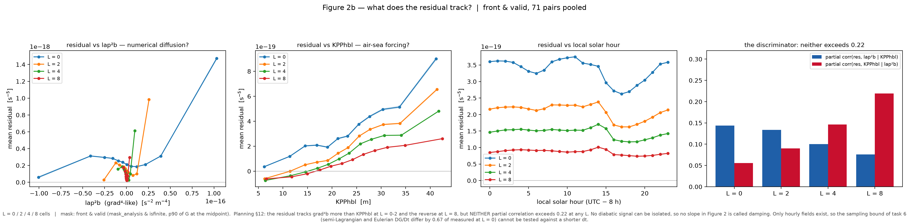

**Figure 8.** The discriminator, front pixels, 71 pairs pooled, $L = 0, 2, 4, 8$. From left: the mean residual binned on $\nabla^4 b$; on the boundary-layer depth; on local solar hour; and the two partial correlations per filter scale, neither above 0.22.

The diurnal composite does not rescue the claim. The design expected the residual to change sign over the day. It does not: it is positive at every local hour, with a 34 % modulation at $L = 0$ and a minimum near 17 local solar time (Figure 9). That expectation is recorded as unmet. A residual of one sign is not damping either: the imbalance before the surface-flux term is subtracted has a mean within ±0.03 of zero at every local hour, while the surface-flux term's own mean is frontolytic at every hour, so the residual's positive mean is the negative of that term's mean, not a missing process. The boundary-layer depth itself shows the expected phase — minimum 15.6 m at 12 and maximum 26.5 m at 02 local solar time — so the forcing signal is in the data; it is not detectable in the residual. With 72 hours the window holds 3 diurnal, 3.6 inertial and 5.8 semidiurnal tidal cycles, which are not separable; Figure 9 is indicative, not conclusive.

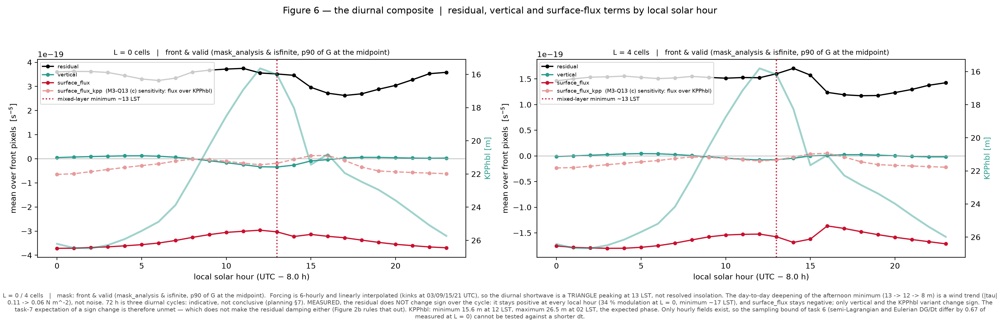

**Figure 9.** The diurnal composite on front pixels at $L = 0$ (left) and $L = 4$ (right): the mean residual, vertical term and surface-flux term by local solar hour, the surface-flux term in its boundary-layer form (dashed), and the boundary-layer depth (right axis, inverted). The residual does not change sign; the surface-flux term is negative at every hour.

---

## 9. Per-front results

M3's pixels are a statistical pool. M4 asked the same question of front *objects*: found, tracked through the window, and reconciled against the prediction along their own water. All of it is at $L = 0$, on the analysis mask of §3.4, and none of it depends on the budget having closed.

### 9.1 The fronts, and whether the flow changed the tracking

Each hour holds 248–311 fronts (median 275) covering 8,545–9,115 pixels; a fraction 0.60–0.66 of those pixels are also front pixels by the 90th-percentile rule of §3.4, a local and a global threshold selecting overlapping but different sets. The ten largest fronts at the middle of the window (121–307 pixels) were tracked in both directions. With the flow-informed tracker **all ten are found at 71 of 71 hours — 70 hours, no gaps.**

**Did the flow-informed prediction change which fronts were linked? Yes, on 3 of 10 tracks.** Of the links both trackers made, 71 differ, and the flow-informed tracker made 51 links that the centroid tracker left as gaps; none the other way. Seven tracks are identical link for link. At every one of the 71 differing links the flow-informed tracker chose the larger front (median 159 pixels against 38). The centroid tracker lost two of the ten fronts for part of the window (found at 49 and 42 of 71 hours). The mechanism is a split: when a front breaks in two, its centroid jumps, the constant-velocity extrapolation flings the next prediction off the front, and the tracker settles on a fragment; a mask carried by the fluid does not care where the centroid went.

The gain is not the advection itself. At hourly cadence the front pixels move a median 0.35 cells per hour, and the advected mask overlaps the next hour's fronts slightly *less* well than no advection at all (overlap 0.759 against 0.774; better on 0 of 70 hourly transitions, though better than advection with the wrong sign on 70 of 70). A sub-cell displacement of a one-pixel skeleton is persistence plus rounding. What the flow supplies is a *material prediction* that survives a split.

### 9.2 Tracking quality

Per link, the distance between the centroid the tracker chose and the centroid the flow predicts is 2.18 cells in the median with a long tail (90th percentile 17.1). The tail is topology, not motion: on the 532 links with no split or merge the median is 1.63 cells; on the 168 flagged links it is 15.5. Mask to mask, the chosen front's pixels lie within one cell of the advected prediction on 72 % of links and within two on 85 %, and the chosen front is the prediction's majority overlap on 99.0 % of links. **168 of 700 links are flagged — 93 splits and 85 merges**; none was dropped. The tracks follow the fluid at the level of the labelled object (Figure 10). The diagnostic is per link, so it cannot detect a tracker that follows the wrong fragment consistently; the comparison of §9.1 is the check on that.

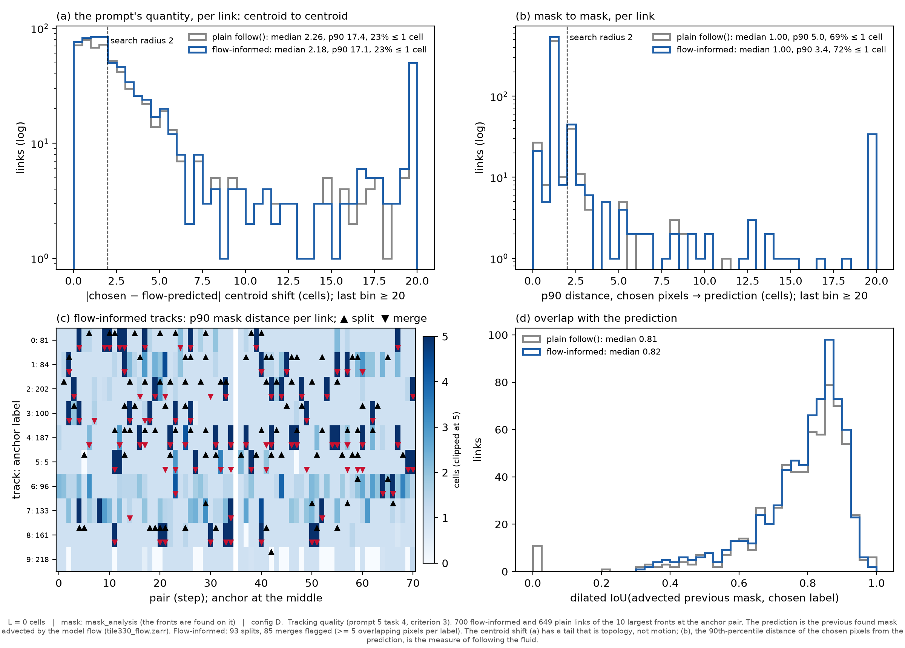

**Figure 10.** Tracking quality, $L = 0$, fronts found on the analysis mask. (a) Per link, the distance between the chosen and the flow-predicted centroid, for the centroid tracker (grey) and the flow-informed tracker (blue). (b) The 90th-percentile distance of the chosen front's pixels from the prediction. (c) The same distance per link along each of the ten flow-informed tracks, with splits (upward triangles) and merges (downward triangles). (d) The overlap of the chosen front with the prediction.

### 9.3 Reconciling a front's strength with its water: criterion 4, both ways

A front's mean $G$ at hour $t$ and at hour $t+1$ are means over *different pixel sets*, and their difference is not a material rate. The reconciliation therefore carries each front pixel forward as a parcel and compares two estimates of the same material rate on those parcels: the change of mean $G$ along them, and the budget's stored measured tendency averaged over them. The tolerance was declared before the run from the followed front of §5.3: correlation at least 0.8 and r.m.s. difference at most 0.5 of the amplitude, pooled over links.

| front pixels; time difference | links | correlation | r.m.s. ratio | pooled | tracks passing |
|------------|---|---|---|---|---|
| skeleton; forward (pre-registered) | 700 | −0.093 | 1.123 | **fails** | 0 of 10 |
| skeleton; centred | 690 | 0.822 | 0.695 | fails | 0 of 10 |
| one-cell band; forward | 700 | 0.925 | 0.440 | passes | 4 of 10 |
| one-cell band; centred | 690 | **0.953** | **0.415** | **passes** | 5 of 10 |

Criterion 4 failed as pre-registered, on the one-pixel skeleton with a forward difference (correlation −0.093, r.m.s. ratio 1.123), and is met only on the construction the principal investigator then chose with the failure in view — the front widened by one cell on each side, with a centred difference (0.953 and 0.415 against 0.8 and 0.5; 5 of 10 tracks individually). Both verdicts stand in the record.

The failure is a **registration artefact**, found by elimination and then reproduced. The stored tendency interpolates $G$ at the departure point and reads it at the arrival cell; a forward matched rate does the reverse. On a ridge one cell wide the interpolated value always sits below the maximum, so the two carry opposite biases. A synthetic Gaussian ridge 0.8–1 cell wide, translated rigidly by 0.35–0.5 cells per hour with no growth, gives $-1.6$ to $-5.6$ % of the ridge maximum per hour by the forward rate and $+0.6$ to $+1.0$ % by the stored construction where the truth is zero; a centred rate gives zero, and on a one-cell band all three agree to 0.8 %. The real fronts are that sharp. On the tracked skeletons the stored tendency is positive on 64 % of pixels, against 54 % on the 90th-percentile pool of §5 and 50 % on all valid pixels.

Two contrasts are recorded with it. The difference of the fronts' own means between consecutive hours — the naive "front at $t$ against front at $t+1$" — differs from the material rate by a set-evolution term 5.2–7.0 times the material rate in r.m.s.: a mean over a changing pixel set is not material, as the design warned. And the 100 links flagged as splits or merges reconcile no worse than the rest.

### 9.4 One tracked front

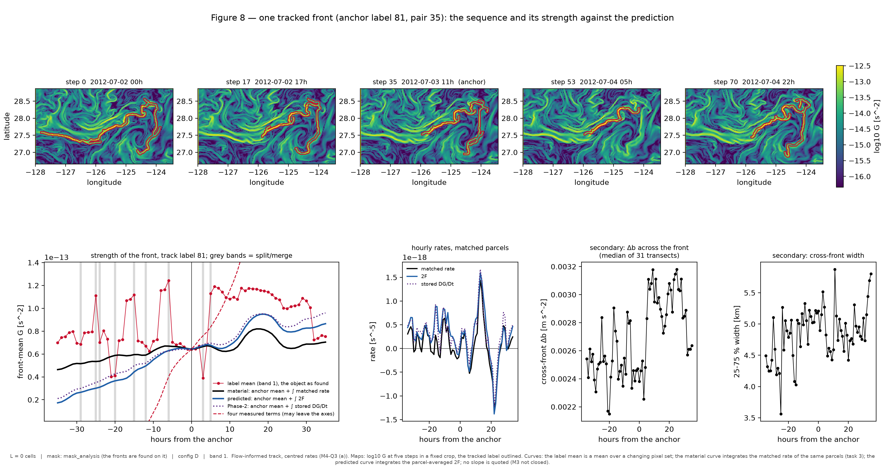

**Figure 11.** One tracked front — the largest at the middle of the window, a 307-pixel filament near 28 °N — at $L = 0$, found on the analysis mask, strengths on the one-cell band. Top: $\log_{10} G$ at five hours with the tracked front outlined. Bottom, from left: the front's strength — the mean over the object as found (red), the material curve integrating the matched rate (black), the curve predicted by $2F$ (blue), by the stored tendency (dotted) and by the four measured terms (dashed, leaving the axes) — with split and merge hours shaded; the hourly rates on the matched parcels; the buoyancy step across the front; and its width.

The object's mean strength jumps by factors of two at the splits and merges while the material curve does not. Over the window the material curve ends at $7.04 \times 10^{-14}$ s$^{-4}$ and the curve predicted by $2F$ at $8.65 \times 10^{-14}$, from a common $6.43 \times 10^{-14}$ at the anchor; the curve from all four measured terms ends at $2.74 \times 10^{-13}$, carried off by the surface-flux term — §7.2 seen on one front. $2F$ is positive on 81 % of hours and the matched rate on 58 %. Across the front the buoyancy step is $2.6 \times 10^{-3}$ m s$^{-2}$ and the width 4.9 km.

### 9.5 The population

Pooled over the ten fronts (690 links, intervals from a bootstrap over fronts and six-hour blocks of hours):

| quantity | value |
|---|---|
| fraction of hours frontogenetic, by the matched material rate | 0.64 [0.50, 0.77] |
| fraction of hours frontogenetic, by $2F$ | 0.81 [0.75, 0.88] |
| hours on which the two agree in sign | 0.78 [0.67, 0.86] |
| fronts with $\int 2F\,dt > 0$ over the window | 10 of 10 |
| fronts with a positive material change of $G$ | 7 of 10 |
| front width, median over all hours | 4.5 km (2.4 cells) |
| buoyancy step across the front, median | $1.56 \times 10^{-3}$ m s$^{-2}$ |

The kinematic prediction says "frontogenetic" more often than the fronts' own water does. Within a track, a front that strengthens narrows: width is anti-correlated with strength on all ten fronts. **Lifetime against mean frontogenesis is not a measurement here**: every track spans the whole window, so lifetime is the window (Figure 12b).

The contrast that matters is M3's finding at object level. Hour by hour on the band, the parcel-mean $2F$ and the matched rate agree closely — correlation 0.951 and amplitude ratio 1.008 pooled over the 690 links — which is a consistency check on front-mean rates, where averaging over some 700 parcels removes the per-pixel sampling noise, and is not an efficiency. Over 70 hours the same ten fronts give a material change that is 0.35, 0.96, 0.51, −0.84, 0.86, −0.11, 0.72, −0.45, 0.36 and 1.10 of the integrated prediction, none of which is an efficiency either: errors that average out from hour to hour do not cancel in the integral, and §5.3 showed that a day-long integral follows water that leaves the front.

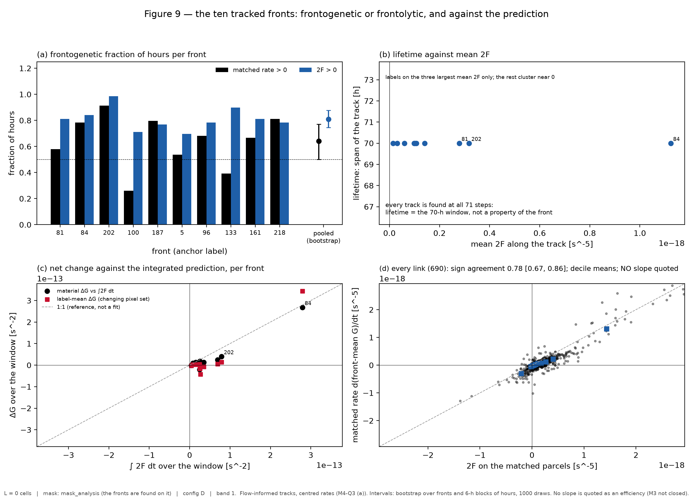

**Figure 12.** The ten tracked fronts, $L = 0$, found on the analysis mask, rates on the one-cell band. (a) The fraction of hours each front is frontogenetic by the matched rate and by $2F$, with the pooled values. (b) Lifetime against mean $2F$: degenerate, every track spanning the window. (c) The net material change of $G$ over the window against $\int 2F\,dt$ per front, with the change of the object's own mean. (d) Every link: the matched rate against $2F$ on the same parcels, with decile means and the one-to-one line as a reference; no line is fitted.

---

## 10. Limitations

- **The window.** 72 hours is 3 diurnal, 3.6 inertial and 5.8 semidiurnal cycles. Those bands are not separable, so the diurnal composite of Figure 9 is indicative, not conclusive. This is the strongest argument for extending to the full 504-hour series.
- **The offshore cut.** The 100 km cut excludes the inner upwelling zone where California Current frontogenesis is most vigorous, so every number here describes the offshore regime, not the California Current System. The tracked fronts are found on the same mask: the coastal zone's largest front — 1,179 pixels, three times the largest offshore — is neither budgeted nor tracked.
- **Tides.** LLC4320 tides are reported over-energetic. Reversible tidal strain pushes any measured-versus-predicted relation toward one and could hide a real weakening of fronts by mixing or forcing.
- **One region, one season, one 72-hour window.** Nothing here generalises beyond them. The second tile of §7.5 is a surface-only budget on the same dates.
- **The hourly cadence** is cause one of the non-closure. Two estimates of the same tendency differ by 0.672 of its amplitude at $L = 0$ and the pipeline's floor on a passive tracer is 0.870. Only hourly output exists, so the model's own sub-hourly evolution cannot be tested at a shorter interval.
- **The surface-flux term** is cause two. It is near-orthogonal to the imbalance in either depth form, and its depth scale is a declared sensitivity, not a measurement.
- **A registration bias on ridge cells.** The measured tendency interpolates at the departure point and reads a cell value at arrival, which biases it positive on the crest of a one-cell ridge: $+0.6$ to $+1$ % of $G$ per hour on a synthetic ridge where the truth is zero, and positive on 64 % of tracked skeleton pixels against 50 % of all valid pixels (§9.3). The 90th-percentile pool of §5 is larger and dilutes it; its size on that pool has not been measured.
- **The diurnal expectation was not met.** The residual is positive at every local hour. That is not damping; it is the surface-flux term's mean (§8).
- **Track lifetimes are the window.** Lifetime against mean frontogenesis is not a measurement.
- **Day-long integrals follow water, not fronts.** The followed front is a standing feature its water crosses in about sixteen hours (§5.3). The 24-hour and 70-hour integrals of §5.3 and §9 are therefore not budgets of a front.
- **Two defects in the front-finding and tracking package are described, not fixed.** In the finder, three faults are worked around on the caller's side (a required worker count; a failure on an empty skeleton; a hole-filling step that turns enclosed land into front), so the fronts of §9 are unaffected, but a user of the package's defaults would get different fronts. In the tracker, the centroid method loses its position check when its extrapolated reference leaves the tile, and then links to whatever lies nearest the tile corner; five links of the centroid tracker's results in §9.1–§9.2 are of this kind. Fixing it would improve the centroid tracker's numbers and narrow, not remove, the difference of §9.1; the flow-informed tracks never triggered it.
- **The second and fourth of the review's requests remain untestable**: sub-hourly evolution, for want of sub-hourly output, and a five-term budget on a second region, for want of a full-depth transfer.

---

## 11. What would have made this a null result, and whether it happened

The design named four conditions (§3.5). The verdict, condition by condition:

1. **The residual comparable to $2F$ at all filter scales, and the budget not closing: met.** The residual is 1.56 / 1.41 / 1.40 / 1.60 times $2F$ in r.m.s.; criterion 1 fails at every scale; 0 of 71 pairs reach the tolerance.
2. **The measured-versus-predicted relation indistinguishable from the discrete-null baseline: judged in Appendix C and nowhere else**, because the numbers it needs are withheld from the body of the report. The judgement there is that the condition is not met as written and is uninformative either way.
3. **The residual tracking neither $\nabla^4 b$ nor the boundary-layer depth, so that no diabatic signal is isolated: met.** Neither partial correlation exceeds 0.22 (§8).
4. **The discrete null unable to pass at $1 \pm 0.05$: not met.** It passes, at 0.981 [0.970, 0.994].

Two of the four conditions are met, and the first is decisive on its own. **This is a null result, and the conclusion is methodological: hourly surface fields at 2 km resolution cannot constrain the surface buoyancy-gradient budget in the summer offshore California Current.** The limiting factor is named twice over: at $L = 0$ and $2$ the hourly cadence, measured as the pipeline's own floor on a passive tracer; at $L = 4$ and $8$ a surface-flux term that does not project onto the imbalance, plus a strain-correlated excess over the floor that the open-ocean tile does not share. Nothing in the object-level analysis of §9 alters this: it shows the same budget failing on ten individual fronts over 70 hours while their hourly rates agree.

---

## 12. Options on record

The report recommends none of these; the decision belongs to the principal investigator.

- **A longer window.** The 504-hour series costs 3.58 h and 53 GB of budget compute against a 42-hour pull of the full-depth store. It would separate the diurnal, inertial and tidal bands and give track lifetimes meaning. It does not change the cadence, which is cause one.
- **Coarser filtering.** $L = 16$ requires a new analysis mask with a land halo and edge margin of at least 11 cells.
- **A different region or season, or the coastal zone.** Each re-opens a decision of record; the coastal zone holds the tile's largest front.
- **Measure the ridge-cell bias on the 90th-percentile pool.** About a day of work (§10).
- **Front-mean budgets.** §9.5 suggests that hourly rates averaged over a tracked front are far less noisy than per-pixel rates. A five-term budget on front means was not pre-registered and has not been run.
- **Stopping**, with the finding written up as it stands.

---

## Appendix A. Glossary

Units are given for every variable. The grid cell on this tile is 1.68–2.07 km.

**Physics**

| term | meaning | units |
|---|---|---|
| $b$ | buoyancy, $g\,\sigma_0(\Theta, S)/\rho_0$; repository sign convention (increases with density) | m s$^{-2}$ |
| $G$ | front strength, $|\nabla_h b|^2$; formed from the same $b_x, b_y$ as $F$ | s$^{-4}$ |
| $F$ | kinematic frontogenesis function (§2.1); $F = \tfrac{1}{2}DG/Dt$ adiabatically | s$^{-5}$ |
| $2F$ | predicted sharpening rate — always compared with $D_hG/Dt$, never $F$ | s$^{-5}$ |
| $D_hG/Dt$ | measured sharpening rate: the horizontal material derivative of $G$ along the surface | s$^{-5}$ |
| $B$; $B_{\rm sfc}$ | diabatic buoyancy source in $Db/Dt = B$; its surface-flux part in the top cell (§2.4) | m s$^{-3}$ |
| $\tau$; $\sigma$ | sub-filter term $-2\nabla\bar b\cdot\nabla\sigma$, zero at $L = 0$; sub-filter advection $\overline{\mathbf{u}\cdot\nabla b} - \bar{\mathbf{u}}\cdot\nabla\bar b$ | s$^{-5}$; m s$^{-3}$ |
| $V$ | vertical term: the finite-top-cell tilting term reintroduced by the discretisation (§2.2) | s$^{-5}$ |
| $S$ | surface-flux term, $2\nabla_h b\cdot\nabla_h \overline{B_{\rm sfc}}^{L}$: fluxes spread over $\Delta z$ (primary) or $h_{\rm bl}$ (sensitivity) | s$^{-5}$ |
| $R$ | residual, $D_hG/Dt - 2F - \tau - V - S$: numerical diffusion plus interior mixing, plus the measured side's sampling error | s$^{-5}$ |
| two-term residual | $R + V + S$: the residual with no full-depth data | s$^{-5}$ |
| imbalance | $D_hG/Dt - 2F - \tau - V$: what the surface-flux term should explain | s$^{-5}$ |
| $Q_{\rm net}$, $Q_{\rm sw}$, $F_w$ | net heat, shortwave and freshwater fluxes into the ocean; six-hourly forcing | W m$^{-2}$; W m$^{-2}$; kg m$^{-2}$ s$^{-1}$ |
| $f_{\rm sw}(h)$ | shortwave fraction absorbed within depth $h$; 0.521 for 1 m | — |
| $w$, $\eta$ | vertical velocity; free-surface height | m s$^{-1}$; m |
| $\Delta z$ | top-cell thickness, 1.0 m | m |
| $h_{\rm bl}$ | boundary-layer depth of the model's vertical mixing scheme (KPP); median 22.2 m on front pixels | m |
| $\nabla^4 b$ | biharmonic of buoyancy, the signature of scale-selective numerical diffusion | m$^{-3}$ s$^{-2}$ |
| $\delta$; $\zeta$ | horizontal divergence $u_x + v_y$; vertical vorticity $v_x - u_y$ (§2.5) | s$^{-1}$ |
| $\sigma_n$, $\sigma_s$; $|\sigma|$ | normal and shear strain, $u_x - v_y$ and $v_x + u_y$; strain magnitude $(\sigma_n^2 + \sigma_s^2)^{1/2}$ | s$^{-1}$ |
| $\theta$ | angle between $\nabla_h b$ and the compressional axis of the strain, in $[0°, 90°]$; $\theta < 45°$ is frontogenetic | ° |
| $f$ | Coriolis parameter, $6.80 \times 10^{-5}$ at 27.8 °N | s$^{-1}$ |
| $\Delta b$; front width | the buoyancy step across a tracked front; the distance over which $b$ rises from 25 to 75 % of that step | m s$^{-2}$; km |

**Method**

| term | meaning |
|---|---|
| $L$ | full width of the top-hat low-pass filter, in grid cells; swept over 0, 2, 4, 8 |
| semi-Lagrangian estimate | $[G(\mathbf{x}, t+\Delta t) - G(\mathbf{x}_d, t)]/\Delta t$ (§3.2); the primary measured side |
| Eulerian estimate | $\partial_t G + \mathbf{u}\cdot\nabla G$ from the same pair; the cross-check of criterion 2 |
| departure point $\mathbf{x}_d$; midpoint time | where the parcel arriving at $\mathbf{x}$ was one hour earlier; $t + \Delta t/2$, where $F$ is evaluated and front pixels are selected |
| front pixels; valid pixels | $G$ at or above its 90th percentile at the midpoint time inside the analysis mask (26,293 per hour); the analysis mask with finite values (262,925 per hour) |
| analysis mask | ocean, outside the 7-cell land halo, inside the 7-cell edge margin, at least 100 km offshore |
| discrete null; baseline | the M1 test with our own advection as truth; its result 0.981 [0.970, 0.994], against which any regression coefficient is read |
| block bootstrap | resampling over 32 × 32-cell blocks crossed with hour, never over pixels |
| explained fraction | $1 - \mathrm{var}(R)/\mathrm{var}(D_hG/Dt)$ |
| optimal multiplier | the coefficient on a term that minimises the residual: $+1$ correct, $-1$ sign error, ~0 irrelevant |
| partial correlation | correlation of $R$ with one candidate signature controlling for the other |
| tracer floor | the residual an offline passive tracer, advected by the model's hourly velocities, leaves in the full pipeline (§7.1) |
| no-skill control | the budget with measured and predicted terms taken from different hours or places (§7.4) |
| followed parcels; unselected control | the 450 front pixels of the seed corridor of §5.3 carried by the model's velocity; 2,500 parcels chosen without regard to $G$ |
| front (object); skeleton | a connected set of front-finder pixels at one hour; its one-pixel-wide form |
| track; link; anchor | one front followed through the window; the association of a front at one hour with a front at the next; the hour a track starts from (the middle of the window) |
| centroid tracker; flow-informed tracker | prediction by constant-velocity extrapolation of the centroid; prediction by advecting the front's mask with the model's velocity (§3.6) |
| split; merge | a link at which the predicted mask overlaps two or more fronts at the new hour; or the chosen front, carried back, overlaps two or more at the old one |
| matched parcels; matched rate | a front's pixels carried one hour by the flow; the change of mean $G$ along them per unit time — a material rate |
| one-cell band; centred difference | the front widened by one cell on each side; a rate from the hours before and after rather than from one side |
| set-evolution term | the difference between the change of a front's own mean and the matched rate: the effect of the pixel set changing |
| LST | local solar time (UTC − 8.0 h at the tile's longitude) |

**Data and code**

| identifier | meaning |
|---|---|
| tile 330; tile 329 | the 720 × 720-cell tile of the LLC4320 grid off Monterey Bay; its western, open-ocean neighbour |
| surface store; chunk store | hourly surface fields; hourly top-three-level fields and fluxes from the full-depth archive |
| derived stores | `tile330_derived_L{0,2,4,8}.zarr`: the per-pair budget fields at each $L$ |
| closure, figure and case summaries | `m3_closure_summary.json`, `m3_figs_summary.json`, `m3_case_summary.json`, `m3_case_sflux.json` |
| digging summaries | `m3_controls_summary.json`, `m3_case_controls.json`, `m3_term_tests_summary.json`, `m3_tracer_summary.json`, `m3_tile2_summary.json`, `m3_parcels_summary.json` |
| object summaries | `m4_find_done.json`, `m4_track_summary.json`, `m4_recon.json`, `m4_quality.json`, `m4_strength.json` |
| split summary | `slides_2F_36.json`: the divergence and strain rates of §2.5, recomputed from the stores by `py/slides_2F.py` |
| `measured`, `two_F`, `subfilter`, `vertical`, `surface_flux`, `residual` | the budget columns: $D_hG/Dt$, $2F$, $\tau$, $V$, $S$, $R$ |
| `mask_analysis`, `front & valid`, `KPPhbl`, `lap2_b` | the analysis mask; the gate's pool; $h_{\rm bl}$; $\nabla^4 b$ |
| config D | the front finder's production configuration used in §3.6 |

---

## Appendix B. Numbers and provenance

Every number in this report is taken from a task log entry in `claude_prompts/frontogenesis_prompts.md` or from the JSON summaries named in Appendix A; no data store was opened by the report or its scripts. `check_frontogenesis_report.py` re-reads every JSON-backed number and requires it to appear as printed; "log only" marks numbers whose only source is the named log entry. The interim report of 12 October 2026 and the digging note of 3 November 2026 carry the fuller tables for M0–M3 and are not rewritten.

| quantity | section | source |
|---|---|---|
| grid spacing, face rotation, surface $w$ against $d\eta/dt$, 0.91× stencil ratio | §3.1, §4 | log only — M0 tasks 3 and 5 |
| discrete null: first attempt 0.758; baseline; finite-volume band; interpolation bias 0.28–1.0 % | §4, §6 | log only — M1 tasks 5, 6, 6b; `m3_closure_summary.json` `declared.baseline`, `baseline_ci`, `v3b_band` |
| temporal systematic 0.972 ± 0.020; displacement maximum 2.27 cells; stores complete | §3.2, §4, §6 | log only — M2 tasks 3 and 6; `declared.temporal` |
| forcing cadence; warm layer 0.01 K; shortwave fraction 0.521 | §2.4, §4 | log only — M2 task 6, M3 task 2 |
| pixels per hour; pooled front pixels; block-bootstrap width ratio 15.2× | §3.4 | log only — M3 tasks 1, 3, 5; `per_L[L].closure.n` |
| tolerances and their date | §3.5 | `declared.criterion1`, `declared.criterion2` |
| residual ratio, explained fraction, residual on $2F$, residual over $2F$ | §1, §5.1, §11 | `per_L[L].closure.residual` |
| per-pair residual ratio; 0 of 71 | §5.1 | `per_L[L].closure.per_pair` |
| term amplitudes; two-term residual; residual with $h_{\rm bl}$ | §5.2 | `closure.terms`, `closure.catchall`, `closure.surface_flux_kpp` |
| sub-filter term over $2F$ and its correlation | §5.2 | `per_L[L].subfilter` |
| the followed front: every number of §5.3's first four paragraphs and its table | §5.3 | `m3_case_summary.json` |
| the surface-flux term on the followed front | §5.3 | `m3_case_sflux.json`; `m3_case_controls.json` (the re-seeded +0.63) |
| the parcels: speeds, front width, on-front fractions; pattern and water displacement | §5.3 | `m3_parcels_summary.json`; table rows and displacements log only — M3-digging task 6 |
| alternatives ruled out | §5.4 | `m3_controls_summary.json` `per_L[L].selections`, `blocks`; log only — M3 task 6 |
| criterion 2 slopes and correlations | §6 | `per_L[L].euler.front` |
| interpolation-order and Eulerian gaps | §7.1 | `closure.measured_coherence` |
| tracer residuals, velocity-column difference, excess over the floor, residual on $2F$ | §1, §7.1 | `m3_tracer_summary.json` `columns.linear.per_L[L]`, `interpolation_effect` |
| optimal multipliers; correlation of $S$ with the rest; three-part fit | §7.2 | `closure.term_contribution`; `m3_term_tests_summary.json` `split` |
| depth-scale check and sensitivity | §7.3 | `closure.depth_scale_check`, `closure.surface_flux_kpp` |
| no-skill controls and their separation | §1, §7.4 | `m3_controls_summary.json` `per_L[L].controls.permutation`, `gaps` |
| second tile | §7.5 | `m3_tile2_summary.json` `compare.per_L[L].tile` |
| partial correlations | §8 | `per_L[L].fig2b`; `m3_figs_summary.json` `fig02b` |
| diurnal composite: sign, 34 %, minimum, $h_{\rm bl}$ extremes; the imbalance's and the term's means | §8 | `m3_figs_summary.json` `fig06`; log only — M3 task 7, M3-digging task 3 |
| fronts and pixels per hour; overlap with the 90th-percentile pool | §9.1 | `m4_find_done.json` `n_fronts`, `n_pixels`, `frac_on_p90` |
| tracks, spans, links differing, links only one tracker made, overlaps, displacement | §9.1 | `m4_track_summary.json` |
| size of the fronts chosen at differing links (159 against 38 pixels); the split mechanism | §9.1 | log only — prompt 5 task 2 |
| tracking quality | §9.2 | `m4_quality.json` `flow.summary`, `flow.rows` |
| reconciliation table; tolerance; set-evolution term; flagged links | §1, §9.3 | `m4_recon.json` `variants.*.summary`; flagged-link statistics log only — prompt 5 task 3 |
| synthetic ridge biases; 64 / 54 / 50 % | §9.3, §10 | log only — prompt 5 task 3 |
| one tracked front | §9.4 | `m4_strength.json` `fig08` |
| population fractions and intervals; counts of fronts; per-front ratios; width and step | §9.5 | `m4_strength.json` `summary.pooled`, `fig09`, `summary.per_front`, `series` |
| hourly correlation and amplitude ratio on the band (not an efficiency) | §9.5 | `m4_recon.json` `variants.band1_centred.summary.two_F_vs_matched` |
| coastal front 1,179 pixels | §10 | log only — prompt 5 task 1 |
| the two package defects | §10 | log only — M1 task 7a, prompt 5 task 4 |
| 504-hour cost; $L = 16$ mask | §12 | log only — M3 tasks 4 and 8; M3-Q3 |
| divergence and strain split on the §9.4 front at 12:30, 3 July | §2.5 | `slides_2F_36.json` `decomposition` (written by `py/slides_2F.py`); flux-form sum 4.29: log only, slides 2F prompt 1 |
| the withheld slopes | Appendix C only | `per_L[L].slopes_not_quoted`; `m3_figs_summary.json` `fig02`, `fig03`; the tracer's from `m3_tracer_summary.json` |

---

## Appendix C. The measured-versus-predicted slopes

**Read this first.** Criterion 1 failed at every filter scale, so **none of the numbers in this appendix is a frontogenesis efficiency, and none may be quoted as one.** They are flagged unquotable in the closure summary. They are printed here, once, out of the narrative, by decision of the principal investigator (2026-11), so that a reader can see the shape of the measured-versus-predicted cloud and so that the design's second null condition can be judged. They appear nowhere else in this report.

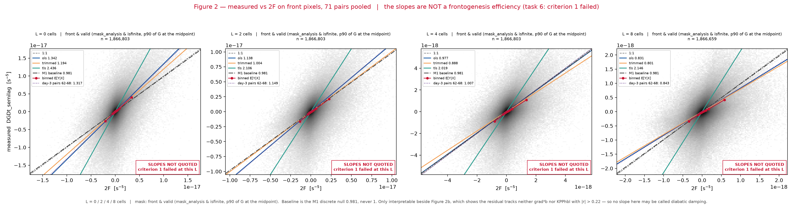

**Figure C1.** The joint distribution of the measured tendency $D_hG/Dt$ and the predicted $2F$ on front pixels, 71 pairs pooled, at $L = 0, 2, 4, 8$, with the fitted lines of three estimators, the binned conditional mean, the one-to-one line and the discrete-null baseline 0.981. Each panel carries the banner under which the figure was drawn: slopes not quoted, criterion 1 failed at this $L$.

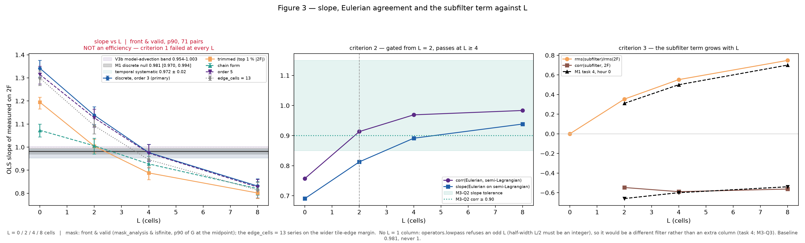

**Figure C2.** Left: the ordinary-least-squares slope of measured on $2F$ against filter scale for the primary construction and four variants, on front pixels, with the baseline and its two systematic bands. Centre: criterion 2 (§6). Right: the sub-filter term against $L$ (§5.2).

\newpage

Slopes of the measured tendency on $2F$, front pixels, 71 pairs pooled, with 32-cell, one-hour block-bootstrap intervals:

| $L$ | ordinary least squares | trimmed | orthogonal | chain-rule $F$ |
|---|---|---|---|---|
| 0 | 1.342 [1.304, 1.376] | 1.194 [1.166, 1.217] | 2.436 [2.362, 2.516] | 1.073 [1.044, 1.100] |
| 2 | 1.138 [1.098, 1.174] | 1.004 [0.975, 1.034] | 2.106 [2.039, 2.176] | 1.006 [0.970, 1.039] |
| 4 | 0.977 [0.941, 1.013] | 0.888 [0.859, 0.914] | 2.019 [1.950, 2.095] | 0.927 [0.893, 0.961] |
| 8 | 0.831 [0.803, 0.862] | 0.801 [0.777, 0.830] | 2.146 [2.065, 2.229] | 0.820 [0.792, 0.851] |

("trimmed" removes the top 1 % of pixels by the magnitude of $2F$; "chain-rule $F$" uses the chain-rule form of the frontogenesis function), to be read against the baseline 0.981 [0.970, 0.994], the model-advection band 0.954–1.003 and the temporal systematic 0.972 ± 0.020. Three-hour blocks widen the ordinary-least-squares intervals by about a half (at $L = 0$, [1.283, 1.392]).

Three things follow from the table, none of them a statement about fronts.

*The slope is not a stable number.* At every scale the orthogonal estimator is 1.8 to 2.6 times the ordinary one — far more than any interval — which is what large, comparable noise on both axes produces. The estimators agree on nothing but the trend with $L$.

*The trend with $L$ is not damping.* The baseline is a grid-scale baseline. At $L > 0$ the budget for the filtered $G$ contains the sub-filter term, which opposes $2F$ and grows with $L$ (§5.2), so the slope on $2F$ alone must fall with $L$ with no diabatic process at all. The offline tracer of §7.1 — a calibration of the pipeline, with no physics — gives ordinary-least-squares slopes of 0.976 / 0.677 / 0.586 / 0.558 at $L = 0 / 2 / 4 / 8$ under the same analysis. The model's slopes lie *above* the tracer's at every scale.

*The second null condition.* The condition reads: the measured slope is not distinguishable from the discrete-null baseline. It can be judged only at $L = 0$, where the baseline applies. There the ordinary-least-squares slope, 1.342 [1.304, 1.376], is distinguishable from 0.981 [0.970, 0.994] — and lies *above* it, as do the trimmed and chain-rule values: the measured tendency is, if anything, larger than the kinematic prediction, the opposite sense to damping. **The condition is therefore not met as written.** It is also uninformative: the departure from the baseline has the sign of the residual's positive regression on $2F$ (+0.440, §5.1), it changes by a factor of two with the estimator, and it belongs to a budget whose residual is as large as its signal. A slope from a budget that does not close has no interpretation, in either direction, and that — not the value of the slope — is why none is quoted.

---

## Appendix D. The divergence and strain split, derived

The conventions are those of the code: `operators.frontogenesis` (`form='chain'`), `strain_from_jacobian` and `strain_alignment`.

**Step 1: the gradient equation.** Take the horizontal gradient of $Db/Dt = 0$:

$$
\frac{D b_x}{Dt} = -(u_x b_x + v_x b_y), \qquad \frac{D b_y}{Dt} = -(u_y b_x + v_y b_y), \qquad\text{i.e.}\qquad \frac{D\nabla_h b}{Dt} = -(\nabla \mathbf{u})^{\mathsf T}\, \nabla_h b,
$$

with $\nabla\mathbf{u} = \begin{pmatrix} u_x & u_y \\ v_x & v_y \end{pmatrix}$. Only *differences* of velocity across the front enter, so a uniform current moves a front without changing it. Then

$$
\frac{DG}{Dt} = 2\,\nabla_h b \cdot \frac{D\nabla_h b}{Dt} = -2\left( u_x b_x^2 + (u_y + v_x) b_x b_y + v_y b_y^2 \right) = 2F .
$$

**Step 2: three motions.** Every 2 × 2 velocity gradient is, identically,

$$
\nabla\mathbf{u} = \tfrac{1}{2}\delta \begin{pmatrix} 1 & 0 \\ 0 & 1 \end{pmatrix} + \tfrac{1}{2}\begin{pmatrix} \sigma_n & \sigma_s \\ \sigma_s & -\sigma_n \end{pmatrix} + \tfrac{1}{2}\zeta \begin{pmatrix} 0 & -1 \\ 1 & 0 \end{pmatrix},
$$

with $\delta = u_x + v_y$, $\sigma_n = u_x - v_y$, $\sigma_s = v_x + u_y$ and $\zeta = v_x - u_y$. The three parts are an isotropic squeeze, an area-preserving (trace-free, symmetric) strain and a solid rotation. Multiplying out recovers $u_x, u_y, v_x, v_y$. In the quadratic form $F = -(\nabla_h b)^{\mathsf T}(\nabla\mathbf{u})(\nabla_h b)$:

- the rotation gives zero, because $\mathbf{g}^{\mathsf T}\begin{pmatrix} 0 & -1 \\ 1 & 0 \end{pmatrix}\mathbf{g} = 0$ for every $\mathbf{g}$;
- the squeeze gives $-\tfrac{1}{2}\delta G$;
- the strain gives $-\tfrac{1}{2}\left[\sigma_n (b_x^2 - b_y^2) + 2\sigma_s b_x b_y\right]$.

**Step 3: the angle.** Write $\nabla_h b = \sqrt{G}\,(\cos\alpha, \sin\alpha)$, so that $b_x^2 - b_y^2 = G\cos 2\alpha$ and $2 b_x b_y = G \sin 2\alpha$. Write the strain as $\sigma_n = |\sigma|\cos 2\psi$, $\sigma_s = |\sigma|\sin 2\psi$. Then

$$
\sigma_n (b_x^2 - b_y^2) + 2\sigma_s b_x b_y = |\sigma|\, G \cos 2(\alpha - \psi).
$$

In a frame rotated by $\psi$ the strain matrix is $\tfrac{1}{2}|\sigma|\,\mathrm{diag}(1, -1)$, so $\psi$ is the **extensional** axis and $\psi + 90°$ the **compressional** axis. With $\theta$ the angle between $\nabla_h b$ and the compressional axis, $\alpha - \psi = \theta + 90°$ and $\cos 2(\alpha - \psi) = -\cos 2\theta$. Collecting the terms:

$$
F = -\tfrac{1}{2}\,\delta\, G + \tfrac{1}{2}\,|\sigma|\, G\cos 2\theta, \qquad 2F = -\delta\, G + |\sigma|\, G\cos 2\theta .
$$

The sign of the strain term is plus because $\theta$ is measured from the compressional axis. Measured from the extensional axis, it would be minus. Since $\cos 2\theta$ does not change with the sign of $b$ or of the axis, $\theta$ is folded to $[0°, 90°]$.

**Step 4: on the grid.** The identity is algebraic, so it holds exactly for the chain-rule $F$ when $\delta$, $\sigma_n$ and $\sigma_s$ are formed from the same Jacobian as $F$ (`strain_from_jacobian`). With the flux-form $\delta$ and $\sigma$ of the derived stores, the two terms sum to 4.29 rather than 4.21 on the front of §2.5. The discretely consistent $2F$ is not of this quadratic form, but it has an exact split of its own. In `_frontogenesis_discrete`,

$$
F = -\tfrac{1}{2}\sum_{\pm}\sum_{k} g_k \sum_{j} J^{\pm}_{jk}\, \hat g_j(\mathbf{x} \pm \mathbf{e}_k),
$$

where $J^{\pm}$ is the **one-sided velocity gradient** (the velocity differences to the $\pm$ neighbours along each axis, over the face spacing), $g_k$ the centred gradient and $\hat g$ the fourth-order gradient *at the neighbours*. $F$ is linear in $J^{\pm}$, so splitting each $J^{\pm}$ as in Step 2 splits $F$ exactly into a convergence, a strain and a rotation part. The rotation part no longer vanishes, because $\hat g$ is taken at the neighbours rather than at the centre; it is a grid remainder, zero for a linear $b$. On the front of §2.5 the split reproduces the stored $2F$ to float32 precision, the parts sum to it to $10^{-15}$ of its r.m.s., and it gives +1.08 + 2.39 − 0.003 = +3.46 (`slides_2F.discrete_parts`). The same sum with the centre gradient $g_k(\mathbf{x})$ in place of $\hat g(\mathbf{x}\pm\mathbf{e}_k)$ is the chain-rule $F$, since the mean of the two one-sided velocity gradients is the centred one (asserted on that band to 7e-12 of the r.m.s.). **The two gridded forms therefore differ in one thing only: where the buoyancy gradient is read.** Across a front one or two cells wide the neighbours sit on the shoulders of the gradient peak and read less than the centre, which is why the discrete form is the smaller (0.82 on this front).
